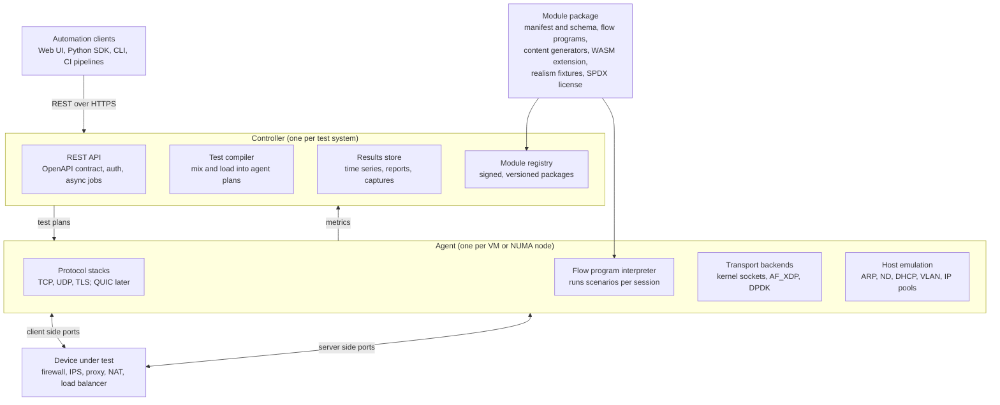

# Open Application Traffic Generator: Feasibility and Specification

Version of Oct 30, 2026. Living copy: https://claude.ai/artifact/Gja7Ds35ty8P23eut8LWS5

## Summary

We assess the generator as feasible as an open source project, with one qualification on library breadth. Existing open source components already solve the hardest engineering problems.

[TRex](https://github.com/cisco-system-traffic-generator/trex-core) (Apache 2.0) provides a scalable stateful TCP layer with L7 emulation. The DPDK [AF\_XDP poll mode driver](https://doc.dpdk.org/guides/nics/af_xdp.html) gives kernel bypass on any Linux network device. The [Open Traffic Generator models](https://github.com/open-traffic-generator/models) (MIT) define a vendor neutral API vocabulary.

The qualification concerns the 780+ application protocols that Keysight advertises for BreakingPoint. Keysight sustains that library through a dedicated research program with frequent content updates. We therefore treat library parity as a long horizon community goal and design v1 so that a new application requires content only.

We recommend that v1 deliver five capabilities.

1. A stateful client and server engine that executes application flow programs over real TCP, UDP, and TLS sessions.
2. A module system in which each application ships as a self contained, versioned package.
3. A capture compiler that converts reference packet captures into draft modules.
4. A REST API that reuses the Open Traffic Generator vocabulary for ports, devices, flows, and metrics.
5. A qcow2 appliance image, with the same build emitting VMDK, VHDX, fixed VHD, and raw images.

We target 15 application modules for v1, covering web, encrypted web, name resolution, mail, file transfer, streaming, and voice. The engine separates traffic generation from traffic content. Security strikes (feature 2) and mobile and embedded protocol packs (feature 8) therefore arrive later as new module types on the same core.

## Scope

v1 delivers the feature 1 engine with a 15 module library and builds the extension points that the deferred features need. The table maps each BreakingPoint feature area to its v1 status.

| Feature area | v1 delivers | Deferred | v1 extension point |
| --- | --- | --- | --- |
| 1. Realistic application traffic | Engine, 15 application modules, application mixes, load profiles, host pools | Library growth toward hundreds of applications | Module SDK and capture compiler |
| 2. Attacks, malware, DDoS, fuzzing, evasions | Nothing | All | Reserved module types, evasion stage slot, raw packet path |
| 3. Threat intelligence updates | Signed module registry | Curated update feed | Versioned registry index |
| 4. Hardware scale performance | Kernel socket and AF\_XDP backends | DPDK at line rate on physical NICs | Transport backend interface |
| 5. Test components | Application simulator (two arm) and client simulator (one arm against real servers) | Stateless frame blaster, routing robot, session sender equivalents | Shared engine and raw packet path |
| 6. Deployment | qcow2 appliance plus VMDK, VHDX, fixed VHD, raw | Cloud marketplace listings | Single image definition |
| 7. Automation | REST API, Python SDK, CLI, Prometheus metrics | Goal seeking test suites | Run state machine and metrics API |
| 8. Mobile, embedded, SCADA, cyber range | Nothing | All | Tunnel and transport adapter layers |

v1 includes a full web UI (decision D8) built only on the public REST API. We exclude two items from v1 by design.

- Compatibility with BreakingPoint configuration files, content, or product names. Contributors write all content independently.
- Line rate generation above 10 Gbps per agent.

## Defining Realistic Traffic

We define realism as eight measurable properties, and every v1 module must pass all eight in continuous integration. The thresholds below are our proposed acceptance targets, and we revise them after the Phase 0 spikes.

The [BreakingPoint datasheet](https://www.keysight.com/au/en/assets/3120-1270/data-sheets/BreakingPoint-Applications-and-Security-Testing.pdf) lists five feature 1 capabilities. These capabilities include 780+ application protocols, customization of any protocol including raw data, high speed mixes with realistic protocol weights, HTTP/1.0, HTTP/1.1, and HTTP/2 transport with NAT and proxy support, and TrafficREWIND configurations derived from production networks.

| Property | Requirement | Measurement | v1 acceptance target |
| --- | --- | --- | --- |
| Protocol conformance | Every message parses as valid in a reference implementation | Classify sampled sessions with nDPI and Zeek; parse with tshark | ≥ 99% of sessions classified as the intended application; zero parser errors |
| Transport behavior | Real TCP state machine with MSS, SACK, window scaling, timestamps, retransmission, congestion control | Compare handshake options with the selected OS profile | Option set matches the OS profile in every handshake |
| Encryption | Real TLS 1.2 and 1.3 handshakes with SNI, ALPN, and common browser fingerprints | Decrypt with exported session keys; compute JA4 fingerprints | Fingerprint matches the configured client profile |
| Content variety | Dynamic fields, realistic object sizes, multiple languages and file types | Payload size distribution and duplicate payload ratio | Duplicate payload ratio ≤ 1% across 10,000 sessions |
| Session structure | Several connections per user action, such as DNS before HTTP, parallel fetches, keepalive reuse | Connection count and ordering per scenario | Scenario graph reproduced exactly |
| Mix accuracy | Achieved mix matches configured weights by sessions or by bytes | Per application share in run metrics and in nDPI output | Absolute error ≤ 2 percentage points per application |
| Temporal behavior | Configurable arrival processes, think times, heavy tailed object sizes | Kolmogorov Smirnov (KS) test against the target distribution | KS test passes at α = 0.05 |
| Host and network identity | Large IP and MAC populations, VLANs, OS specific TTL, NAT and proxy traversal | Host counts and per host session distribution | Configured host count reached with zero address conflicts |

We meet the TrafficREWIND capability with a profile extractor that derives mixes and temporal models from a production capture. The extractor follows the method of [Swing](https://cseweb.ucsd.edu/~kvishwanath/Swing/), which extracts user, application, and network distributions from observed traffic and replays them through commodity protocol stacks.

## Prior Art and Reusable Components

We found no open source project that combines a stateful application engine, a broad application library, and a modular content model. Several projects each solve one layer, and we reuse them directly or as reference designs.

| Project | What it provides | License | Status we observed | Our use |
| --- | --- | --- | --- | --- |
| [TRex](https://github.com/cisco-system-traffic-generator/trex-core) | DPDK engine with stateless (STL), advanced stateful (ASTF), and client emulation (EMU) modes; ASTF emulates L7 applications over a scalable TCP layer; Python API; virtio, VMXNET3, E1000, and Amazon ENA drivers | [Apache 2.0](https://github.com/cisco-system-traffic-generator/trex-core/blob/master/LICENSE) | Large repository (7,046 commits); release cadence to verify | Candidate scale backend through an adapter; EMU plugin model as reference for host emulation |
| [WARP17](https://github.com/juniper/warp17) | DPDK user space TCP/IP stack; raw TCP and an HTTP 1.1 subset; protobuf RPC API; IPv4 only | BSD-3-Clause | Latest supported DPDK LTS is 19.11.3, which indicates dormancy | Reference design for setup rate and per core session tables |
| [Open Traffic Generator models](https://github.com/open-traffic-generator/models) and [Ixia-c](https://github.com/open-traffic-generator/ixia-c) | OpenAPI models for emulating L2 to L7 devices and generating test traffic; snappi and gosnappi SDKs; Ixia-c reference implementation with a free community edition | MIT (models) | Models marked as under development; top level directories cover ports, flows, devices, LAG, LLDP, captures, results | API vocabulary for ports, devices, flows, metrics; we add application objects |
| [F-Stack](https://github.com/F-Stack/f-stack) | FreeBSD TCP/IP stack in DPDK user space with POSIX style and coroutine APIs; Nginx and Redis ports | BSD-2-Clause (main code) | Maintained by Tencent Cloud; recent Nginx 1.25 port | Candidate stack for running real protocol libraries at DPDK speed |
| [DPDK AF\_XDP PMD](https://doc.dpdk.org/guides/nics/af_xdp.html) | Runs DPDK applications on any kernel network interface, with zero copy where the driver supports it | BSD-3-Clause | Upstream DPDK | Portable fast path inside VMs |
| [virtio-net AF\_XDP zero copy](https://lwn.net/Articles/947423/) | Kernel patch series that adds AF\_XDP zero copy to virtio-net | GPL-2.0 (kernel) | Posted 2023 to 2024; mainline status to verify | Sets AF\_XDP performance on KVM guests |
| [nDPI](https://archive.fosdem.org/2021/stands.fosdem.org/stands/ntop/ndpi/index.html) | DPI library that identifies applications independent of port | LGPL-3.0 | Packaged by major distributions | Realism oracle in CI, run out of process |
| Zeek | Protocol analyzers and structured logs | BSD (verify) | Widely deployed | Second realism oracle |
| Scapy | Packet crafting and parsing | GPL-2.0 (verify) | Widely deployed | Tooling only, out of process |
| [Swing](https://cseweb.ucsd.edu/~kvishwanath/Swing/), Tmix, Harpoon | Research generators that extract workload models from traces | Varies | Research code; last Swing release 2008 | Method for the profile extractor |
| [UERANSIM](https://github.com/aligungr/UERANSIM) | 5G UE and gNB simulator | Copyleft (GPL-3.0 in older copies, AGPL-3.0 in the current README) plus a commercial license | Original author no longer active | Reference for feature 8; out of process only |
| [Keysight CyPerf](https://www.keysight.com/us/en/products/network-test/cloud-test/cyperf) | Commercial controller plus lightweight containerized agents across clouds | Proprietary | Shipping, with a free community edition | Reference for the controller and agent split |

The survey supports two conclusions. First, no surveyed project separates application content from the engine through a stable module contract, so this contract is the main contribution of the generator.

Second, TRex ASTF emulates L7 applications without implementing each exact protocol, which suits template content. We found no evidence that ASTF performs real TLS key exchange, and the Phase 0 spikes verify this point.

## Feasibility by Requirement

Six of the seven requirements are feasible for v1, and library parity is feasible only as a long horizon effort. We give effort as relative classes (S, M, L) because calendar time depends on team size, which remains an open decision.

| Requirement | Verdict | Basis | Primary risk | Effort |
| --- | --- | --- | --- | --- |
| Realistic traffic per session | Feasible | Kernel stacks give full TCP and TLS fidelity; TRex ASTF and WARP17 show stateful generation at scale | Real TLS handshakes consume CPU at high connection rates | L |
| Library parity with 780+ applications | Long horizon only | Keysight maintains its library with a dedicated research team | Contributor throughput; licensing of captured content | L, ongoing |
| Modularity | Feasible | TRex EMU and WARP17 already isolate protocol logic as plugins | Module contract churn breaks community modules | M |
| Reuse for security testing (feature 2) | Feasible with v1 hooks | Strikes are flow programs with malicious content; evasions are transforms between program and transport | Fuzzing needs stateless raw packets beside stateful sessions; the [TRex ASTF guide](https://www.slideshare.net/slideshow/trexastfpdf/254868943) states that STL and ASTF modes cannot run together | M |
| qcow2 portability | Feasible | qcow2 runs natively on KVM, QEMU, Proxmox, and OpenStack; one build emits the other formats | NIC driver and performance variance across hypervisors | S to M |
| API automation | Feasible | OTG supplies an OpenAPI vocabulary and SDK generators | OTG lacks stateful application objects, so we maintain an extension | M |
| Generality for mobile and embedded (feature 8) | Feasible with v1 hooks | Tunnels such as GTP-U and transports such as SCTP slot under the flow program layer | Copyleft reference stacks; non-IP links need external hardware | M, deferred |

Public cloud import paths confirm that one image definition must emit several formats. [AWS image import](https://docs.aws.amazon.com/vm-import/latest/userguide/vmimport-differences.html) accepts OVA, VHD, VHDX, VMDK, and raw. [Azure](https://github.com/Microsoft/azure-docs/blob/master/articles/virtual-machines/linux/create-upload-generic.md) accepts only fixed VHD, with a [virtual size aligned to 1 MB](https://docs.azure.cn/zh-cn/virtual-machines/Linux/create-upload-ubuntu). [Google Compute Engine](https://docs.cloud.google.com/compute/docs/import/importing-virtual-disks) imports qcow2 and VMDK through Migrate to Virtual Machines.

## System Architecture

The generator splits into a controller that compiles tests and agents that execute them, and all protocol knowledge lives in module packages. This split lets one controller drive many agents across VMs and clouds, the pattern that Keysight CyPerf also uses.



Modules enter through the registry and run inside the agent interpreter, so neither the controller nor the engine contains protocol specific code.

Each agent runs one worker per isolated core. Each worker owns its sessions, timers, and memory pools, which removes locks between cores.

The transport backend interface exposes batched send, batched receive, and port configuration. The kernel socket backend ships first because it gives full TCP and TLS fidelity on every hypervisor. A Phase 0 spike decides whether a TRex ASTF adapter or an F-Stack backend delivers tier T2.

## Module System Specification

Every application, transport, and host behavior ships as a module, and the engine loads modules through one versioned contract. A module declares its capabilities in a manifest and supplies behavior as declarative flow programs. Module code runs only when a protocol needs computation that flow programs cannot express.

### Module types

| Type | Purpose | Status | Examples |
| --- | --- | --- | --- |
| app | Application scenario with one or more flows | v1 | http1, http2, dns, smtp, sip\_rtp |
| transport | Session layer that wraps a byte stream | v1 (TLS); QUIC later | tls, quic |
| host | L2 and L3 host behavior | v1 | arp, nd, dhcp4, vlan |
| content | Payload generators shared across applications | v1 | html, jpeg, email\_body, json\_api |
| tunnel | Encapsulation below the transport | Reserved for feature 8 | gtpu, gre, vxlan |
| strike | Malicious scenario with an expected verdict | Reserved for feature 2 | exploit, malware\_transfer |
| evasion | Transform between flow program and transport | Reserved for feature 2 | tcp\_segmentation, http\_encoding |
| fuzzer | Mutation source for raw or stateful paths | Reserved for feature 2 | tcp\_option\_fuzz |

### Manifest fields

| Field | Type | Meaning |
| --- | --- | --- |
| name | string | Unique module identifier |
| version | semver | Module version |
| type | enum | One module type from the table above |
| engine\_api | semver range | Engine contract versions the module supports |
| license | SPDX expression | License of module code and content |
| provides | list | Protocols and default ports, for example tcp/80 |
| requires | list | Other modules, for example tls >= 1.0 |
| parameters | JSON Schema | User configurable fields with defaults |
| scenarios | list of files | Flow programs the module exports |
| assets | list | Content files and generator references |
| extension | object, optional | WebAssembly component and its exported hooks |
| fixtures | list | Reference captures with expected nDPI and Zeek labels |
| provenance | object | Capture source, consent, and scrub record |

### Flow program contract

A flow program is a per session script that the interpreter executes on the client side, the server side, or both. A scenario groups several flow programs with dependencies and shared variables, which reproduces the multi connection structure that BreakingPoint calls a Superflow.

| Action | Side | Meaning |
| --- | --- | --- |
| connect | client | Open a TCP or UDP session, optionally through a transport module |
| accept | server | Accept a session on a port |
| send | both | Render a template and write it |
| expect | both | Read until a byte count or pattern holds, with a timeout |
| delay | both | Wait for a think time drawn from a named distribution |
| set | both | Bind a scenario variable from an expression |
| loop, branch | both | Repeat a block, or choose a block by probability |
| spawn | both | Start a dependent flow, such as an FTP data channel |
| close | both | Close with FIN, RST, or half close |
| raw | both | Write bytes without template validation; reserved for strikes |

The following illustrative scenario resolves a name and then fetches a page over TLS.

```yaml
scenario: web_browse
vars: { host: "www.example.test" }
flows:
  - id: lookup
    module: dns
    client:
      - send: "{{ dns.query(name=vars.host, qtype='A') }}"
      - expect: { min_bytes: 12, timeout_ms: 2000 }
      - set: { server_ip: "{{ dns.answer_ip(last) }}" }
  - id: page
    after: lookup
    module: http1
    transport: { module: tls, profile: chrome_desktop }
    client:
      - connect: { host: "{{ vars.server_ip }}", port: 443 }
      - send: "{{ http1.request('GET', '/', headers=profiles.chrome) }}"
      - expect: { pattern: "\r\n\r\n", timeout_ms: 5000 }
      - delay: { dist: lognormal, mu: 0.5, sigma: 1.0 }
      - close: fin
    server:
      - expect: { pattern: "\r\n\r\n" }
      - send: "{{ http1.response(200, body=content.html(size=dist.pareto(1.2, 4096))) }}"
```

### Extension hooks

When a protocol needs computation, such as SSH key exchange or SMB signing, the module ships a WebAssembly extension. The extension implements five hooks (on\_open, on\_data, on\_timer, on\_close, render) and reaches the network only through engine calls. The sandbox protects agents from faulty community code at a moderate speed cost.

### Packaging and distribution

Each module is a signed archive with its manifest at the root. A git backed registry publishes a signed index, which later carries the feature 3 update feed. The agent refuses unsigned modules outside developer mode.

Every module pull request must pass schema validation, fixture replay, and the eight realism checks before merge.

## Traffic Model and Test Configuration

A test configuration composes five objects, and the controller compiles them into per agent plans. The same configuration runs in three topologies.

- Application simulator (two arm). Agents emulate both clients and servers on opposite sides of the DUT.
- Client simulator (one arm). Agents emulate clients against real servers.
- Server simulator (one arm). Real clients connect to emulated servers.

| Object | Contains | Notes |
| --- | --- | --- |
| network | Ports, host pools (IP and MAC ranges, VLAN, gateway), OS profiles, NAT expectations | Client and server pools sit on separate ports in two arm mode |
| profile | Mix entries with scenario, weight, and per entry parameter overrides; one weight basis (sessions or bytes) | Weights normalize within the basis |
| load | Objective (concurrent sessions, sessions per second, throughput, or simulated users) and phases (ramp up, steady, ramp down) | Phases accept linear or step shapes |
| timeline | Duration, random seed, warm up period excluded from statistics | One seed makes a run repeatable |
| criteria | Pass and fail rules over metrics | For example, failed sessions below 0.1% |

The following example describes a 10 Gbps enterprise mix.

```yaml
apiVersion: v1
kind: Test
metadata: { name: enterprise_mix_10g }
network:
  ports:
    - { name: client0, location: agent-a/eth1 }
    - { name: server0, location: agent-a/eth2 }
  host_pools:
    - { name: users, port: client0, ipv4: 10.10.0.0/16, count: 20000, gateway: 10.10.0.1, os_profile: windows11 }
    - { name: servers, port: server0, ipv4: 172.16.0.0/24, count: 200, gateway: 172.16.0.1, os_profile: linux6 }
profile:
  basis: bytes
  mix:
    - { scenario: web_browse, weight: 45 }
    - { scenario: video_hls, weight: 30 }
    - { scenario: sip_call, weight: 15 }
    - { scenario: smtp_send, weight: 5 }
    - { scenario: dns_only, weight: 5 }
load:
  objective: { type: throughput_bps, value: 10e9 }
  phases:
    - { name: ramp_up, duration_s: 60, shape: linear }
    - { name: steady, duration_s: 600 }
    - { name: ramp_down, duration_s: 30 }
timeline: { seed: 42, warmup_s: 30 }
criteria:
  - { metric: sessions.failed_ratio, op: "<", value: 0.001 }
```

The controller resolves the mix into per scenario session rates and splits host pools and rates across agents by core count. Each session stays pinned to one core for its lifetime.

A byte weighted mix requires a feedback loop. The controller first estimates bytes per session from module metadata, then corrects per scenario rates every second from live counters until the mix error falls under the 2 point target.

## API Specification

The controller exposes a contract first REST API defined in OpenAPI 3.1, and we generate the Python SDK and the CLI from that contract. Long operations return HTTP 202 with a run identifier, and clients poll or subscribe for state.

| Method | Path | Purpose |
| --- | --- | --- |
| GET | /v1/capabilities | Engine API version, backends, agent inventory, installed modules |
| GET, POST | /v1/modules | List or install modules |
| GET, DELETE | /v1/modules/{name}/{version} | Inspect or remove a module |
| POST | /v1/configs | Store a test configuration and return its identifier |
| GET | /v1/configs/{id} | Fetch a stored configuration |
| POST | /v1/configs/{id}:validate | Check schema, module references, and agent capacity |
| POST | /v1/runs | Start a run from a configuration; returns 202 and a run identifier |
| GET | /v1/runs/{id} | Run state and summary counters |
| POST | /v1/runs/{id}:stop | Stop with ramp down; a force flag aborts immediately |
| GET | /v1/runs/{id}/metrics | Metrics by view (application, scenario, port, TCP, TLS) and time window |
| GET | /v1/runs/{id}/metrics:stream | Live metrics over Server Sent Events |
| GET | /v1/runs/{id}/report | Report as JSON, CSV, or HTML |
| POST, GET | /v1/runs/{id}/captures | Start a filtered capture; download pcapng |
| GET, POST | /v1/agents | List, register, reserve, and release agents |
| GET | /metrics | Prometheus exposition for the controller and agents |

Each run moves from pending to preparing, running, and stopping, then ends as completed, failed, or aborted. The API reports errors as RFC 9457 problem details and versions the path by major release.

The controller authenticates clients with scoped API tokens (read, run, admin) over TLS on the management interface. Controller and agents exchange plans and counters over gRPC with mutual TLS.

We reuse Open Traffic Generator names for ports, devices, flows, and metrics, and we add three objects (host\_pool, profile, load). We publish these additions as a separate OpenAPI document, which keeps a later OTG conformance layer possible.

## Packaging and Deployment

One image definition produces every artifact, and the qcow2 image is the primary deliverable. We build with Packer on an Ubuntu LTS base, then convert the qcow2 master with qemu-img into the other formats.

The image contains six components.

- Controller and agent services as systemd units, with the role (controller, agent, or all in one) selected at first boot.
- cloud-init with the NoCloud datasource for local hypervisors and native datasources for public clouds.
- A kernel with XDP sockets enabled, DPDK, libxdp, and hugepage and CPU isolation profiles applied by role.
- A dedicated management interface that never carries test traffic.
- A Prometheus exporter and a Grafana dashboard definition.
- Matching container images of the controller and agent for Docker and Kubernetes labs.

| Target | Image format | Default NIC | Default backend | Note |
| --- | --- | --- | --- | --- |
| KVM, QEMU, Proxmox, OpenStack | qcow2 | virtio-net | AF\_XDP with copy mode fallback | Zero copy depends on guest kernel support |
| VMware ESXi | VMDK inside OVA | VMXNET3 | Kernel, or DPDK vmxnet3 PMD | TRex lists VMXNET3 support |
| Hyper-V | VHDX | netvsc | Kernel | AF\_XDP behavior to verify |
| AWS | raw or VMDK through image import | ENA | DPDK ENA PMD | TRex lists Amazon ENA support |
| Azure | Fixed VHD, 1 MB aligned | Accelerated networking VF | Kernel | DPDK path to verify |
| Google Cloud | qcow2 or VMDK through Migrate to Virtual Machines | gVNIC or virtio-net | Kernel or AF\_XDP | Backend to verify |
| Bare metal or SR-IOV | raw | Physical function or VF | DPDK | Highest performance tier |

The agent detects its NIC and kernel features at boot and selects the fastest working backend, and the API reports the selection. Release CI boots every format on at least one matching hypervisor before publication.

The smallest supported deployment is one all in one VM with 4 vCPU, 8 GB RAM, one management NIC, and two test NICs. We set hugepage and core budgets for larger agents from Phase 0 benchmarks.

## Statistics and Realism Validation

The agent records counters at four levels, and a separate pipeline checks realism with independent classifiers. Live views update every second, and latency measurements use HDR histograms.

| Level | Counters |
| --- | --- |
| Application and scenario | Sessions attempted, established, succeeded, and failed by reason; transactions; bytes in each direction; response time p50, p90, p99 |
| Flow action | Expect timeouts, pattern mismatches, unexpected resets, per action latency |
| Transport | TCP handshakes, retransmissions, resets, zero window events, RTT; TLS handshakes, alerts by type, resumption ratio |
| Port and host | Packets, bytes, drops, ARP and ND failures, active hosts |

The validation pipeline runs in five steps.

1. The agent mirrors a configurable sample of sessions (default 1%) to a capture ring and exports TLS session keys in NSS key log format.
2. nDPI and Zeek classify the decrypted sample out of process.
3. The validator compares classifications with the intended scenario labels and computes conformance and mix error.
4. The validator compares size and inter arrival distributions with the target model through the KS test.
5. The run report records each realism metric with its pass or fail result.

The same pipeline runs in module CI against fixture captures, so a module that regresses realism fails before merge.

## Extension Path for Features 2 and 8

Both deferred features reuse the engine, the flow program interpreter, and the host emulation layer without core changes. v1 must preserve four hooks for that reuse.

1. The raw action in flow programs, which writes bytes without template validation.
2. An evasion stage slot between the interpreter and the transport, empty in v1.
3. A stateless raw packet path that shares ports with stateful sessions, which fuzzing and DDoS generation require.
4. A tunnel slot between IP and the transport, which GTP-U and other encapsulations fill.

| Capability | Reused layers | New module type | Additional engine work |
| --- | --- | --- | --- |
| Exploit and malware strikes | Interpreter, TCP, TLS, content | strike | Verdict semantics per strike (blocked, allowed, partially delivered) |
| Evasions | Interpreter, TCP | evasion | Segment overlap and reordering controls in the TCP stack |
| Fuzzing | Raw packet path, host emulation | fuzzer | Mutation scheduler; DUT health probes to detect failures |
| DDoS | Raw packet path, host pools | strike | Stateless rate engine with large source pools |
| Mobile user plane | Interpreter, app modules, tunnel slot | tunnel (gtpu) | Per UE tunnel state; correlation with an external or emulated core |
| Mobile control plane | Host emulation pattern | host (nas, ngap) | SCTP transport; 3GPP procedures; UERANSIM interoperation out of process |
| Embedded and SCADA over IP | Interpreter, TCP, UDP | app (modbus, dnp3, mqtt, coap, bacnet) | None |
| Non-IP links such as Zigbee, CAN, serial | Interpreter | link (future type) | External adapter hardware and drivers |

Strike content raises a distribution question that application content does not. We plan a separate strike registry with access controls and decide its policy when feature 2 work starts.

## Non-Functional Requirements

Performance targets scale with the transport backend. Every figure below is a v1 goal that the Phase 0 benchmarks confirm or revise, measured with cleartext HTTP/1.1.

| Tier | Backend | Environment | Throughput per agent | New sessions per second per agent | Concurrent sessions per agent |
| --- | --- | --- | --- | --- | --- |
| T0 | Kernel sockets | Any VM, 4 vCPU | 1 Gbps | 5,000 | 100,000 |
| T1 | AF\_XDP | KVM or cloud VM, 16 vCPU | 10 Gbps | 100,000 | 2,000,000 |
| T2 | DPDK | SR-IOV or bare metal, 32 cores | 40 Gbps | 1,000,000 | 10,000,000 |

The T2 targets sit well under published results. WARP17 reports about 7 million TCP sessions per second on 40 Gbps hardware. TLS handshakes lower session rates, so we set TLS targets after Phase 0 measures handshake cost per core.

The generator must also meet eight further requirements.

- Repeatability. A run records configuration, module versions, engine version, and seed, and replaying them reproduces the session schedule.
- Isolation. Test interfaces carry no management traffic, and the image blocks routing between test and management networks by default.
- Tool security. Scoped API tokens, mutual TLS between controller and agents, signed modules, and sandboxed extensions.
- Licensing. A GPL-3.0 core. Module code and every library linked into the agent must carry a GPL-3.0 compatible license, and CI checks the SPDX expression of each one.
- Observability. Prometheus metrics, structured JSON logs, and a diagnostic bundle per run.
- Fault containment. An agent crash ends only its own sessions; the controller marks the run degraded and lets the pass criteria decide the outcome.
- Time synchronization. Agents use NTP by default and PTP when available, which multi agent latency metrics require.
- Compatibility. Semantic versioning for the engine contract and the REST API; modules declare the engine range they support.

## Roadmap and Milestones

v1 ships at the end of Phase 3, and each phase ends at a gate with a measurable exit criterion. We list phases without dates because calendar time depends on decision D9.

```mermaid
flowchart LR
  p0["Phase 0: Spikes<br/>engine benchmark, TLS cost per core,<br/>AF_XDP on virtio, TRex ASTF adapter"]
  g0{{"Gate 0: engine decision recorded"}}
  p1["Phase 1: Core alpha<br/>flow interpreter, kernel backend,<br/>HTTP and DNS, REST API skeleton"]
  g1{{"Gate 1: mix classified 99% by nDPI"}}
  p2["Phase 2: Library<br/>15 app modules, capture compiler,<br/>mixes and load, qcow2 pipeline"]
  g2{{"Gate 2: 15 modules pass realism CI"}}
  p3["Phase 3: Scale<br/>AF_XDP backend, DPDK backend,<br/>multi agent runs, benchmark suite"]
  g3{{"Gate 3: v1 release, tier T1 targets met"}}
  p4["Phase 4 (after v1): Extensions<br/>strike modules, evasion stage,<br/>GTP-U and SCTP, IoT and SCADA"]
  p0 --> g0 --> p1 --> g1 --> p2 --> g2 --> p3 --> g3 -.-> p4
```



Phase 0 gates every later phase, because its spikes choose the engine path and set the TLS targets.

Phase 0 is the cheapest point to change direction. Each of its four spikes produces a measured result and a recommendation for the decision table.

The web UI (decision D8) runs as a parallel workstream from Phase 1 and consumes only the public REST API. It adds a large effort class to v1, so its readiness joins tier T1 as a condition of the v1 release gate.

### Building with an agent swarm

A swarm of AI coding agents builds v1 (decision D9), so the specification doubles as the coordination layer between agents. We adopt four rules for that build.

1. Contracts land first. The OpenAPI document, the module manifest schema, and the flow program action set merge before any parallel work starts.
2. One workstream per agent. The controller, the agent engine, each transport backend, the web UI, and each application module form separate workstreams with separate repositories or directories.
3. Gates become test suites. Each phase gate runs as an automated acceptance suite, and the realism CI judges every module agent.
4. The owner approves gates and decisions. Agents propose; the human owner merges contract changes and signs off each gate.

Calendar time then depends on agent throughput and on review capacity at each gate.

## Risks and Mitigations

Content production and TLS cost carry the highest combined risk. The table lists nine risks with their mitigations.

| Risk | Likelihood | Impact | Mitigation |
| --- | --- | --- | --- |
| Library growth stalls after v1 | High | High | Capture compiler, contributor guide, module CI, and a public wishlist ranked by user votes |
| Captured content carries copyrighted or personal data | Medium | High | Synthetic content generators by default; provenance field; scrub tooling; no third party captures without a license |
| Real TLS at high session rates exhausts CPU | High | Medium | Session resumption profiles, per core TLS contexts, measured targets; a labeled replay mode for DUTs that do not inspect TLS |
| Performance varies widely across hypervisors | High | Medium | Tiered targets, automatic backend selection, a published benchmark per hypervisor |
| An upstream engine stagnates, as WARP17 has | Medium | High | Engine adapter boundary; no hard dependency on one external engine |
| A GPL-3.0 incompatible license enters the agent process | Medium | Medium | Process boundaries for tools with incompatible licenses; SPDX checks in CI |
| Content or naming infringes Keysight rights | Low | High | Independent content, own terminology, no BreakingPoint file formats |
| Users aim the tool at networks they do not own | Medium | Medium | Isolated test ports, no internet egress by default, an authorized use statement |
| Module contract churn breaks community modules | Medium | Medium | Declarative flow programs first; semantic versioning; deprecation window of two minor releases |

## Open Decisions

Nine decisions remain open, and each has a recommended default. We settle them one at a time, starting with D1, and record each choice in this table.

| ID | Decision | Options | Recommended default | Why it matters |
| --- | --- | --- | --- | --- |
| D1 | Engine strategy | Own controller and flow programs with a kernel backend in v1 and TRex ASTF evaluated as a scale adapter; build fully on TRex ASTF; own DPDK engine on F-Stack; own stack from scratch | Chosen 2026-10-30. Own controller and flow programs, kernel backend first, TRex adapter spike | Sets fidelity, v1 speed, and long term control |
| D2 | Implementation languages | Rust, C++, or Go for the agent; Go or Python for the controller | Chosen 2026-10-30. Rust agent, Go controller | Memory safety when parsing DUT responses; DPDK bindings; gosnappi ecosystem |
| D3 | Extension sandbox | WebAssembly, C ABI shared objects, Lua | Chosen 2026-10-30. WebAssembly | Safety of community code against per call speed |
| D4 | Core license | Apache 2.0, MIT, GPL-3.0 | Chosen 2026-10-30. GPL-3.0 (recommended default was Apache 2.0) | Patent grant; matches TRex; permits commercial adoption |
| D5 | API baseline | OTG extension; independent REST with OTG vocabulary | Chosen 2026-10-30. Independent REST with OTG vocabulary and a later conformance layer | Client ecosystem against freedom to model applications |
| D6 | Image base and builder | Debian stable or Ubuntu LTS; Packer or mkosi | Chosen 2026-10-30. Ubuntu LTS with Packer (recommended default was Debian stable with mkosi) | Kernel recency for AF\_XDP; image size; reproducible builds |
| D7 | v1 application list | Any 15 modules | Chosen 2026-10-30. HTTP/1.1, HTTP/2, HTTPS (TLS 1.2 and 1.3), DNS, SMTP, IMAP, POP3, FTP, SSH, SMB2, SIP with RTP, HLS video, NTP, LDAP, MQTT | Sets which DPI and firewall test cases v1 covers |
| D8 | User interface in v1 | None; minimal web UI | Chosen 2026-10-30. Full web UI (recommended default was none) | Moves effort from interface to engine and content |
| D9 | Team model | Solo; small core team; open community from day one | Chosen 2026-10-30. Swarm of AI coding agents | Converts effort classes into calendar time |
| D10 | Native first party extensions | WebAssembly only; native Rust behind the same traits for first party modules | Chosen 2026-11-02. Native Rust for first party modules, WebAssembly for community modules | Speed of built in modules against one extension path |
| D11 | Web UI stack | React, Svelte, Vue | Chosen 2026-11-03. React 19 with Vite and TypeScript | Ecosystem and accessible widgets against bundle size |

## References

- [Keysight BreakingPoint Applications and Security Testing datasheet (Oct 2025)](https://www.keysight.com/au/en/assets/3120-1270/data-sheets/BreakingPoint-Applications-and-Security-Testing.pdf)
- [Keysight BreakingPoint Virtual Edition datasheet](https://www.keysight.com/content/dam/keysight/en/doc/ungate/data-sheets/BreakingPoint-Virtual-Edition-VE.pdf)
- [Keysight CyPerf product page](https://www.keysight.com/us/en/products/network-test/cloud-test/cyperf)
- [TRex repository](https://github.com/cisco-system-traffic-generator/trex-core) and [license](https://github.com/cisco-system-traffic-generator/trex-core/blob/master/LICENSE)
- [TRex advanced stateful guide](https://www.slideshare.net/slideshow/trexastfpdf/254868943)
- [WARP17 repository](https://github.com/juniper/warp17)
- [Open Traffic Generator models](https://github.com/open-traffic-generator/models) and [Ixia-c](https://github.com/open-traffic-generator/ixia-c)
- [F-Stack repository](https://github.com/F-Stack/f-stack)
- [DPDK AF\_XDP poll mode driver](https://doc.dpdk.org/guides/nics/af_xdp.html)
- [virtio-net AF\_XDP zero copy patch series (LWN)](https://lwn.net/Articles/947423/)
- [nDPI overview](https://archive.fosdem.org/2021/stands.fosdem.org/stands/ntop/ndpi/index.html)
- [Swing traffic generator](https://cseweb.ucsd.edu/~kvishwanath/Swing/)
- [UERANSIM repository](https://github.com/aligungr/UERANSIM)
- [AWS VM Import formats](https://docs.aws.amazon.com/vm-import/latest/userguide/vmimport-differences.html)
- [Azure generic Linux image requirements](https://github.com/Microsoft/azure-docs/blob/master/articles/virtual-machines/linux/create-upload-generic.md) and [VHD size alignment](https://docs.azure.cn/zh-cn/virtual-machines/Linux/create-upload-ubuntu)
- [Google Compute Engine virtual disk import](https://docs.cloud.google.com/compute/docs/import/importing-virtual-disks)
