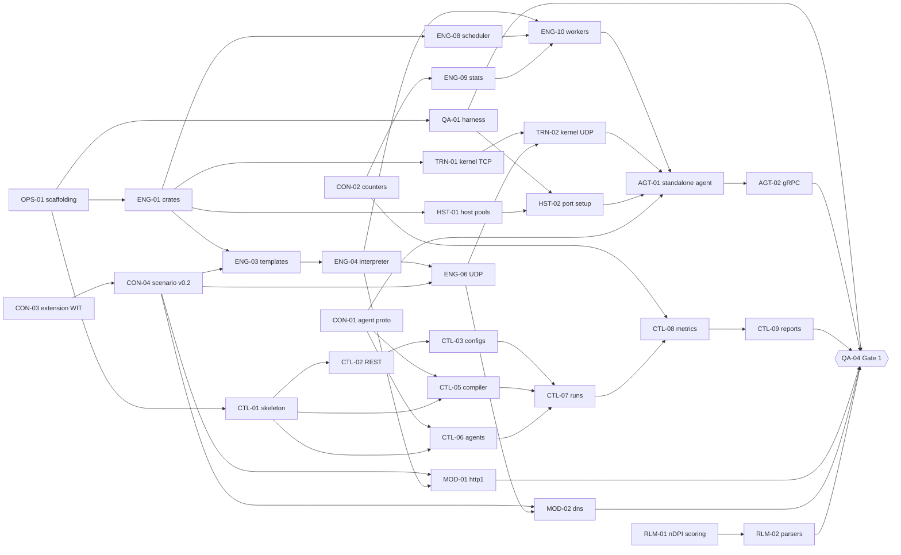

# Implementation Plan

This page explains how we divide v1 into atomic work packages that independent agents build in parallel. The catalog in [`plan/work-packages.yaml`](https://github.com/alrawi/FixingPointSystem/blob/main/plan/work-packages.yaml) defines every package, and the pages [Phase 1](Work-Packages-Phase-1.md), [Phase 2](Work-Packages-Phase-2.md), and [Phase 3](Work-Packages-Phase-3.md) are generated from it.

The plan covers feature 1 of the [specification](https://github.com/alrawi/FixingPointSystem/blob/main/docs/spec/specification.md), the REST API, the qcow2 appliance, and the web UI. Features 2 and 8 stay out of scope. Packages must keep the reserved contract fields and module types that the specification lists, and no package implements them.

## Atomic work packages

A work package is atomic when one agent can finish it in one session without coordinating with another agent during the work. We enforce five properties.

1. **One workstream.** A package changes paths that a single workstream owns. The catalog checker rejects any other path, except the package's own CI workflow, a proposed decision record that the owner must accept, its handoff file, and the wiki ingest. Packages that may run in parallel own disjoint subdirectories, for example `controller/internal/store/` and `controller/internal/compiler/`. Where two packages share a crate, such as ENG-05, ENG-06, and ENG-07 in `engine/fps-interp/`, each adds its own module files and merges `origin/main` before review.
2. **One session.** Size S takes up to two hours of agent work and about 300 changed lines. Size M takes up to five hours and about 800 lines. Size L marks an epic, which a planner splits before anyone claims it.
3. **Contract seams.** A package depends on other packages only through a contract or a published Rust trait, Go interface, or file format. It never depends on another package's internal code.
4. **Testable alone.** A package ships with fakes for its neighbors, so its tests pass before the neighbors exist. For example, CTL-07 tests the run orchestrator against the fake agent from CTL-06.
5. **Checkable acceptance.** Every acceptance criterion names a command or an observation that a reviewer can repeat.

## Workstreams and paths

| ID | Workstream | Owned paths | Language |
|---|---|---|---|
| CON | Contracts | `contracts/`, `docs/decisions/`, `tools/contracts/` | YAML, JSON Schema, Protocol Buffers, WIT |
| OPS | Repository and swarm tooling | `tools/swarm/`, `tools/plan/`, `.github/`, root build files | Python, Shell |
| QA | Test infrastructure and gate suites | `tests/`, `bench/` | Shell, Python, Rust |
| ENG | Agent engine | `engine/fps-io`, `fps-flow`, `fps-interp`, `fps-sched`, `fps-stats`, `fps-runtime`, `fps-wasm`, `fps-capture` | Rust |
| TRN | Transport backends | `engine/fps-backend-*`, `engine/fps-tcp`, `modules/tls/` | Rust |
| HST | Host emulation | `engine/fps-hosts/` | Rust |
| AGT | Agent service | `engine/fps-agent/` | Rust |
| CTL | Controller | `controller/` | Go |
| CLI | Python SDK and command line client | `sdk/python/`, `cli/` | Python, Go |
| MOD | Application and content modules | `modules/<name>/` | YAML, Rust |
| RLM | Realism validation | `realism/` | Python |
| CAP | Capture compiler and profile extractor | `capture/` | Python |
| IMG | Appliance image | `image/` | HCL, Shell |
| UI | Web UI | `ui/` | TypeScript, pending UI-00 |

Shared root files such as `Cargo.toml`, `Makefile`, and `go.work` change only in OPS packages, and no package needs to edit them. [Swarm Protocol](Swarm-Protocol.md#conflict-free-merges) lists the per package files that replace them.

## Target repository layout

```text
contracts/            owner approved interfaces (OpenAPI, schemas, proto, WIT, metrics catalog)
plan/                 work package catalog
engine/               Rust workspace for the agent
  fps-io/             SessionIo and DatagramIo traits, in memory test doubles
  fps-flow/           scenario model, loader, template compiler
  fps-interp/         flow program interpreter
  fps-sched/          session scheduler and load phases
  fps-stats/          counters and histograms
  fps-runtime/        per core workers
  fps-hosts/          host pools and port setup
  fps-backend-*/      kernel, AF_XDP, and DPDK backends
  fps-agent/          agent binary and gRPC service
modules/<name>/       manifest, scenarios, fixtures, optional native/ crate
controller/           Go controller
cli/                  Go command line client
sdk/python/           generated Python client
realism/              realism checks
capture/              capture compiler and profile extractor
image/                Packer templates and image tooling
ui/                   web UI
tests/                harness, golden helpers, gate suites
bench/                benchmark baselines and comparison
docs/handoff/         one handoff file per work package
docs/wiki/            source of this wiki
```

## Seams between workstreams

Each seam has one owner and one definition. A package that needs a seam to change opens a contract change ticket and blocks until the owner approves it.

| Seam | Defined in | Producer | Consumers |
|---|---|---|---|
| REST API | `contracts/openapi/fps-api-v1.yaml` | CTL | CLI, UI, QA |
| Module manifest and scenarios | `contracts/schemas/`, scenario contract v0.2 with the template grammar and the manifest function catalog (CON-04) | CON | MOD, ENG, CTL, CAP |
| Agent control protocol and plans | `contracts/proto/` and `contracts/examples/plans/` (CON-01, CON-06). Agents dial the controller, which serves `ControllerService` | CTL | AGT |
| Counter catalog | `contracts/metrics/catalog.yaml` (CON-02) | ENG | CTL, UI, RLM |
| Extension interface | `contracts/extension/fps-extension.wit` and the Rust traits in `contracts/extension/README.md` (CON-03) | ENG | MOD |
| Byte stream and datagram I/O | `SessionIo`, `DatagramIo` in `engine/fps-io` | TRN | ENG |
| Host capabilities | `HostCapabilities` and `SystemRoot` in `engine/fps-agent` (AGT-03) | AGT | TRN backend selection, CTL through `Capabilities` |
| Realism report | [`realism/schema/realism-report.schema.json`](https://github.com/alrawi/FixingPointSystem/blob/main/realism/schema/realism-report.schema.json) (RLM-01) | RLM | CTL, QA |

### Counter catalog

The [metric catalog](https://github.com/alrawi/FixingPointSystem/blob/main/contracts/metrics/catalog.yaml) from CON-02 names 48 counters, gauges, and histograms across five levels, which are application, scenario, flow action, transport, and port and host. The [contracts README](https://github.com/alrawi/FixingPointSystem/blob/main/contracts/README.md#metric-catalog) explains the fields. Packages that record, serve, or chart metrics follow four rules.

1. Code uses catalog names exactly, and ENG-09 checks its snapshot names against the catalog file.
2. A criterion or an API field that names a histogram appends one statistic, for example `sessions.response_time.p99`.
3. An OpenAPI field that carries a metric names it with `x-fps-metric`, and the validator rejects names that the catalog lacks.
4. A new metric is a contract change, so it needs a CON package and owner approval.

### Capability detection

AGT-03 detects host capabilities in [`engine/fps-agent`](https://github.com/alrawi/FixingPointSystem/tree/main/engine/fps-agent). The function `detect` reads `/proc` and `/sys` under an injectable `SystemRoot` and returns `HostCapabilities`, which `to_capabilities` maps into a hand written mirror of the proto `Capabilities` message. A contract test reads `agent.proto` and fails when the mirror drifts. Consumers rely on five facts.

The agent needs Linux 6.3 or newer for `IP_LOCAL_PORT_RANGE`, and AGT-06 makes it refuse to start on an older kernel.

1. `cores` counts online CPUs, and `memory_bytes` is `MemAvailable`.
2. `ports` lists every interface except loopback. The driver comes from the device `uevent`, so a virtual interface such as a bridge reports an empty driver, and a link without a speed reports 0.
3. `backends` lists `BACKEND_AF_XDP` only when the kernel is 4.18 or newer and its config or `/proc/kallsyms` proves AF_XDP sockets. Unknown support leaves the backend out.
4. Each detected port carries a native XDP and a zero copy hint from a table of drivers and kernel versions. Only an AF_XDP bind with `XDP_ZEROCOPY` proves zero copy, so backend selection treats the hint as a starting point.
5. NUMA nodes, the kernel release, and the port hints have no field in contract version 0.1.0, so they stay on `HostCapabilities` until follow up #74 adds them.

The fake system roots in `engine/fps-agent/testdata/` cover a virtio-net guest, a host without XDP, and a host with two NUMA nodes. Later agent packages add fixtures there instead of writing new fakes.
### Realism report

The realism runner from RLM-01 writes one JSON report per capture with `python3 -m realism score --pcap FILE --labels FILE`, and the [realism README](https://github.com/alrawi/FixingPointSystem/blob/main/realism/README.md) describes the command, the labels file, and the report. Packages that add checks or read reports follow four rules.

1. A check adds one entry to `checks` with the common fields `check`, `passed`, and `metrics`. Its schema adds a definition under `$defs` and one `if` and `then` entry in `$defs.check.allOf`.
2. Metric names and labels in a report come from the metric catalog, for example `realism.conformance_ratio` with the labels `application` and `classifier`.
3. Classifiers run out of process. The nDPI classifier calls `ndpiReader -d`, so port based guesses never count toward conformance.
4. The report passes when it has at least one check and every check passes. RLM-02 added the `parser_errors` check, which counts tshark and Zeek parser errors per application, and RLM-11 made it list every parser it skipped under `skipped_parsers`, at report format 0.3.0. The conformance check passes when every labelled application reaches the threshold, which is 0.99 unless the labels file or the command sets another.

## Phases and gates

Each phase ends at a gate, and a QA package automates the gate as a test suite. The owner signs off each gate.

| Phase | Name | Gate suite | Exit criterion |
|---|---|---|---|
| 1 | Core alpha | QA-04 | HTTP/1.1 and DNS mix classified at 99% by nDPI through controller and agent |
| 2 | Library | QA-05 | All 15 modules pass realism CI; byte mixes within 2 points; qcow2 boots and runs. The suite passes with one waiver until the run counts a spawned flow with the session that opened it (CTL-49), since CTL-47 and MOD-25 put the byte estimates in place |
| 3 | Scale | QA-07 | Tier T1 on KVM, multi agent runs, every image format, UI end to end suite |

## Critical path of Phase 1

The packages below gate Gate 1. Agents should prefer them, and the selection rule in the [Swarm Protocol](Swarm-Protocol.md) does so automatically.



Packages with no dependencies start immediately. In Phase 1 these packages are OPS-01, OPS-02, OPS-04, CON-01, CON-02, CON-03, RLM-01, and UI-00. Five of them carry `needs:owner`. Agents draft those packages at once, and each one finishes when the owner approves the contract or decision, or creates the secret that OPS-04 needs.

## Definition of Done

A package is done when every item below holds. The reviewer agent checks each item, and the owner merges only after an approving review.

1. Every acceptance checkbox of the package holds, and the pull request description shows how each one was verified.
2. The change touches only the package's paths, its handoff file, and `docs/wiki/`.
3. New code follows [Coding Standards](Coding-Standards.md), and every linter of the workstream passes with no new suppressions.
4. New behavior has tests at the levels that [Testing](Testing.md) requires. Every fixed defect has a regression test.
5. CI passes on the pull request.
6. Public items carry documentation comments, and the workstream README describes any new command or configuration.
7. New dependencies carry a GPL-3.0 compatible license, and `cargo deny check` or the matching check for the language passes.
8. The handoff file shows status `ready for review`, progress 100%, and a complete session log.
9. The wiki reflects the change as [Wiki Maintenance](Wiki-Maintenance.md) requires.

## Changing the plan

The catalog changes through plan pull requests. A plan pull request touches only `plan/work-packages.yaml` and the generated wiki pages, and the owner approves it.

```bash
python3 tools/plan/plan.py check          # validate ids, paths, dependencies, cycles
python3 tools/plan/plan.py render         # regenerate Work-Packages-Phase-N.md
python3 tools/plan/plan.py seed --phase 1 # print the issues that seeding would create
python3 tools/plan/plan.py seed --phase 1 --apply
```

A planner splits an epic by adding child packages with new ids in the same workstream. Each child depends on the epic's dependencies, and every dependent of the epic depends on all children. The epic then becomes a tracking issue that closes when its children close. After a plan pull request merges, the planner runs the seeder for the affected phase. The seeder matches existing issues by the `[ID]` prefix of their titles, so an issue created by hand must use that prefix and the labels that `tools/plan/plan.py` assigns.
