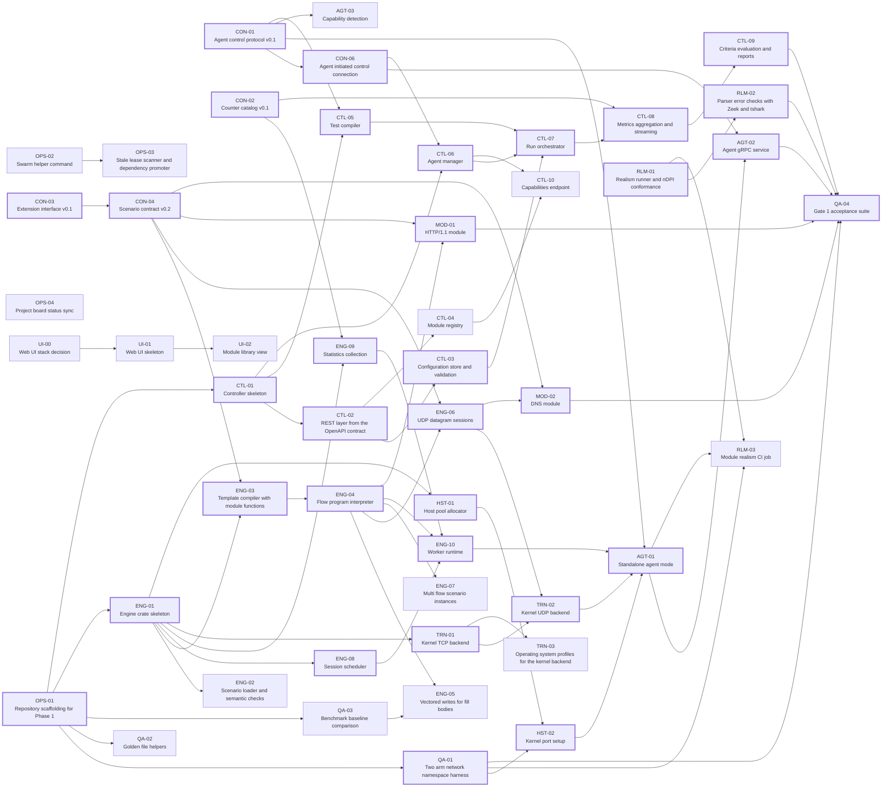

<!-- Generated by tools/plan/plan.py render from plan/work-packages.yaml. Do not edit by hand. -->

# Phase 1 work packages (Core alpha)

Gate 1. A two arm run of the HTTP/1.1 and DNS mix through the controller and one kernel backend agent reaches 99% nDPI classification as the intended application, and the REST API skeleton passes its contract tests.

This page lists 49 work packages. Packages marked critical path gate the phase.
Read [Swarm Protocol](Swarm-Protocol.md) before claiming one.

## Dependency graph

## Summary

| ID | Title | Size | Depends on | Critical |
|---|---|---|---|---|
| [OPS-01](#ops-01-repository-scaffolding-for-phase-1) | Repository scaffolding for Phase 1 | S | none | yes |
| [OPS-02](#ops-02-swarm-helper-command) | Swarm helper command | M | none |  |
| [OPS-03](#ops-03-stale-lease-scanner-and-dependency-promoter) | Stale lease scanner and dependency promoter | S | OPS-02 |  |
| [OPS-04](#ops-04-project-board-status-sync) | Project board status sync | S | none |  |
| [QA-01](#qa-01-two-arm-network-namespace-harness) | Two arm network namespace harness | M | OPS-01 | yes |
| [QA-02](#qa-02-golden-file-helpers) | Golden file helpers | S | OPS-01 |  |
| [QA-03](#qa-03-benchmark-baseline-comparison) | Benchmark baseline comparison | M | OPS-01 |  |
| [CON-01](#con-01-agent-control-protocol-v01) | Agent control protocol v0.1 | M | none | yes |
| [CON-02](#con-02-counter-catalog-v01) | Counter catalog v0.1 | S | none | yes |
| [CON-03](#con-03-extension-interface-v01) | Extension interface v0.1 | M | none | yes |
| [CON-04](#con-04-scenario-contract-v02) | Scenario contract v0.2 | M | CON-03 | yes |
| [CON-06](#con-06-agent-initiated-control-connection) | Agent initiated control connection | M | CON-01 | yes |
| [ENG-01](#eng-01-engine-crate-skeleton) | Engine crate skeleton | S | OPS-01 | yes |
| [ENG-02](#eng-02-scenario-loader-and-semantic-checks) | Scenario loader and semantic checks | M | ENG-01 |  |
| [ENG-03](#eng-03-template-compiler-with-module-functions) | Template compiler with module functions | M | ENG-01, CON-04 | yes |
| [ENG-04](#eng-04-flow-program-interpreter) | Flow program interpreter | M | ENG-03 | yes |
| [ENG-05](#eng-05-vectored-writes-for-fill-bodies) | Vectored writes for fill bodies | S | ENG-04, QA-03 |  |
| [ENG-06](#eng-06-udp-datagram-sessions) | UDP datagram sessions | M | ENG-04, CON-04 | yes |
| [ENG-07](#eng-07-multi-flow-scenario-instances) | Multi flow scenario instances | M | ENG-04 |  |
| [ENG-08](#eng-08-session-scheduler) | Session scheduler | M | ENG-01 | yes |
| [ENG-09](#eng-09-statistics-collection) | Statistics collection | M | ENG-01, CON-02 | yes |
| [ENG-10](#eng-10-worker-runtime) | Worker runtime | M | ENG-04, ENG-08, ENG-09 | yes |
| [TRN-01](#trn-01-kernel-tcp-backend) | Kernel TCP backend | M | ENG-01 | yes |
| [TRN-02](#trn-02-kernel-udp-backend) | Kernel UDP backend | S | TRN-01, ENG-06 | yes |
| [TRN-03](#trn-03-operating-system-profiles-for-the-kernel-backend) | Operating system profiles for the kernel backend | S | TRN-01 |  |
| [HST-01](#hst-01-host-pool-allocator) | Host pool allocator | S | ENG-01 | yes |
| [HST-02](#hst-02-kernel-port-setup) | Kernel port setup | M | HST-01, QA-01 | yes |
| [AGT-01](#agt-01-standalone-agent-mode) | Standalone agent mode | M | ENG-10, TRN-02, HST-02, CON-01 | yes |
| [AGT-02](#agt-02-agent-grpc-service) | Agent gRPC service | M | AGT-01, CON-06 | yes |
| [AGT-03](#agt-03-capability-detection) | Capability detection | S | CON-01 |  |
| [CTL-01](#ctl-01-controller-skeleton) | Controller skeleton | S | OPS-01 | yes |
| [CTL-02](#ctl-02-rest-layer-from-the-openapi-contract) | REST layer from the OpenAPI contract | M | CTL-01 | yes |
| [CTL-03](#ctl-03-configuration-store-and-validation) | Configuration store and validation | M | CTL-02 | yes |
| [CTL-04](#ctl-04-module-registry) | Module registry | M | CTL-02 |  |
| [CTL-05](#ctl-05-test-compiler) | Test compiler | M | CTL-01, CON-01 | yes |
| [CTL-06](#ctl-06-agent-manager) | Agent manager | M | CTL-01, CON-06 | yes |
| [CTL-07](#ctl-07-run-orchestrator) | Run orchestrator | M | CTL-03, CTL-05, CTL-06 | yes |
| [CTL-08](#ctl-08-metrics-aggregation-and-streaming) | Metrics aggregation and streaming | M | CTL-07, CON-02 | yes |
| [CTL-09](#ctl-09-criteria-evaluation-and-reports) | Criteria evaluation and reports | S | CTL-08 | yes |
| [CTL-10](#ctl-10-capabilities-endpoint) | Capabilities endpoint | S | CTL-04, CTL-06 |  |
| [MOD-01](#mod-01-http11-module) | HTTP/1.1 module | M | ENG-04, CON-04 | yes |
| [MOD-02](#mod-02-dns-module) | DNS module | M | ENG-06, CON-04 | yes |
| [RLM-01](#rlm-01-realism-runner-and-ndpi-conformance) | Realism runner and nDPI conformance | M | none | yes |
| [RLM-02](#rlm-02-parser-error-checks-with-zeek-and-tshark) | Parser error checks with Zeek and tshark | S | RLM-01 | yes |
| [RLM-03](#rlm-03-module-realism-ci-job) | Module realism CI job | M | RLM-01, QA-01, AGT-01 |  |
| [QA-04](#qa-04-gate-1-acceptance-suite) | Gate 1 acceptance suite | M | QA-01, AGT-02, CTL-09, MOD-01, MOD-02, RLM-02 | yes |
| [UI-00](#ui-00-web-ui-stack-decision) | Web UI stack decision | S | none |  |
| [UI-01](#ui-01-web-ui-skeleton) | Web UI skeleton | M | UI-00 |  |
| [UI-02](#ui-02-module-library-view) | Module library view | S | UI-01 |  |

## CON Contracts

### CON-01 Agent control protocol v0.1

Phase 1 · size M · workstream CON · critical path

- **Depends on.** none
- **Paths.** `contracts/proto/`

Define the gRPC service between controller and agents and the compiled plan messages that the controller sends.

Deliverables.

- contracts/proto/fps/agent/v1/agent.proto with Register, Heartbeat, Prepare, Start, Stop, and StreamCounters.
- Plan messages for scenario sources, module digests, host pool slices, per worker rates, load phases, and the seed.
- A canonical JSON mapping of the plan for the standalone agent mode.
- buf lint and buf breaking checks in CI.

Acceptance.

- [ ] `buf lint` passes, and an example plan in contracts/examples/plans/ validates against the JSON mapping.
- [ ] The owner approves the pull request.

### CON-02 Counter catalog v0.1

Phase 1 · size S · workstream CON · critical path

- **Depends on.** none
- **Paths.** `contracts/metrics/`, `tools/contracts/`

Name every counter and histogram once, with unit, level, and labels, so that the agent, the controller, the API, and the UI agree on metric names.

Deliverables.

- contracts/metrics/catalog.yaml covering the four counter levels of the specification.
- A validator rule that metric names in the OpenAPI document and in criteria examples exist in the catalog.

Acceptance.

- [ ] `python3 tools/contracts/validate.py` passes with the new rule, and a test shows that an unknown metric fails.

### CON-03 Extension interface v0.1

Phase 1 · size M · workstream CON · critical path

- **Depends on.** none
- **Paths.** `contracts/extension/`, `docs/decisions/`

Define the extension world with the five hooks of the specification and the template functions that modules export, and propose how first party modules ship native code behind the same interface.

Deliverables.

- contracts/extension/fps-extension.wit with on_open, on_data, on_timer, on_close, render, and exported template functions.
- Decision record 0010 (proposed) for native first party extensions that implement the same interface as a Rust trait.
- A mapping table from WIT types to the Rust trait.

Acceptance.

- [ ] wasm-tools validates the WIT file.
- [ ] The owner accepts or rejects decision record 0010.

### CON-04 Scenario contract v0.2

Phase 1 · size M · workstream CON · critical path

- **Depends on.** CON-03
- **Paths.** `contracts/schemas/`, `contracts/examples/`, `contracts/README.md`, `contracts/CHANGELOG.md`, `tools/contracts/`

Extend the template grammar with module function calls and the last received buffer, and state datagram semantics for expect on UDP flows.

Deliverables.

- Grammar for module calls such as dns.query(name=vars.host, qtype='A') with keyword arguments.
- The reference `last` for the bytes that the previous expect consumed.
- Datagram rules for expect on UDP, one datagram per read with a size limit.
- Updated examples and validator tests.

Acceptance.

- [ ] `python3 tools/contracts/validate.py` and `python3 -m pytest tools/contracts` pass.
- [ ] contracts/CHANGELOG.md records v0.2, and the owner approves.

### CON-06 Agent initiated control connection

Phase 1 · size M · workstream CON · critical path

- **Depends on.** CON-01
- **Paths.** `contracts/proto/`, `contracts/openapi/`, `contracts/examples/plans/`, `contracts/README.md`, `contracts/CHANGELOG.md`, `tools/contracts/`

Apply the owner decision of 2026-11-02 that agents register with the controller. The agent dials the controller, so agents behind NAT or in clouds need no inbound port.

Deliverables.

- A ControllerService that the controller serves, with Register and a bidirectional Session stream that carries heartbeats, Prepare, Start, Stop, and counter snapshots.
- Removal of AgentService, or a documented reason to keep any part of it.
- Updated state machine, error codes, and example plan in contracts/README.md.
- A note in the OpenAPI registerAgent description that agents register themselves.

Acceptance.

- [ ] `buf lint` and `python3 tools/contracts/check_plans.py` pass.
- [ ] The owner approves the pull request.

## OPS Repository and swarm tooling

### OPS-01 Repository scaffolding for Phase 1

Phase 1 · size S · workstream OPS · critical path

- **Depends on.** none
- **Paths.** `Cargo.toml`, `Makefile`, `go.work`, `CODEOWNERS`, `.github/workflows/`

Prepare the shared files so that later packages add crates, Go modules, and CI jobs without editing the same lines.

Deliverables.

- Root Cargo.toml lists members by glob (spikes/*, engine/*, modules/*/native).
- A root Makefile with the targets lint, test, and test-<workstream> that delegate to per workstream scripts.
- A go.work file that includes controller/ and cli/ once they exist.
- CODEOWNERS that requires owner review for contracts/ and docs/decisions/.
- A documented pattern of one CI workflow file per workstream.

Acceptance.

- [ ] `make lint test` runs the existing contract, Rust, and shell checks and passes.
- [ ] A new empty crate under engine/ builds without any edit to the root Cargo.toml.

### OPS-02 Swarm helper command

Phase 1 · size M · workstream OPS

- **Depends on.** none
- **Paths.** `tools/swarm/`

Implement the claim, heartbeat, release, takeover, and stale commands of the Swarm Protocol over the GitHub REST API so that agents stop typing raw API calls.

Deliverables.

- tools/swarm/fps_swarm.py with the subcommands list, claim, heartbeat, release, takeover, block, and review.
- A status card renderer and parser that round trips the format in the Swarm Protocol.
- Unit tests that replay recorded API responses and never call the network.

Acceptance.

- [ ] `python3 -m pytest tools/swarm` passes offline.
- [ ] Two simulated agents that claim the same issue concurrently resolve to exactly one holder.

### OPS-03 Stale lease scanner and dependency promoter

Phase 1 · size S · workstream OPS

- **Depends on.** OPS-02
- **Paths.** `.github/workflows/swarm-scan.yml`, `tools/swarm/`

Run a scheduled workflow that marks expired leases stale and promotes backlog packages whose dependencies have closed.

Deliverables.

- A workflow on a 30 minute schedule that uses only the repository token.
- The scanner relabels expired in progress issues as status:stale and comments with the expiry time.
- The scanner moves status:backlog issues to status:ready when every dependency issue is closed.

Acceptance.

- [ ] Unit tests cover expiry, a renewed lease, a blocked issue, and dependency promotion.
- [ ] A manual workflow dispatch with dry_run set prints the planned changes and changes nothing.

### OPS-04 Project board status sync

Phase 1 · size S · workstream OPS

- **Depends on.** none
- **Paths.** `.github/workflows/project-sync.yml`
- **Owner action.** The owner creates a token with project access and stores it as the FPS_PROJECT_TOKEN secret.

Mirror the status label of each work package issue into the Status field of the GitHub Project, because sandboxed agents cannot reach the Projects API.

Deliverables.

- A workflow triggered by issue label events that sets the Project Status option matching the status label.
- The workflow exits successfully and does nothing when the secret is absent.

Acceptance.

- [ ] Relabeling a test issue moves its card to the matching column within one minute.

## QA Test infrastructure and gate suites

### QA-01 Two arm network namespace harness

Phase 1 · size M · workstream QA · critical path

- **Depends on.** OPS-01
- **Paths.** `tests/harness/`

Build a harness that connects a client namespace and a server namespace through a routing namespace that stands in for the device under test, so that end to end tests run on any Linux CI runner without virtual machines.

Deliverables.

- tests/harness/netns.sh with the commands up, down, exec, and capture.
- Configurable client and server prefixes, MTU, optional VLAN, and optional NAT in the routing namespace.
- A capture command that writes pcapng from the routing namespace.

Acceptance.

- [ ] `sudo tests/harness/netns.sh up` followed by a curl from the client namespace to a server namespace listener succeeds.
- [ ] `down` removes every namespace, link, and route that `up` created.
- [ ] shellcheck passes.

### QA-02 Golden file helpers

Phase 1 · size S · workstream QA

- **Depends on.** OPS-01
- **Paths.** `tests/golden/`

Provide one golden file convention for Rust, Go, and Python tests, with an explicit update switch.

Deliverables.

- A small Rust crate, a Go package, and a pytest fixture that compare output with testdata files.
- Each helper rewrites the golden file only when UPDATE_GOLDEN=1 is set.
- A diff that names the golden file on mismatch.

Acceptance.

- [ ] Each helper has tests for match, mismatch, and update.

### QA-03 Benchmark baseline comparison

Phase 1 · size M · workstream QA

- **Depends on.** OPS-01
- **Paths.** `bench/`

Record benchmark baselines as JSON and fail a run that regresses beyond a stated tolerance.

Deliverables.

- bench/compare.py that reads a result file and a baseline file and applies per metric tolerances.
- The S1 engine benchmark recorded as the first baseline with host details.
- Instructions to refresh a baseline in a reviewed pull request.

Acceptance.

- [ ] A synthetic 15% regression fails against a 10% tolerance, and a 5% regression passes.

### QA-04 Gate 1 acceptance suite

Phase 1 · size M · workstream QA · critical path

- **Depends on.** QA-01, AGT-02, CTL-09, MOD-01, MOD-02, RLM-02
- **Paths.** `tests/gates/gate1/`

Automate the Gate 1 criterion end to end with the controller, one agent, the harness, and the realism runner.

Deliverables.

- tests/gates/gate1/run.sh that starts the controller and agent, submits the mix through the API, captures, and scores.
- A gate report in Markdown with the measured values.

Acceptance.

- [ ] The suite passes on a clean CI runner and fails when the classification threshold is raised above the measured value.

## ENG Agent engine

### ENG-01 Engine crate skeleton

Phase 1 · size S · workstream ENG · critical path

- **Depends on.** OPS-01
- **Paths.** `engine/fps-io/`, `engine/fps-flow/`, `engine/fps-interp/`, `engine/fps-stats/`

Create the engine crates and move the reusable parts of the S1 spike into them with their tests.

Deliverables.

- fps-io with the SessionIo trait and an in memory duplex implementation for tests.
- fps-flow with the program model and template parser from spikes/s1-engine.
- fps-interp and fps-stats as empty crates with lint settings and forbid(unsafe_code).

Acceptance.

- [ ] `cargo test -p fps-io -p fps-flow` passes, including the ported S1 tests.
- [ ] `cargo clippy --workspace --all-targets -- -D warnings` passes.

### ENG-02 Scenario loader and semantic checks

Phase 1 · size M · workstream ENG

- **Depends on.** ENG-01
- **Paths.** `engine/fps-flow/`

Load scenario YAML into the program model and apply the same semantic rules as the Python validator.

Deliverables.

- A loader that returns typed errors with the file, flow, and action index.
- The semantic rules of tools/contracts/validate.py for flows, after, spawn, branch, and templates.
- A shared fixture directory that both validators read.

Acceptance.

- [ ] Every fixture produces the same accept or reject verdict in Rust and in Python.

### ENG-03 Template compiler with module functions

Phase 1 · size M · workstream ENG · critical path

- **Depends on.** ENG-01, CON-04
- **Paths.** `engine/fps-flow/`

Compile templates into byte segments and call slots, and dispatch module function calls through the TemplateFn trait.

Deliverables.

- Segment compilation for literals, vars, session fields, fill, hex, rand_int, and module calls.
- Constant folding for templates without session dependent parts.
- A human readable dump of compiled programs for golden tests.

Acceptance.

- [ ] Golden tests cover every grammar rule of contract v0.2.
- [ ] A property test shows that rendering is deterministic for a fixed seed and session id.

### ENG-04 Flow program interpreter

Phase 1 · size M · workstream ENG · critical path

- **Depends on.** ENG-03
- **Paths.** `engine/fps-interp/`

Execute compiled flow programs over any SessionIo for TCP sessions, with timeouts, the three expect modes, and seeded delay distributions.

Deliverables.

- All v0.1 actions except spawn and UDP specific behavior.
- Per session random number generators derived from the run seed and session id.
- Fixed, uniform, exponential, lognormal, and Pareto delays.
- Failure reasons that map to the counter catalog.

Acceptance.

- [ ] Interpreter tests run client and server programs against each other over the in memory duplex.
- [ ] Each failure reason has a test that triggers it.

### ENG-05 Vectored writes for fill bodies

Phase 1 · size S · workstream ENG

- **Depends on.** ENG-04, QA-03
- **Paths.** `engine/fps-interp/`

Write fill() bodies as vectored writes from a shared filler buffer, which is Gate 0 carry over item 1.

Deliverables.

- Vectored write support in the interpreter send path.
- A bulk benchmark baseline in bench/baselines/.

Acceptance.

- [ ] The 1 MiB body workload stays within 25% of the hand written baseline on the same host.

### ENG-06 UDP datagram sessions

Phase 1 · size M · workstream ENG · critical path

- **Depends on.** ENG-04, CON-04
- **Paths.** `engine/fps-io/`, `engine/fps-interp/`

Add a datagram variant of SessionIo and the UDP semantics of contract v0.2 to the interpreter.

Deliverables.

- A DatagramIo trait with an in memory implementation for tests.
- connect, accept, send, expect, and close for UDP flows.

Acceptance.

- [ ] A DNS shaped request and response program passes over the in memory implementation.
- [ ] Datagram size limits and timeouts have tests.

### ENG-07 Multi flow scenario instances

Phase 1 · size M · workstream ENG

- **Depends on.** ENG-04
- **Paths.** `engine/fps-interp/`

Run all flows of one scenario instance with after ordering, spawn, and shared scenario variables.

Deliverables.

- A scenario instance object that owns shared variables and flow states.
- after ordering and spawn with the failure propagation rules of the contract.

Acceptance.

- [ ] The web_browse example runs its lookup flow before its page flow in a test.
- [ ] A spawned flow failure fails its parent scenario instance.

### ENG-08 Session scheduler

Phase 1 · size M · workstream ENG · critical path

- **Depends on.** ENG-01
- **Paths.** `engine/fps-sched/`

Produce session start times from the load objective, phases, and arrival process, deterministically from the seed.

Deliverables.

- Constant and Poisson arrivals, a concurrency cap, and linear and step phases.
- A schedule iterator that a worker drains with an injected clock.

Acceptance.

- [ ] Two schedules with the same seed are identical, and a KS test accepts the Poisson inter arrival times.
- [ ] Phase boundary tests cover ramp up, steady, and ramp down.

### ENG-09 Statistics collection

Phase 1 · size M · workstream ENG · critical path

- **Depends on.** ENG-01, CON-02
- **Paths.** `engine/fps-stats/`

Collect the catalog counters and HDR latency histograms per worker without locks and publish one snapshot per second.

Deliverables.

- Per worker counter shards and histograms keyed by catalog names.
- A snapshot type that merges shards and serializes to the plan JSON mapping.

Acceptance.

- [ ] A concurrency test with eight workers loses no increments.
- [ ] Snapshot names match contracts/metrics/catalog.yaml.

### ENG-10 Worker runtime

Phase 1 · size M · workstream ENG · critical path

- **Depends on.** ENG-04, ENG-08, ENG-09
- **Paths.** `engine/fps-runtime/`

Run one single threaded async runtime per pinned core, each owning its sessions, timers, and statistics shard.

Deliverables.

- Worker threads with optional core pinning and a shared nothing session model.
- Graceful stop with ramp down and immediate abort.

Acceptance.

- [ ] A loopback test drives the http1 web_get example at a fixed rate and reports matching counters.
- [ ] Stop completes within the configured ramp down time plus one second.

## TRN Transport backends

### TRN-01 Kernel TCP backend

Phase 1 · size M · workstream TRN · critical path

- **Depends on.** ENG-01
- **Paths.** `engine/fps-backend-kernel/`

Implement SessionIo over kernel TCP sockets with source addresses from the host pool.

Deliverables.

- connect with IP_BIND_ADDRESS_NO_PORT and a configured local port range.
- accept on pool addresses with a configurable backlog.
- Socket options for buffer sizes, Nagle, and linger.

Acceptance.

- [ ] A loopback test opens 10,000 sessions from 100 source addresses without address errors.

### TRN-02 Kernel UDP backend

Phase 1 · size S · workstream TRN · critical path

- **Depends on.** TRN-01, ENG-06
- **Paths.** `engine/fps-backend-kernel/`

Implement DatagramIo over kernel UDP sockets bound to pool addresses.

Deliverables.

- Connected UDP sockets for clients and bound sockets for servers.

Acceptance.

- [ ] A loopback test exchanges 10,000 request and response pairs from 100 source addresses.

### TRN-03 Operating system profiles for the kernel backend

Phase 1 · size S · workstream TRN

- **Depends on.** TRN-01
- **Paths.** `engine/fps-backend-kernel/`

Apply the TTL, MSS, window, SACK, and timestamp settings of each OS profile where the kernel exposes them, and document what the kernel controls.

Deliverables.

- Profiles windows11, linux6, and macos14 as data files.
- A limits table that names each option the kernel backend cannot set per socket.

Acceptance.

- [ ] A capture from the QA-01 harness shows the configured TTL and MSS for each profile.

## HST Host emulation

### HST-01 Host pool allocator

Phase 1 · size S · workstream HST · critical path

- **Depends on.** ENG-01
- **Paths.** `engine/fps-hosts/`

Map sessions to source hosts deterministically and split pools across agents and workers.

Deliverables.

- Round robin, uniform, and Zipf host selection from the seed.
- Slicing of a pool by agent and worker without overlap.

Acceptance.

- [ ] Property tests show that slices are disjoint and cover the pool.

### HST-02 Kernel port setup

Phase 1 · size M · workstream HST · critical path

- **Depends on.** HST-01, QA-01
- **Paths.** `engine/fps-hosts/`

Configure a test port for the kernel backend with a network namespace, a local route for the pool prefix, the gateway, an optional VLAN, and the sysctl profile.

Deliverables.

- Netlink based setup and teardown that never touches the management interface.
- A sysctl profile for local port range, TIME_WAIT reuse, and socket buffers.

Acceptance.

- [ ] An integration test in the QA-01 harness binds and connects from 20,000 pool addresses.
- [ ] Teardown leaves no namespace, route, or link behind.

## AGT Agent service

### AGT-01 Standalone agent mode

Phase 1 · size M · workstream AGT · critical path

- **Depends on.** ENG-10, TRN-02, HST-02, CON-01
- **Paths.** `engine/fps-agent/`

Run a plan file without a controller and print one counter snapshot per second as JSON lines.

Deliverables.

- `fps-agent run --plan plan.json --modules DIR` with exit codes for pass, fail, and error.
- Module loading from a directory with digest checks.

Acceptance.

- [ ] The http1 and DNS example plan runs in the QA-01 harness and reports successful sessions on both arms.

### AGT-02 Agent gRPC service

Phase 1 · size M · workstream AGT · critical path

- **Depends on.** AGT-01, CON-06
- **Paths.** `engine/fps-agent/`

Implement the agent side of the control protocol with registration, heartbeat, prepare, start, stop, and the counter stream.

Deliverables.

- A tonic server and a client loop that registers with a configured controller.
- State handling that rejects out of order calls with gRPC status codes.

Acceptance.

- [ ] A test with a fake controller drives prepare, start, and stop and receives counter snapshots.

### AGT-03 Capability detection

Phase 1 · size S · workstream AGT

- **Depends on.** CON-01
- **Paths.** `engine/fps-agent/`

Report cores, NUMA nodes, memory, NIC drivers, kernel version, and XDP support in the capabilities message.

Deliverables.

- Detection code with a fake system root for tests.

Acceptance.

- [ ] Tests cover a virtio-net guest, a host without XDP, and a host with two NUMA nodes.

## CTL Controller

### CTL-01 Controller skeleton

Phase 1 · size S · workstream CTL · critical path

- **Depends on.** OPS-01
- **Paths.** `controller/cmd/`, `controller/internal/app/`, `controller/go.mod`, `controller/.golangci.yml`

Create the Go module with the controller binary, configuration loading, structured logging, and lint settings.

Deliverables.

- controller/cmd/fps-controller with flags and a configuration file.
- log/slog JSON logging, a health endpoint, and graceful shutdown.
- golangci-lint configuration and a CI workflow.

Acceptance.

- [ ] `go test -race ./...` and `golangci-lint run` pass in controller/.

### CTL-02 REST layer from the OpenAPI contract

Phase 1 · size M · workstream CTL · critical path

- **Depends on.** CTL-01
- **Paths.** `controller/internal/api/`

Generate the server interface from contracts/openapi/fps-api-v1.yaml and add problem details, scoped tokens, and stubs.

Deliverables.

- Generated types and server interface with a check that the generated code is current.
- RFC 9457 problem responses and read, run, and admin token scopes.
- Stubs that return 501 problems for operations that later packages implement.

Acceptance.

- [ ] A contract test calls every operation and validates each response against the OpenAPI document.

### CTL-03 Configuration store and validation

Phase 1 · size M · workstream CTL · critical path

- **Depends on.** CTL-02
- **Paths.** `controller/internal/store/`

Store test configurations and validate them against the schema, module references, and agent capacity.

Deliverables.

- SQLite storage behind a repository interface.
- POST and GET /v1/configs and POST /v1/configs/{id}:validate.

Acceptance.

- [ ] Every example under contracts/examples/tests/ stores and validates, and each invalid fixture returns a problem that names the field.

### CTL-04 Module registry

Phase 1 · size M · workstream CTL

- **Depends on.** CTL-02
- **Paths.** `controller/internal/registry/`

List, install, inspect, and delete module packages with manifest validation and content digests.

Deliverables.

- A local registry directory with an index file.
- The /v1/modules operations.

Acceptance.

- [ ] Installing the example http1 and dns modules succeeds, and a manifest with an unknown license fails.

### CTL-05 Test compiler

Phase 1 · size M · workstream CTL · critical path

- **Depends on.** CTL-01, CON-01
- **Paths.** `controller/internal/compiler/`

Compile a test configuration into per agent plans by normalizing the mix and splitting rates and host pools by core count.

Deliverables.

- A pure function from configuration and agent inventory to plans.
- Session based mix normalization. Byte based correction arrives in CTL-12.

Acceptance.

- [ ] Golden tests cover one agent, two agents with unequal cores, and a pool that does not divide evenly.
- [ ] Compiling twice with the same seed yields identical plans.

### CTL-06 Agent manager

Phase 1 · size M · workstream CTL · critical path

- **Depends on.** CTL-01, CON-06
- **Paths.** `controller/internal/agents/`, `controller/internal/fakeagent/`

Track agent registration, inventory, reservation, and heartbeat timeouts.

Deliverables.

- The controller side of Register and Heartbeat and the /v1/agents operations.
- A fake agent package for tests in other controller packages.

Acceptance.

- [ ] A test with three fake agents covers reservation, release, and a missed heartbeat.

### CTL-07 Run orchestrator

Phase 1 · size M · workstream CTL · critical path

- **Depends on.** CTL-03, CTL-05, CTL-06
- **Paths.** `controller/internal/runs/`

Drive the run state machine from pending to a final state and contain agent faults.

Deliverables.

- POST /v1/runs, GET /v1/runs/{id}, and POST /v1/runs/{id}:stop.
- Degraded marking when an agent fails during a run.

Acceptance.

- [ ] Table driven tests cover every allowed state transition and reject every other transition.
- [ ] A test with a failing fake agent ends the run according to its criteria.

### CTL-08 Metrics aggregation and streaming

Phase 1 · size M · workstream CTL · critical path

- **Depends on.** CTL-07, CON-02
- **Paths.** `controller/internal/metrics/`

Merge agent snapshots into run metrics, serve the metrics views, stream them over Server Sent Events, and expose Prometheus metrics.

Deliverables.

- GET /v1/runs/{id}/metrics with views and windows, the SSE stream, and /metrics.

Acceptance.

- [ ] Aggregated counters equal the sum of fake agent snapshots, and histogram merges match a reference merge.

### CTL-09 Criteria evaluation and reports

Phase 1 · size S · workstream CTL · critical path

- **Depends on.** CTL-08
- **Paths.** `controller/internal/report/`

Evaluate pass and fail criteria and produce JSON and CSV reports.

Deliverables.

- GET /v1/runs/{id}/report for JSON and CSV.

Acceptance.

- [ ] Golden reports cover a passing run, a failing criterion, and a degraded run.

### CTL-10 Capabilities endpoint

Phase 1 · size S · workstream CTL

- **Depends on.** CTL-04, CTL-06
- **Paths.** `controller/internal/api/capabilities.go`

Serve GET /v1/capabilities from the registry and agent inventory.

Deliverables.

- The capabilities operation with engine API version, backends, agents, and modules.

Acceptance.

- [ ] The contract test for /v1/capabilities passes with two fake agents.

## MOD Application and content modules

### MOD-01 HTTP/1.1 module

Phase 1 · size M · workstream MOD · critical path

- **Depends on.** ENG-04, CON-04
- **Paths.** `modules/http1/`

Ship the http1 module with request and response functions and scenarios for a single fetch, keepalive browsing, and uploads.

Deliverables.

- Manifest, scenarios, native functions http1.request and http1.response, and parameter schema.
- HTTP/1.0 and HTTP/1.1 variants with chunked and length delimited bodies.
- A synthetic fixture capture generated in the QA-01 harness.

Acceptance.

- [ ] The module passes contract validation and its interpreter tests.
- [ ] nDPI classifies at least 99% of fixture sessions as HTTP.

### MOD-02 DNS module

Phase 1 · size M · workstream MOD · critical path

- **Depends on.** ENG-06, CON-04
- **Paths.** `modules/dns/`

Ship the dns module with query encoding, answer parsing, and lookup scenarios over UDP with TCP fallback.

Deliverables.

- Native functions dns.query and dns.answer_ip and a server that answers from a zone file.
- Record types A, AAAA, CNAME, MX, and TXT.

Acceptance.

- [ ] tshark parses every fixture message without errors, and nDPI classifies at least 99% of sessions as DNS.

## RLM Realism validation

### RLM-01 Realism runner and nDPI conformance

Phase 1 · size M · workstream RLM · critical path

- **Depends on.** none
- **Paths.** `realism/`

Score a capture against expected application labels with nDPI run out of process and write a realism report.

Deliverables.

- `python3 -m realism score --pcap FILE --labels FILE` writing a JSON report.
- A report schema in realism/schema/ that later checks extend.

Acceptance.

- [ ] Tests use small synthetic captures and a stub classifier, and one optional test runs the real ndpiReader when it is installed.

### RLM-02 Parser error checks with Zeek and tshark

Phase 1 · size S · workstream RLM · critical path

- **Depends on.** RLM-01
- **Paths.** `realism/`

Count parser errors and malformed packets per application with tshark and Zeek.

Deliverables.

- A conformance check that adds parser error counts to the realism report.

Acceptance.

- [ ] A capture with one malformed DNS message reports exactly one parser error.

### RLM-03 Module realism CI job

Phase 1 · size M · workstream RLM

- **Depends on.** RLM-01, QA-01, AGT-01
- **Paths.** `realism/`, `.github/workflows/realism.yml`

Run every changed module in the harness, capture its traffic, and fail the pull request when a realism check fails.

Deliverables.

- A workflow that detects changed module directories and runs their fixtures.
- The realism report uploaded as a workflow artifact.

Acceptance.

- [ ] A pull request that breaks the http1 request line fails the job.

## UI Web UI

### UI-00 Web UI stack decision

Phase 1 · size S · workstream UI

- **Depends on.** none
- **Paths.** `ui/docs/`
- **Owner action.** The owner accepts or rejects decision record 0011.

Propose the UI language, framework, build tool, and test tools as decision record 0011 for owner approval.

Deliverables.

- A comparison of at most three stacks against license, bundle size, accessibility, and generated client support.

Acceptance.

- [ ] The owner records a decision.

### UI-01 Web UI skeleton

Phase 1 · size M · workstream UI

- **Depends on.** UI-00
- **Paths.** `ui/`

Create the UI project with the generated API client, token sign in, layout, and a mock API server for tests.

Deliverables.

- A generated client from contracts/openapi/fps-api-v1.yaml with a currency check.
- Lint, format, unit test, and build scripts wired to CI.

Acceptance.

- [ ] The UI builds, its unit tests pass, and it renders the capabilities of the mock server.

### UI-02 Module library view

Phase 1 · size S · workstream UI

- **Depends on.** UI-01
- **Paths.** `ui/`

List installed modules with their manifests, scenarios, and parameters.

Deliverables.

- A list view and a detail view for modules.

Acceptance.

- [ ] Component tests cover an empty registry, two modules, and an API error.
