<!-- Generated by tools/plan/plan.py render from plan/work-packages.yaml. Do not edit by hand. -->

# Phase 2 work packages (Library)

Gate 2. All 15 application modules of decision D7 pass the eight realism checks in module CI, byte weighted mixes stay within 2 points of their targets, and the qcow2 image boots and runs a test unattended.

This page lists 109 work packages. Packages marked critical path gate the phase.
Read [Swarm Protocol](Swarm-Protocol.md) before claiming one.

## Dependency graph

```mermaid
flowchart LR
  CON_10["CON-10<br/>Behavior profiles and distributions in the scenario contract"]
  CTL_21["CTL-21<br/>Throughput rate calibration"]
  CON_05["CON-05<br/>Agent control protocol v0.2"]
  OPS_05["OPS-05<br/>Release workflow"]
  ENG_11["ENG-11<br/>WebAssembly extension host"]
  ENG_12["ENG-12<br/>Session sampling and capture"]
  ENG_13["ENG-13<br/>Run time rate adjustment"]
  TRN_04["TRN-04<br/>TLS transport module"]
  TRN_05["TRN-05<br/>TLS client fingerprint profiles"]
  AGT_04["AGT-04<br/>Signed module verification"]
  AGT_05["AGT-05<br/>Capture and rate update handlers"]
  CTL_11["CTL-11<br/>Module signing and signed index"]
  CTL_12["CTL-12<br/>Byte weighted mix control"]
  CTL_13["CTL-13<br/>HTML report"]
  CTL_14["CTL-14<br/>Captures API"]
  CTL_15["CTL-15<br/>Mutual TLS between controller and agents"]
  CLI_01["CLI-01<br/>Python SDK"]
  CLI_02["CLI-02<br/>fps command line client"]
  MOD_03["MOD-03<br/>Content generators"]
  MOD_04["MOD-04<br/>HTTPS scenarios"]
  MOD_05["MOD-05<br/>HTTP/2 framing and HPACK functions"]
  MOD_06["MOD-06<br/>HTTP/2 module"]
  MOD_07["MOD-07<br/>SMTP module"]
  MOD_08["MOD-08<br/>IMAP module"]
  MOD_09["MOD-09<br/>POP3 module"]
  MOD_10["MOD-10<br/>FTP module"]
  MOD_11["MOD-11<br/>SSH module"]
  MOD_12["MOD-12<br/>SMB2 encoding functions"]
  MOD_13["MOD-13<br/>SMB2 module"]
  MOD_14["MOD-14<br/>SIP with RTP module"]
  MOD_15["MOD-15<br/>HLS video module"]
  MOD_16["MOD-16<br/>NTP module"]
  MOD_17["MOD-17<br/>LDAP module"]
  MOD_18["MOD-18<br/>MQTT module"]
  RLM_04["RLM-04<br/>TLS decryption and JA4 checks"]
  RLM_05["RLM-05<br/>Content variety check"]
  RLM_06["RLM-06<br/>Temporal distribution check"]
  RLM_07["RLM-07<br/>Mix accuracy check"]
  RLM_08["RLM-08<br/>Session structure check"]
  RLM_09["RLM-09<br/>Transport behavior check"]
  RLM_10["RLM-10<br/>Host identity check"]
  CAP_01["CAP-01<br/>Capture session extraction"]
  CAP_02["CAP-02<br/>Scenario generation from sessions"]
  CAP_03["CAP-03<br/>Scrubbing and provenance"]
  CAP_04["CAP-04<br/>Profile extractor"]
  IMG_01["IMG-01<br/>qcow2 base image"]
  IMG_02["IMG-02<br/>First boot roles and tuning"]
  IMG_03["IMG-03<br/>Image format conversion"]
  IMG_04["IMG-04<br/>Image boot test in CI"]
  IMG_05["IMG-05<br/>Container images"]
  UI_03["UI-03<br/>Test configuration editor"]
  UI_04["UI-04<br/>Run launch and live metrics"]
  UI_05["UI-05<br/>Reports and run comparison"]
  UI_06["UI-06<br/>Agents and ports view"]
  QA_05["QA-05<br/>Gate 2 acceptance suite"]
  CON_11["CON-11<br/>Module settings in the agent protocol"]
  AGT_07["AGT-07<br/>Module settings, side label, and client default in the agent"]
  ENG_15["ENG-15<br/>New failure reasons and side label in the interpreter and runtime"]
  CTL_22["CTL-22<br/>Module settings and port locations end to end in the controller"]
  CTL_23["CTL-23<br/>Client side default in metric views, run seeds, and test stability"]
  ENG_16["ENG-16<br/>Profiles and distributions in the template engine"]
  ENG_17["ENG-17<br/>Load WebAssembly extensions into sessions"]
  CTL_24["CTL-24<br/>Throughput calibration in the run loop"]
  ENG_18["ENG-18<br/>Rate handles and paused worker wake in the runtime"]
  CTL_25["CTL-25<br/>Scenario contract v0.3 in the controller"]
  CON_12["CON-12<br/>Side selection in the run metrics API"]
  CTL_26["CTL-26<br/>Serve the HTML report"]
  CTL_27["CTL-27<br/>Mutual TLS in the controller"]
  AGT_08["AGT-08<br/>Mutual TLS and enrollment in the agent"]
  ENG_19["ENG-19<br/>Capture TCP sessions in the runtime"]
  CTL_28["CTL-28<br/>Verify module signatures at install and in plans"]
  CTL_29["CTL-29<br/>Rebuild the agent inventory after a restart"]
  CON_13["CON-13<br/>Capture download over the agent connection"]
  AGT_09["AGT-09<br/>Serve capture downloads in the agent"]
  CTL_30["CTL-30<br/>Send UpdateRates from the agent manager"]
  CTL_31["CTL-31<br/>CA in the enrollment chain and trust store flags"]
  AGT_10["AGT-10<br/>Shared capture cell and pinned enrollment check in the agent"]
  IMG_06["IMG-06<br/>Mutual TLS in the image"]
  CON_14["CON-14<br/>Signature headers and calibration history in the REST contract"]
  AGT_11["AGT-11<br/>Load WebAssembly extensions in the agent"]
  CTL_32["CTL-32<br/>Capture file retention in the controller"]
  CON_15["CON-15<br/>Capture and criteria contract gaps"]
  AGT_12["AGT-12<br/>Port filter for captures and a real end to end capture"]
  CTL_33["CTL-33<br/>Version stamp in fps-controller"]
  CTL_34["CTL-34<br/>Byte weights in the compiler"]
  AGT_13["AGT-13<br/>First party native modules in the agent"]
  ENG_20["ENG-20<br/>Upgrade a running flow to TLS"]
  CTL_35["CTL-35<br/>List runs"]
  CON_16["CON-16<br/>Controller version, configuration listing, and REST breaking check"]
  CON_17["CON-17<br/>The tls_upgrade action in the scenario contract"]
  CTL_36["CTL-36<br/>Serve stopCapture, capture files, and labeled criteria"]
  AGT_14["AGT-14<br/>TLS profiles, TLS key export, and labeled criteria in the agent"]
  MOD_20["MOD-20<br/>STARTTLS scenarios for smtp and imap"]
  CLI_03["CLI-03<br/>Stabilize the CLI end to end test"]
  AGT_15["AGT-15<br/>Stabilize the agent enrollment test"]
  ENG_21["ENG-21<br/>Extension seams found by AGT-11"]
  CTL_37["CTL-37<br/>Serve listConfigs and the controller version"]
  ENG_22["ENG-22<br/>Refuse tls_upgrade on UDP in the flow loader"]
  ENG_23["ENG-23<br/>Multi flow scenario instances in the runtime"]
  AGT_16["AGT-16<br/>Multi flow scenarios and digested extension bytes in the agent"]
  CON_18["CON-18<br/>Decide the transport keyword of the scenario contract"]
  ENG_24["ENG-24<br/>TLS per session connectors, instance TLS, and tls metrics"]
  MOD_21["MOD-21<br/>Parser errors on live http1 captures"]
  CON_19["CON-19<br/>Contract gaps found by CAP-02 and RLM-06"]
  RLM_12["RLM-12<br/>A current nDPI and a shared decrypted view in the realism runner"]
  TRN_15["TRN-15<br/>TLS plaintext backpressure and mail and h2 profiles"]
  ENG_25["ENG-25<br/>int_bytes and now in the engine"]
  CTL_38["CTL-38<br/>Distributions in the compiler and scenario counts in the run report"]
  CON_20["CON-20<br/>Stream events, metric source label, and provenance fields"]
  TRN_04 --> TRN_05
  RLM_04 --> TRN_05
  CTL_11 --> AGT_04
  CON_05 --> AGT_04
  CON_05 --> AGT_05
  ENG_12 --> AGT_05
  ENG_13 --> AGT_05
  ENG_18 --> AGT_05
  CON_05 --> CTL_12
  AGT_05 --> CTL_12
  AGT_05 --> CTL_14
  CON_13 --> CTL_14
  TRN_04 --> MOD_04
  MOD_05 --> MOD_06
  TRN_04 --> MOD_06
  MOD_03 --> MOD_07
  TRN_04 --> MOD_07
  MOD_03 --> MOD_08
  MOD_03 --> MOD_09
  MOD_03 --> MOD_10
  ENG_11 --> MOD_11
  MOD_12 --> MOD_13
  MOD_03 --> MOD_13
  MOD_03 --> MOD_15
  CAP_01 --> CAP_02
  CAP_01 --> CAP_03
  CAP_01 --> CAP_04
  IMG_01 --> IMG_02
  IMG_01 --> IMG_03
  IMG_02 --> IMG_04
  UI_04 --> UI_05
  MOD_04 --> QA_05
  MOD_06 --> QA_05
  MOD_07 --> QA_05
  MOD_08 --> QA_05
  MOD_09 --> QA_05
  MOD_10 --> QA_05
  MOD_11 --> QA_05
  MOD_13 --> QA_05
  MOD_14 --> QA_05
  MOD_15 --> QA_05
  MOD_16 --> QA_05
  MOD_17 --> QA_05
  MOD_18 --> QA_05
  RLM_04 --> QA_05
  RLM_05 --> QA_05
  RLM_06 --> QA_05
  RLM_07 --> QA_05
  RLM_08 --> QA_05
  RLM_09 --> QA_05
  RLM_10 --> QA_05
  CTL_12 --> QA_05
  IMG_04 --> QA_05
  CTL_22 --> CON_11
  CON_11 --> AGT_07
  CON_10 --> ENG_16
  ENG_11 --> ENG_17
  ENG_15 --> ENG_17
  CTL_21 --> CTL_24
  CON_05 --> CTL_24
  AGT_05 --> CTL_24
  ENG_13 --> ENG_18
  CON_10 --> CTL_25
  ENG_16 --> CTL_25
  CTL_23 --> CON_12
  CTL_13 --> CTL_26
  CTL_15 --> CTL_27
  CTL_27 --> AGT_08
  ENG_12 --> ENG_19
  AGT_05 --> ENG_19
  CTL_11 --> CTL_28
  CTL_27 --> CTL_29
  CON_05 --> CON_13
  CON_13 --> AGT_09
  AGT_05 --> AGT_09
  CTL_24 --> CTL_30
  CTL_27 --> CTL_31
  CTL_28 --> CTL_31
  ENG_19 --> AGT_10
  AGT_08 --> AGT_10
  CTL_31 --> AGT_10
  AGT_08 --> IMG_06
  IMG_02 --> IMG_06
  CTL_28 --> CON_14
  CTL_24 --> CON_14
  ENG_17 --> AGT_11
  AGT_07 --> AGT_11
  CTL_14 --> CTL_32
  CON_13 --> CON_15
  CTL_14 --> CON_15
  AGT_07 --> CON_15
  AGT_09 --> AGT_12
  AGT_10 --> AGT_12
  OPS_05 --> CTL_33
  CTL_12 --> CTL_34
  MOD_07 --> AGT_13
  AGT_11 --> AGT_13
  TRN_04 --> ENG_20
  MOD_07 --> ENG_20
  CON_15 --> CON_16
  ENG_20 --> CON_17
  CON_15 --> CTL_36
  ENG_20 --> AGT_14
  CON_15 --> AGT_14
  AGT_13 --> AGT_14
  CON_17 --> MOD_20
  AGT_14 --> MOD_20
  MOD_08 --> MOD_20
  CLI_02 --> CLI_03
  AGT_10 --> AGT_15
  AGT_11 --> ENG_21
  CON_16 --> CTL_37
  CTL_33 --> CTL_37
  CON_17 --> ENG_22
  AGT_13 --> ENG_23
  ENG_23 --> AGT_16
  ENG_21 --> AGT_16
  AGT_14 --> AGT_16
  ENG_20 --> CON_18
  ENG_23 --> ENG_24
  AGT_14 --> ENG_24
  MOD_04 --> MOD_21
  CON_18 --> CON_19
  MOD_20 --> RLM_12
  TRN_05 --> TRN_15
  CON_19 --> ENG_25
  CON_19 --> CTL_38
  CON_19 --> CON_20
  classDef critical stroke-width:3px
  class TRN_04,MOD_03,IMG_01,QA_05 critical
```

## Summary

| ID | Title | Size | Depends on | Critical |
|---|---|---|---|---|
| [CON-10](#con-10-behavior-profiles-and-distributions-in-the-scenario-contract) | Behavior profiles and distributions in the scenario contract | M | CON-04 |  |
| [CTL-21](#ctl-21-throughput-rate-calibration) | Throughput rate calibration | M | CTL-18, CTL-08 |  |
| [CON-05](#con-05-agent-control-protocol-v02) | Agent control protocol v0.2 | S | CON-01 |  |
| [OPS-05](#ops-05-release-workflow) | Release workflow | M | OPS-01 |  |
| [ENG-11](#eng-11-webassembly-extension-host) | WebAssembly extension host | M | CON-03, ENG-04 |  |
| [ENG-12](#eng-12-session-sampling-and-capture) | Session sampling and capture | M | ENG-10 |  |
| [ENG-13](#eng-13-run-time-rate-adjustment) | Run time rate adjustment | S | ENG-08 |  |
| [TRN-04](#trn-04-tls-transport-module) | TLS transport module | M | ENG-04, TRN-01 | yes |
| [TRN-05](#trn-05-tls-client-fingerprint-profiles) | TLS client fingerprint profiles | M | TRN-04, RLM-04 |  |
| [AGT-04](#agt-04-signed-module-verification) | Signed module verification | S | AGT-02, CTL-11, CON-05 |  |
| [AGT-05](#agt-05-capture-and-rate-update-handlers) | Capture and rate update handlers | S | AGT-02, CON-05, ENG-12, ENG-13, ENG-18 |  |
| [CTL-11](#ctl-11-module-signing-and-signed-index) | Module signing and signed index | M | CTL-04 |  |
| [CTL-12](#ctl-12-byte-weighted-mix-control) | Byte weighted mix control | M | CTL-08, CON-05, AGT-05 |  |
| [CTL-13](#ctl-13-html-report) | HTML report | S | CTL-09 |  |
| [CTL-14](#ctl-14-captures-api) | Captures API | M | CTL-07, AGT-05, CON-13 |  |
| [CTL-15](#ctl-15-mutual-tls-between-controller-and-agents) | Mutual TLS between controller and agents | M | CTL-06, AGT-02 |  |
| [CLI-01](#cli-01-python-sdk) | Python SDK | M | CTL-02 |  |
| [CLI-02](#cli-02-fps-command-line-client) | fps command line client | M | CTL-07 |  |
| [MOD-03](#mod-03-content-generators) | Content generators | M | CON-03, ENG-03 | yes |
| [MOD-04](#mod-04-https-scenarios) | HTTPS scenarios | S | MOD-01, TRN-04 |  |
| [MOD-05](#mod-05-http2-framing-and-hpack-functions) | HTTP/2 framing and HPACK functions | M | CON-04 |  |
| [MOD-06](#mod-06-http2-module) | HTTP/2 module | M | MOD-05, TRN-04 |  |
| [MOD-07](#mod-07-smtp-module) | SMTP module | M | MOD-03, TRN-04 |  |
| [MOD-08](#mod-08-imap-module) | IMAP module | M | MOD-03 |  |
| [MOD-09](#mod-09-pop3-module) | POP3 module | S | MOD-03 |  |
| [MOD-10](#mod-10-ftp-module) | FTP module | M | ENG-07, MOD-03 |  |
| [MOD-11](#mod-11-ssh-module) | SSH module | M | CON-03, ENG-11 |  |
| [MOD-12](#mod-12-smb2-encoding-functions) | SMB2 encoding functions | M | CON-04 |  |
| [MOD-13](#mod-13-smb2-module) | SMB2 module | M | MOD-12, MOD-03 |  |
| [MOD-14](#mod-14-sip-with-rtp-module) | SIP with RTP module | M | ENG-06, ENG-07 |  |
| [MOD-15](#mod-15-hls-video-module) | HLS video module | M | MOD-01, MOD-03 |  |
| [MOD-16](#mod-16-ntp-module) | NTP module | S | ENG-06 |  |
| [MOD-17](#mod-17-ldap-module) | LDAP module | M | CON-04 |  |
| [MOD-18](#mod-18-mqtt-module) | MQTT module | M | CON-04 |  |
| [RLM-04](#rlm-04-tls-decryption-and-ja4-checks) | TLS decryption and JA4 checks | M | RLM-01 |  |
| [RLM-05](#rlm-05-content-variety-check) | Content variety check | S | RLM-01 |  |
| [RLM-06](#rlm-06-temporal-distribution-check) | Temporal distribution check | S | RLM-01 |  |
| [RLM-07](#rlm-07-mix-accuracy-check) | Mix accuracy check | S | RLM-01, CTL-09 |  |
| [RLM-08](#rlm-08-session-structure-check) | Session structure check | M | RLM-01 |  |
| [RLM-09](#rlm-09-transport-behavior-check) | Transport behavior check | S | RLM-01, TRN-03 |  |
| [RLM-10](#rlm-10-host-identity-check) | Host identity check | S | RLM-01 |  |
| [CAP-01](#cap-01-capture-session-extraction) | Capture session extraction | M | none |  |
| [CAP-02](#cap-02-scenario-generation-from-sessions) | Scenario generation from sessions | M | CAP-01, CON-04 |  |
| [CAP-03](#cap-03-scrubbing-and-provenance) | Scrubbing and provenance | M | CAP-01 |  |
| [CAP-04](#cap-04-profile-extractor) | Profile extractor | M | CAP-01 |  |
| [IMG-01](#img-01-qcow2-base-image) | qcow2 base image | M | AGT-02, CTL-07 | yes |
| [IMG-02](#img-02-first-boot-roles-and-tuning) | First boot roles and tuning | M | IMG-01 |  |
| [IMG-03](#img-03-image-format-conversion) | Image format conversion | S | IMG-01 |  |
| [IMG-04](#img-04-image-boot-test-in-ci) | Image boot test in CI | M | IMG-02 |  |
| [IMG-05](#img-05-container-images) | Container images | S | AGT-02, CTL-07 |  |
| [UI-03](#ui-03-test-configuration-editor) | Test configuration editor | M | UI-01 |  |
| [UI-04](#ui-04-run-launch-and-live-metrics) | Run launch and live metrics | M | UI-01 |  |
| [UI-05](#ui-05-reports-and-run-comparison) | Reports and run comparison | M | UI-04 |  |
| [UI-06](#ui-06-agents-and-ports-view) | Agents and ports view | S | UI-01 |  |
| [QA-05](#qa-05-gate-2-acceptance-suite) | Gate 2 acceptance suite | M | MOD-04, MOD-06, MOD-07, MOD-08, MOD-09, MOD-10, MOD-11, MOD-13, MOD-14, MOD-15, MOD-16, MOD-17, MOD-18, RLM-03, RLM-04, RLM-05, RLM-06, RLM-07, RLM-08, RLM-09, RLM-10, CTL-12, IMG-04 | yes |
| [CON-11](#con-11-module-settings-in-the-agent-protocol) | Module settings in the agent protocol | S | CON-09, CTL-22 |  |
| [AGT-07](#agt-07-module-settings-side-label-and-client-default-in-the-agent) | Module settings, side label, and client default in the agent | M | CON-11, ENG-14, MOD-19 |  |
| [ENG-15](#eng-15-new-failure-reasons-and-side-label-in-the-interpreter-and-runtime) | New failure reasons and side label in the interpreter and runtime | M | ENG-14 |  |
| [CTL-22](#ctl-22-module-settings-and-port-locations-end-to-end-in-the-controller) | Module settings and port locations end to end in the controller | M | CTL-18 |  |
| [CTL-23](#ctl-23-client-side-default-in-metric-views-run-seeds-and-test-stability) | Client side default in metric views, run seeds, and test stability | S | CTL-20 |  |
| [ENG-16](#eng-16-profiles-and-distributions-in-the-template-engine) | Profiles and distributions in the template engine | M | CON-10 |  |
| [ENG-17](#eng-17-load-webassembly-extensions-into-sessions) | Load WebAssembly extensions into sessions | M | ENG-11, ENG-15 |  |
| [CTL-24](#ctl-24-throughput-calibration-in-the-run-loop) | Throughput calibration in the run loop | M | CTL-21, CON-05, AGT-05 |  |
| [ENG-18](#eng-18-rate-handles-and-paused-worker-wake-in-the-runtime) | Rate handles and paused worker wake in the runtime | S | ENG-13 |  |
| [CTL-25](#ctl-25-scenario-contract-v03-in-the-controller) | Scenario contract v0.3 in the controller | S | CON-10, ENG-16 |  |
| [CON-12](#con-12-side-selection-in-the-run-metrics-api) | Side selection in the run metrics API | S | CTL-23 |  |
| [CTL-26](#ctl-26-serve-the-html-report) | Serve the HTML report | S | CTL-13 |  |
| [CTL-27](#ctl-27-mutual-tls-in-the-controller) | Mutual TLS in the controller | M | CTL-15 |  |
| [AGT-08](#agt-08-mutual-tls-and-enrollment-in-the-agent) | Mutual TLS and enrollment in the agent | M | CTL-27 |  |
| [ENG-19](#eng-19-capture-tcp-sessions-in-the-runtime) | Capture TCP sessions in the runtime | S | ENG-12, AGT-05 |  |
| [CTL-28](#ctl-28-verify-module-signatures-at-install-and-in-plans) | Verify module signatures at install and in plans | M | CTL-11 |  |
| [CTL-29](#ctl-29-rebuild-the-agent-inventory-after-a-restart) | Rebuild the agent inventory after a restart | S | CTL-27 |  |
| [CON-13](#con-13-capture-download-over-the-agent-connection) | Capture download over the agent connection | S | CON-05 |  |
| [AGT-09](#agt-09-serve-capture-downloads-in-the-agent) | Serve capture downloads in the agent | S | CON-13, AGT-05 |  |
| [CTL-30](#ctl-30-send-updaterates-from-the-agent-manager) | Send UpdateRates from the agent manager | S | CTL-24 |  |
| [CTL-31](#ctl-31-ca-in-the-enrollment-chain-and-trust-store-flags) | CA in the enrollment chain and trust store flags | S | CTL-27, CTL-28 |  |
| [AGT-10](#agt-10-shared-capture-cell-and-pinned-enrollment-check-in-the-agent) | Shared capture cell and pinned enrollment check in the agent | S | ENG-19, AGT-08, CTL-31 |  |
| [IMG-06](#img-06-mutual-tls-in-the-image) | Mutual TLS in the image | S | AGT-08, IMG-02 |  |
| [CON-14](#con-14-signature-headers-and-calibration-history-in-the-rest-contract) | Signature headers and calibration history in the REST contract | S | CTL-28, CTL-24 |  |
| [AGT-11](#agt-11-load-webassembly-extensions-in-the-agent) | Load WebAssembly extensions in the agent | S | ENG-17, AGT-07 |  |
| [CTL-32](#ctl-32-capture-file-retention-in-the-controller) | Capture file retention in the controller | S | CTL-14 |  |
| [CON-15](#con-15-capture-and-criteria-contract-gaps) | Capture and criteria contract gaps | S | CON-13, CTL-14, AGT-07 |  |
| [AGT-12](#agt-12-port-filter-for-captures-and-a-real-end-to-end-capture) | Port filter for captures and a real end to end capture | S | AGT-09, AGT-10 |  |
| [CTL-33](#ctl-33-version-stamp-in-fps-controller) | Version stamp in fps-controller | S | OPS-05 |  |
| [CTL-34](#ctl-34-byte-weights-in-the-compiler) | Byte weights in the compiler | S | CTL-12 |  |
| [AGT-13](#agt-13-first-party-native-modules-in-the-agent) | First party native modules in the agent | S | MOD-07, AGT-11 |  |
| [ENG-20](#eng-20-upgrade-a-running-flow-to-tls) | Upgrade a running flow to TLS | M | TRN-04, MOD-07 |  |
| [CTL-35](#ctl-35-list-runs) | List runs | S | CTL-07 |  |
| [CON-16](#con-16-controller-version-configuration-listing-and-rest-breaking-check) | Controller version, configuration listing, and REST breaking check | S | CON-15 |  |
| [CON-17](#con-17-the-tls_upgrade-action-in-the-scenario-contract) | The tls_upgrade action in the scenario contract | S | ENG-20 |  |
| [CTL-36](#ctl-36-serve-stopcapture-capture-files-and-labeled-criteria) | Serve stopCapture, capture files, and labeled criteria | S | CON-15 |  |
| [AGT-14](#agt-14-tls-profiles-tls-key-export-and-labeled-criteria-in-the-agent) | TLS profiles, TLS key export, and labeled criteria in the agent | M | ENG-20, CON-15, AGT-13 |  |
| [MOD-20](#mod-20-starttls-scenarios-for-smtp-and-imap) | STARTTLS scenarios for smtp and imap | S | CON-17, AGT-14, MOD-08 |  |
| [CLI-03](#cli-03-stabilize-the-cli-end-to-end-test) | Stabilize the CLI end to end test | S | CLI-02 |  |
| [AGT-15](#agt-15-stabilize-the-agent-enrollment-test) | Stabilize the agent enrollment test | S | AGT-10 |  |
| [ENG-21](#eng-21-extension-seams-found-by-agt-11) | Extension seams found by AGT-11 | S | AGT-11 |  |
| [CTL-37](#ctl-37-serve-listconfigs-and-the-controller-version) | Serve listConfigs and the controller version | S | CON-16, CTL-33 |  |
| [ENG-22](#eng-22-refuse-tls_upgrade-on-udp-in-the-flow-loader) | Refuse tls_upgrade on UDP in the flow loader | S | CON-17 |  |
| [ENG-23](#eng-23-multi-flow-scenario-instances-in-the-runtime) | Multi flow scenario instances in the runtime | M | ENG-07, AGT-13 |  |
| [AGT-16](#agt-16-multi-flow-scenarios-and-digested-extension-bytes-in-the-agent) | Multi flow scenarios and digested extension bytes in the agent | S | ENG-23, ENG-21, AGT-14 |  |
| [CON-18](#con-18-decide-the-transport-keyword-of-the-scenario-contract) | Decide the transport keyword of the scenario contract | S | ENG-20 |  |
| [ENG-24](#eng-24-tls-per-session-connectors-instance-tls-and-tls-metrics) | TLS per session connectors, instance TLS, and tls metrics | S | ENG-23, AGT-14 |  |
| [MOD-21](#mod-21-parser-errors-on-live-http1-captures) | Parser errors on live http1 captures | S | MOD-04 |  |
| [CON-19](#con-19-contract-gaps-found-by-cap-02-and-rlm-06) | Contract gaps found by CAP-02 and RLM-06 | S | CON-18 |  |
| [RLM-12](#rlm-12-a-current-ndpi-and-a-shared-decrypted-view-in-the-realism-runner) | A current nDPI and a shared decrypted view in the realism runner | S | MOD-20 |  |
| [TRN-15](#trn-15-tls-plaintext-backpressure-and-mail-and-h2-profiles) | TLS plaintext backpressure and mail and h2 profiles | S | TRN-05 |  |
| [ENG-25](#eng-25-int_bytes-and-now-in-the-engine) | int_bytes and now in the engine | S | CON-19 |  |
| [CTL-38](#ctl-38-distributions-in-the-compiler-and-scenario-counts-in-the-run-report) | Distributions in the compiler and scenario counts in the run report | S | CON-19 |  |
| [CON-20](#con-20-stream-events-metric-source-label-and-provenance-fields) | Stream events, metric source label, and provenance fields | S | CON-19 |  |

## CON Contracts

### CON-10 Behavior profiles and distributions in the scenario contract

Phase 2 · size M · workstream CON

- **Depends on.** CON-04
- **Paths.** `contracts/schemas/scenario.schema.json`, `contracts/examples/modules/`

Apply decision D12 item 18. Define the profiles root and the dist module that the specification example uses, such as profiles.chrome and dist.pareto(...).

Deliverables.

- The profiles root and the dist functions in the scenario grammar.
- The specification example validates.
- An entry in contracts/changes/CON-10.md.

Acceptance.

- [ ] The schema checks pass on the specification example.

### CON-05 Agent control protocol v0.2

Phase 2 · size S · workstream CON

- **Depends on.** CON-01
- **Paths.** `contracts/proto/`

Add run time rate updates, capture requests, and module signatures to the control protocol.

Deliverables.

- UpdateRates, StartCapture, and StopCapture messages and signature fields in module references.

Acceptance.

- [ ] buf breaking reports no breaking change against v0.1, and the owner approves.

### CON-11 Module settings in the agent protocol

Phase 2 · size S · workstream CON

- **Depends on.** CON-09, CTL-22
- **Paths.** `contracts/proto/fps/agent/v1/`, `contracts/changes/`, `contracts/examples/tests/`, `contracts/examples/tests-pending/`

The compiler carries module settings in modules[].settings of a plan (CTL-18), but fps.agent.v1.ModuleRef has no settings field, and both the agent's plan parser and the controller's protojson reject unknown fields. A test with module settings therefore fails at dispatch.

Deliverables.

- ModuleRef.settings as a google.protobuf.Struct, additive.
- Regenerated Go and Rust bindings.
- An entry in contracts/changes/CON-11.md.
- port_locations.yaml, dns_zone.yaml, and filtered_criteria.yaml move from tests-pending to tests, now that CTL-18, CTL-20, and CTL-22 compile them.

Acceptance.

- [ ] The proto checks pass and a plan with module settings round trips through both bindings.
- [ ] The contract checks compile every file in contracts/examples/tests/.

### CON-12 Side selection in the run metrics API

Phase 2 · size S · workstream CON

- **Depends on.** CTL-23
- **Paths.** `contracts/openapi/`, `contracts/changes/`

CTL-23 made metric views default to the client side and the aggregator can serve the server side, but GET /v1/runs/{id}/metrics has no parameter to ask for it.

Deliverables.

- An optional side query parameter (client or server, default client) on the run metrics endpoint, additive, with a change note.

Acceptance.

- [ ] The contract checks pass, and the change note states that omitting the parameter keeps today's answer.

### CON-13 Capture download over the agent connection

Phase 2 · size S · workstream CON

- **Depends on.** CON-05
- **Paths.** `contracts/proto/fps/agent/v1/`, `contracts/changes/`

CON-05 added StartCapture and StopCapture, but the controller has no way to get the file, which stays on the agent. The owner chose to stream it over the existing mutually authenticated agent connection.

Deliverables.

- A command or stream in fps.agent.v1 by which the controller asks an agent for a finished capture by id and receives it in ordered chunks with offsets, the total size, and the sha256 digest that StopCaptureResult reported, so a transfer can resume at an offset; additive, with contracts/changes/CON-13.md.
- Updated Rust mirrors in the agent (the agent answers UNIMPLEMENTED until AGT-09); the Go bindings are regenerated by the coordinator.

Acceptance.

- [ ] The proto checks pass, buf breaking reports no breaking change, and a round trip test of the new messages passes in both bindings.

### CON-14 Signature headers and calibration history in the REST contract

Phase 2 · size S · workstream CON

- **Depends on.** CTL-28, CTL-24
- **Paths.** `contracts/openapi/`, `contracts/changes/`

CTL-28 reads X-Module-Signature-Key-Id and X-Module-Signature on installModule and answers 403 on a refused signature, and CTL-24 records Run.Calibration; neither is in the OpenAPI document. Needs owner approval as a contract change.

Deliverables.

- installModule documents the two optional headers and the 403 response; the run schema gains an optional calibration array; additive, with contracts/changes/CON-14.md.

Acceptance.

- [ ] The OpenAPI checks pass and the change is additive.

### CON-15 Capture and criteria contract gaps

Phase 2 · size S · workstream CON

- **Depends on.** CON-13, CTL-14, AGT-07
- **Paths.** `contracts/`

Gaps that CTL-14 and AGT-07 found. Needs owner approval as a contract change.

Deliverables.

- REST - a way to stop a capture without downloading it (a stop operation or a ready state in Capture) and the agent of each capture file.
- fps.agent.v1 - an export_tls_keys field in StartCaptureCommand, and labels on the wire Criterion so a criterion can name a side.
- contracts/examples/tests/dns_zone.yaml uses the first party dns/lookup_a scenario, so it runs against the agent. All additive, with contracts/changes/CON-15.md.

Acceptance.

- [ ] The OpenAPI and proto checks pass, buf breaking reports no breaking change, and the example validates.

### CON-16 Controller version, configuration listing, and REST breaking check

Phase 2 · size S · workstream CON

- **Depends on.** CON-15
- **Paths.** `contracts/`, `.github/workflows/openapi-breaking.yml`

Findings from CTL-33, CLI-02, CON-14, and CTL-34. Needs owner approval as a contract change.

Deliverables.

- An optional controller_version in Capabilities; GET /configs to list stored configurations; the MixEntry.weight comment says session share; an oasdiff breaking check for the OpenAPI document in a new workflow openapi-breaking.yml on a hosted runner. All additive, with contracts/changes/CON-16.md.

Acceptance.

- [ ] The OpenAPI and proto checks pass, and the new breaking check passes on this change and fails on a deliberately breaking fixture.

### CON-17 The tls_upgrade action in the scenario contract

Phase 2 · size S · workstream CON

- **Depends on.** ENG-20
- **Paths.** `contracts/`, `tools/contracts/`

ENG-20 parses tls_upgrade in the engine, but the scenario schema refuses unknown action keywords. Needs owner approval as a contract change.

Deliverables.

- tls_upgrade in contracts/schemas/scenario.schema.json as the ENG-20 log entry gives it, the README action table row, the validator rule that tls_upgrade in a UDP flow is an error, and contracts/changes/CON-17.md with the scenario contract version bump.

Acceptance.

- [ ] The contract checks pass, a scenario with tls_upgrade validates, and one in a UDP flow fails.

### CON-18 Decide the transport keyword of the scenario contract

Phase 2 · size S · workstream CON

- **Depends on.** ENG-20
- **Paths.** `contracts/`

The schema's transport (module tls with a profile) is rejected by the engine loader and ignored by the validator, so MOD-04 used tls_upgrade as each flow's first action instead. Needs owner approval as a contract change.

Deliverables.

- Either remove the transport keyword or define it as sugar for a leading tls_upgrade; contracts/changes/CON-18.md with the scenario contract version.

Acceptance.

- [ ] The contract checks pass, and the loader and the validator agree on the keyword.

### CON-19 Contract gaps found by CAP-02 and RLM-06

Phase 2 · size S · workstream CON

- **Depends on.** CON-18
- **Paths.** `contracts/`

CAP-02 found no function that writes an integer as bytes, no clock function, and no rule for whether after carries variables; RLM-06 found that the test configuration has no arrival or size distributions and the metric catalog has no application value for all sessions. Needs owner approval as a contract change.

Deliverables.

- Built in functions for integer to bytes (width, endianness) and the current time (HTTP date, epoch seconds and milliseconds); the rule for variables across after; optional arrival and size distributions in the test configuration that realism targets can follow; an all value or property for the KS metrics. contracts/changes/CON-19.md.

Acceptance.

- [ ] The contract checks pass and every change is additive.

### CON-20 Stream events, metric source label, and provenance fields

Phase 2 · size S · workstream CON

- **Depends on.** CON-19
- **Paths.** `contracts/`

UI-04 found the SSE end event, the retry field, the event ids, and the 501 of a controller without a stream undocumented; RLM-07 found the mix metrics cannot say their source; CAP-03 found the manifest provenance has no fields for the capture digest, scrub rules, and date. Needs owner approval as a contract change.

Deliverables.

- Document the stream's event names, ids, retry, and 501; add a source label to the mix metrics; add optional provenance fields (capture_sha256, scrub_rules with versions, scrubbed_at). contracts/changes/CON-20.md.

Acceptance.

- [ ] The contract checks pass and every change is additive.

## OPS Repository and swarm tooling

### OPS-05 Release workflow

Phase 2 · size M · workstream OPS

- **Depends on.** OPS-01
- **Paths.** `.github/workflows/release.yml`

Build versioned agent, controller, module, and image artifacts from a tag with checksums and a changelog.

Deliverables.

- A tag triggered workflow that uploads artifacts and SHA256 sums to a GitHub release.

Acceptance.

- [ ] A release candidate tag produces every artifact in a dry run.

## QA Test infrastructure and gate suites

### QA-05 Gate 2 acceptance suite

Phase 2 · size M · workstream QA · critical path

- **Depends on.** MOD-04, MOD-06, MOD-07, MOD-08, MOD-09, MOD-10, MOD-11, MOD-13, MOD-14, MOD-15, MOD-16, MOD-17, MOD-18, RLM-03, RLM-04, RLM-05, RLM-06, RLM-07, RLM-08, RLM-09, RLM-10, CTL-12, IMG-04
- **Paths.** `tests/gates/gate2/`

Automate the Gate 2 criteria across all 15 modules, byte weighted mixes, and the image.

Deliverables.

- A gate script and report that run every module through realism CI and a byte weighted enterprise mix.

Acceptance.

- [ ] The suite passes on a clean runner and records every measured value in the gate report.

## ENG Agent engine

### ENG-11 WebAssembly extension host

Phase 2 · size M · workstream ENG

- **Depends on.** CON-03, ENG-04
- **Paths.** `engine/fps-wasm/`

Host module extensions that implement the extension world, with fuel and memory limits.

Deliverables.

- An adapter that exposes WASM template functions and hooks through the same Rust trait as native extensions.
- Per call fuel limits and per instance memory limits.

Acceptance.

- [ ] A test extension that loops forever is stopped by its fuel limit and fails only its own session.

### ENG-12 Session sampling and capture

Phase 2 · size M · workstream ENG

- **Depends on.** ENG-10
- **Paths.** `engine/fps-capture/`

Mirror a configurable sample of sessions into a pcapng ring with TLS key logs.

Deliverables.

- A packet socket ring filtered to the sampled sessions and a pcapng writer.
- Key log export in NSS key log format next to each capture.

Acceptance.

- [ ] A 1% sample of 10,000 sessions yields between 70 and 130 captured sessions.

### ENG-13 Run time rate adjustment

Phase 2 · size S · workstream ENG

- **Depends on.** ENG-08
- **Paths.** `engine/fps-sched/`

Let the scheduler change per scenario rates during a run without restarting workers.

Deliverables.

- A rate update method that takes effect on the next scheduling tick.

Acceptance.

- [ ] A test changes the rate twice and measures the new rates within 5%.

### ENG-15 New failure reasons and side label in the interpreter and runtime

Phase 2 · size M · workstream ENG

- **Depends on.** ENG-14
- **Paths.** `engine/fps-interp/`, `engine/fps-runtime/`, `engine/fps-stats/`

ENG-14 added the counters, but no engine code reports them yet.

Deliverables.

- FailureKind::reason returns datagram_rejected for the two datagram variants, and template_error or extension_error for a render failure by its cause.
- fps-runtime registers its session series through SessionCounters with the side label instead of its own loop over Reason::ALL.
- sessions.concurrent and sessions.duration carry the side label.

Acceptance.

- [ ] Unit tests show each of the three reasons reported by the interpreter and both sides in a runtime snapshot.

### ENG-16 Profiles and distributions in the template engine

Phase 2 · size M · workstream ENG

- **Depends on.** CON-10
- **Paths.** `engine/fps-flow/`

CON-10 added the profiles root and the dist functions to the scenario contract, but the Rust template parser rejects both, so the specification example stays in scenarios-pending.

Deliverables.

- The parser and evaluator of fps-flow accept profiles.<name> (text, entries rendered as Name, colon, value, CRLF in declaration order) and dist.pareto, dist.lognormal, dist.exponential, and dist.uniform drawn from the session generator, with the argument rules of contracts/changes/CON-10.md.

Acceptance.

- [ ] Unit tests cover each function, the cap, seeded repeatability, and the profile rendering, and contracts/examples/modules/http1/scenarios-pending/web_profile.yaml parses.

### ENG-17 Load WebAssembly extensions into sessions

Phase 2 · size M · workstream ENG

- **Depends on.** ENG-11, ENG-15
- **Paths.** `engine/fps-runtime/`, `engine/fps-interp/`, `engine/fps-wasm/`

ENG-11 built the WebAssembly host, but nothing loads extension.wasm from a module manifest or implements the engine Host trait for a runtime session.

Deliverables.

- The runtime compiles a module's extension.wasm once and instantiates it per session through fps-wasm.
- A Host implementation per session whose random calls derive from the run seed and the session id.
- FailureKind::reason returns extension_error when a render failure carries a WasmFailure.

Acceptance.

- [ ] A runtime test runs a scenario whose module ships a WAT-built extension, and a looping extension fails only its own session with extension_error.

### ENG-18 Rate handles and paused worker wake in the runtime

Phase 2 · size S · workstream ENG

- **Depends on.** ENG-13
- **Paths.** `engine/fps-runtime/`

ENG-13 made scheduler rates changeable at run time, but the runtime does not expose its workers' RateHandle values, and a client worker that sleeps while next_due is None (paused or at the cap) never sees a new rate.

Deliverables.

- The runtime returns a fps_sched::RateControl that maps each mix entry name to the rate handles of its workers, for AGT-05 to drive with UpdateRates.
- A client worker with nothing due wakes at least every 100 ms to read its handle.

Acceptance.

- [ ] A runtime test pauses a scenario with rate 0, resumes it, and changes its rate twice through RateControl, and the realized rates follow within the ENG-13 tolerances.

### ENG-19 Capture TCP sessions in the runtime

Phase 2 · size S · workstream ENG

- **Depends on.** ENG-12, AGT-05
- **Paths.** `engine/fps-runtime/`, `engine/fps-capture/`

AGT-05 serves StartCapture with a shared capture cell, but only the agent's UDP workers read it, so a capture of TCP sessions is empty because fps-runtime has no tap hook.

Deliverables.

- The capture cell moves into fps-capture, and fps-runtime reads it when a session opens and wraps the session with Capture::tap, at no cost when no capture runs.

Acceptance.

- [ ] A runtime test starts a capture mid run and finds the sampled TCP sessions in the ring, and tshark parses them where it is installed.

### ENG-20 Upgrade a running flow to TLS

Phase 2 · size M · workstream ENG

- **Depends on.** TRN-04, MOD-07
- **Paths.** `engine/fps-runtime/`, `engine/fps-flow/`, `engine/fps-interp/`

A flow binds its transport once, so STARTTLS (SMTP, IMAP, POP3, FTP, LDAP) cannot be expressed (MOD-07 finding).

Deliverables.

- A flow action that upgrades the session's transport to TLS in place with a role per side, using the TRN-04 TLS module, and the scenario contract text for it if the contract must name it (report a needed CON change instead of making it).

Acceptance.

- [ ] A loopback test runs an SMTP STARTTLS exchange whose second half is TLS, and the key log decrypts it.

### ENG-21 Extension seams found by AGT-11

Phase 2 · size S · workstream ENG

- **Depends on.** AGT-11
- **Paths.** `engine/fps-runtime/`

fps_runtime::extension::close_reason is crate private, so the agent repeats the mapping; SessionExtensions::open tells every extension its transport is tcp; and the loader reads extension.wasm again after the tree digest, so a writer could swap it in between.

Deliverables.

- Export close_reason, add the transport to SessionKey, and load the extension from the bytes that were digested.

Acceptance.

- [ ] A UDP session's extension sees transport udp, and a test shows the extension bytes are the digested bytes.

### ENG-22 Refuse tls_upgrade on UDP in the flow loader

Phase 2 · size S · workstream ENG

- **Depends on.** CON-17
- **Paths.** `engine/fps-flow/`

validate.py refuses tls_upgrade in a UDP flow since CON-17, but fps-flow's check_action accepts it and the runtime fails the session with internal.

Deliverables.

- A LoadError kind TlsUpgradeOnUdp and a verdicts.yaml case, so both validators agree.

Acceptance.

- [ ] The fps-flow parity fixtures pass with the new case.

### ENG-23 Multi flow scenario instances in the runtime

Phase 2 · size M · workstream ENG

- **Depends on.** ENG-07, AGT-13
- **Paths.** `engine/fps-runtime/`

fps-interp has ScenarioInstance and spawn, but fps-runtime has no worker that drives an instance, so the agent refuses scenarios with more than one flow and the FTP module cannot run through it (AGT-13 finding). SIP with spawned RTP flows needs the same.

Deliverables.

- A worker that runs the flows of an instance through a FlowEnv of the kernel backend, with session ids, metric series, and capture for every flow.
- A stream opener that binds a spawned data port on accept and tolerates a connect that arrives before the listener.

Acceptance.

- [ ] A loopback runtime test runs modules/ftp mixed_session end to end with one data connection per transfer.

### ENG-24 TLS per session connectors, instance TLS, and tls metrics

Phase 2 · size S · workstream ENG

- **Depends on.** ENG-23, AGT-14
- **Paths.** `engine/fps-runtime/`, `engine/fps-interp/`

TlsProfiles shares one connector per profile, so a client against a server that issues tickets resumes and changes its JA4 (AGT-14 works around it with ticketless servers); ScenarioInstance flows get no TlsUpgrader (ENG-23); and the runtime records no tls.* metrics.

Deliverables.

- A connector factory per profile that builds one client connector per session, a TlsUpgrader for every flow of an instance, and the tls.* handshake metrics of the catalog from TlsSession reports.

Acceptance.

- [ ] Three consecutive sessions against a ticket issuing server keep the same ClientHello JA4, a tls_upgrade inside a spawned flow succeeds, and the tls metrics appear in a run snapshot.

### ENG-25 int_bytes and now in the engine

Phase 2 · size S · workstream ENG

- **Depends on.** CON-19
- **Paths.** `engine/fps-flow/`, `engine/fps-interp/`

CON-19 defined the built in functions int_bytes and now; the engine does not implement them.

Deliverables.

- int_bytes(value, width, endianness) and now(format) with a clock seam that tests pin; verdicts.yaml parity fixtures for both.

Acceptance.

- [ ] Unit tests cover every width, both endiannesses, the error cases, and the three now formats under a pinned clock, and the parity fixtures pass in Rust and Python.

## TRN Transport backends

### TRN-04 TLS transport module

Phase 2 · size M · workstream TRN · critical path

- **Depends on.** ENG-04, TRN-01
- **Paths.** `modules/tls/`

Wrap sessions in TLS 1.2 and 1.3 with rustls, with client profiles, a per run certificate authority, resumption, and key logs.

Deliverables.

- Client profiles for SNI, ALPN, versions, groups, and cipher order.
- Server certificates issued per run by a generated authority.
- Session resumption and NSS key log export.

Acceptance.

- [ ] Handshake rates on one core stay within 10% of the S2 spike results.
- [ ] tshark decrypts a sample capture with the exported keys.

### TRN-05 TLS client fingerprint profiles

Phase 2 · size M · workstream TRN

- **Depends on.** TRN-04, RLM-04
- **Paths.** `modules/tls/`

Define client profiles whose JA4 fingerprints match common browsers and verify them in CI.

Deliverables.

- At least four browser profiles with documented sources for each field order.

Acceptance.

- [ ] RLM-04 reports the expected JA4 value for every profile.

### TRN-15 TLS plaintext backpressure and mail and h2 profiles

Phase 2 · size S · workstream TRN

- **Depends on.** TRN-05
- **Paths.** `modules/tls/`

TlsSession::poll_fill fails with "received plaintext buffer full" when one ciphertext chunk completes more than 16 KiB of plaintext while earlier plaintext is unread (MOD-06), and there is no mail client profile without ALPN and no h2 server profile (MOD-20, MOD-06).

Deliverables.

- Treat a full plaintext buffer as backpressure (stop reading, keep the ciphertext, retry after the application drains); a mail client profile without ALPN; server profiles server-tls13-h2 and server-tls13-noalpn.

Acceptance.

- [ ] A TLS test moves a 1 MiB body in one burst both ways, and handshakes with the new profiles negotiate the expected ALPN.

## AGT Agent service

### AGT-04 Signed module verification

Phase 2 · size S · workstream AGT

- **Depends on.** AGT-02, CTL-11, CON-05
- **Paths.** `engine/fps-agent/`

Refuse unsigned or altered modules outside developer mode.

Deliverables.

- Signature verification against the registry key and a developer mode flag.

Acceptance.

- [ ] Tests cover a valid signature, a tampered archive, and developer mode.

### AGT-05 Capture and rate update handlers

Phase 2 · size S · workstream AGT

- **Depends on.** AGT-02, CON-05, ENG-12, ENG-13, ENG-18
- **Paths.** `engine/fps-agent/`

Implement the v0.2 protocol calls for rate updates and captures in the agent.

Deliverables.

- Handlers for UpdateRates, StartCapture, and StopCapture.

Acceptance.

- [ ] A fake controller test changes rates and downloads a capture.

### AGT-07 Module settings, side label, and client default in the agent

Phase 2 · size M · workstream AGT

- **Depends on.** CON-11, ENG-14, MOD-19
- **Paths.** `engine/fps-agent/`

Apply module settings that arrive in a plan, and report session statistics with the side label that CON-08 defines and ENG-14 implements in fps-stats.

Deliverables.

- The agent passes ModuleRef.settings to the module, resolving relative paths against the module directory, so the dns zone_file setting of MOD-19 works through the controller.
- The UDP session path registers its session series through fps_stats::SessionCounters with the side label.
- The criteria of the agent in src/criteria.rs count the client side unless a criterion names a side.

Acceptance.

- [ ] A controller e2e run of contracts/examples/tests/dns_zone.yaml answers from the configured zone.
- [ ] Tests show both sides in a snapshot and the client default in agent criteria.

### AGT-08 Mutual TLS and enrollment in the agent

Phase 2 · size M · workstream AGT

- **Depends on.** CTL-27
- **Paths.** `engine/fps-agent/`

The agent must dial the controller over mutual TLS, enroll with a one time token, and renew its certificate.

Deliverables.

- A TLS channel that trusts the controller CA and presents the agent certificate; enrollment with a P-256 key and a token read from a file or the environment, never argv; renewal before expiry while idle; flags for the CA file, token source, enrollment address, and key directory.

Acceptance.

- [ ] The controller e2e test enrolls an agent with a token and runs a plan over mutual TLS, and a handshake failure ends the agent with a clear error.

### AGT-09 Serve capture downloads in the agent

Phase 2 · size S · workstream AGT

- **Depends on.** CON-13, AGT-05
- **Paths.** `engine/fps-agent/`

Serve the capture download of CON-13 from the file AGT-05 writes.

Deliverables.

- The agent streams a finished capture in chunks from an offset, refuses unknown ids and captures still running, and deletes a capture file after a configurable retention.

Acceptance.

- [ ] A fake controller test downloads a capture in two parts resumed at an offset and checks the digest.

### AGT-10 Shared capture cell and pinned enrollment check in the agent

Phase 2 · size S · workstream AGT

- **Depends on.** ENG-19, AGT-08, CTL-31
- **Paths.** `engine/fps-agent/`

ENG-19 added fps_capture::CaptureCell and the runtime tap, and CTL-31 puts the CA in the handshake chain. The agent still has its own cell and checks a pinned fingerprint only after the token is spent.

Deliverables.

- The agent uses fps_capture::CaptureCell and passes it to RuntimeConfig, so TCP and UDP sessions share one capture.
- With --tls-ca-sha256, the agent finds the pinned CA in the presented chain before it sends the enrollment token, and refuses otherwise.

Acceptance.

- [ ] An agent test captures TCP sessions through StartCapture; a fake enrollment endpoint with another CA gets no token.
- [ ] {'tests/mtls.rs a_certificate_that_the_controller_refuses_is_a_permanent_failure is stable': 'under TLS 1.3 a refused client certificate can surface as a closed connection instead of an alert, which the agent then treats as redialable (seen three times in CI on 2026-11-09; the coordinator made the test accept both outcomes). Make the agent classify a connection that the controller closes right after a handshake with a client certificate as a TLS failure, so the exit is permanent and immediate, and tighten the test again.'}

### AGT-11 Load WebAssembly extensions in the agent

Phase 2 · size S · workstream AGT

- **Depends on.** ENG-17, AGT-07
- **Paths.** `engine/fps-agent/`

ENG-17 loads extension.wasm in fps-runtime through ExtensionSet, but the agent does not call it, and its UDP path has its own session loop.

Deliverables.

- The agent calls ExtensionSet::load_module_dir for each plan module and sets FlowRef::extensions.
- The UDP session loop wraps native functions through ExtensionSet::session_functions and calls finish at session end.

Acceptance.

- [ ] An agent test runs a plan whose module ships a WAT-built extension over TCP and UDP, and a looping extension fails only its own sessions with extension_error.

### AGT-12 Port filter for captures and a real end to end capture

Phase 2 · size S · workstream AGT

- **Depends on.** AGT-09, AGT-10
- **Paths.** `engine/fps-agent/`

The REST contract requires a port when a capture starts, and the agent refuses any port, so no capture starts through the controller against the real agent (AGT-09 finding).

Deliverables.

- The agent accepts StartCapture with a port and records only sessions whose server port matches, for TCP (the shared cell of AGT-10) and UDP; an empty port keeps recording every session.
- engine/fps-agent/tests/controller_e2e.sh starts a capture on a dns run through POST /v1/runs/{id}/captures, stops it through the download, and checks the pcapng and its SHA-256.

Acceptance.

- [ ] The controller e2e job downloads a capture from the real agent over mutual TLS and tshark (when installed) or the fps-capture reader parses it; agent tests show a port filter that skips other sessions.

### AGT-13 First party native modules in the agent

Phase 2 · size S · workstream AGT

- **Depends on.** MOD-07, AGT-11
- **Paths.** `engine/fps-agent/`

NativeFunctions in the agent dispatches only http1 and dns, so an smtp plan, or any plan that calls content functions, fails in the agent (MOD-07 finding).

Deliverables.

- The agent dispatches the native functions of every first party module crate (smtp and content as well as http1 and dns) through one registry, so a new module needs one line.

Acceptance.

- [ ] The controller e2e test runs an smtp plan through the real agent, and an agent test shows each first party module's functions resolve.

### AGT-14 TLS profiles, TLS key export, and labeled criteria in the agent

Phase 2 · size M · workstream AGT

- **Depends on.** ENG-20, CON-15, AGT-13
- **Paths.** `engine/fps-agent/`

The agent builds no TlsProfiles, so a plan with tls_upgrade fails every session; it ignores export_tls_keys and refuses a criterion with labels (ENG-20 and CON-15 findings).

Deliverables.

- The agent builds the TLS profiles a plan names and sets RuntimeConfig::tls, with a key log that the capture download ships when export_tls_keys is set.
- Criterion.labels apply, at least side.
- From MOD-04 - one TLS connector per client session (a shared connector resumes and changes the JA4 from the second handshake on), and the server profiles server-tls13 and server-tls12 (single version, ALPN http/1.1, a certificate for www.example.test) besides the browser profiles; modules/http1/tests/common/tls.rs is the reference registry.

Acceptance.

- [ ] A controller e2e run with an SMTP STARTTLS scenario passes through the real agent, and a capture of it decrypts with the exported keys; a server side criterion counts the server series.

### AGT-15 Stabilize the agent enrollment test

Phase 2 · size S · workstream AGT

- **Depends on.** AGT-10
- **Paths.** `engine/fps-agent/`

tests/mtls.rs an_agent_enrolls_with_a_token_registers_and_renews failed once at its line 550 assertion and passed on re-run on 2026-11-09.

Deliverables.

- Find and fix the race without adding sleeps, and explain the cause in the PR.

Acceptance.

- [ ] The test passes 200 times in a row locally and in a temporary CI step, which is then removed.

### AGT-16 Multi flow scenarios and digested extension bytes in the agent

Phase 2 · size S · workstream AGT

- **Depends on.** ENG-23, ENG-21, AGT-14
- **Paths.** `engine/fps-agent/`

Lift the one flow check in assemble.rs once ENG-23 lands, and load extension.wasm from the bytes that were digested (ENG-21 added ExtensionSet::load_module_bytes).

Deliverables.

- The agent runs multi flow scenarios through the ENG-23 worker, and modules.rs reads extension.wasm once, digests those bytes with the module tree, and compiles the same bytes.
- Per ENG-23 - remove the one flow refusal in assemble.rs, refuse multi flow scenarios with a UDP flow, and compile with Scenario::parse_instance; register fps-module-http2 (a stateful Http2 value, see the MOD-05 log entry) in the module registry.
- Per ENG-24 and MOD-06 - build client connectors through TlsProfiles::with_client_factory (one per session, so server profiles may issue tickets again), set FlowRef::port to the plan port name, and offer the TRN-15 profiles (mail client without ALPN, server-tls13-h2).

Acceptance.

- [ ] The controller e2e test runs an ftp plan through the real agent, and a test shows a swapped extension.wasm after the digest is never compiled.

## CTL Controller

### CTL-21 Throughput rate calibration

Phase 2 · size M · workstream CTL

- **Depends on.** CTL-18, CTL-08
- **Paths.** `controller/internal/runs/calibrate/`

Apply decision D12 item 10. The compiler turns a throughput objective into a session rate from expected_bytes, and the controller corrects the rate from measured bytes per session during the run.

Deliverables.

- The rate correction loop with bounds on step size.

Acceptance.

- [ ] A test with a wrong estimate converges to within 5 percent of the throughput objective.

### CTL-11 Module signing and signed index

Phase 2 · size M · workstream CTL

- **Depends on.** CTL-04
- **Paths.** `controller/internal/registry/signing/`

Sign module archives and publish a signed registry index.

Deliverables.

- Ed25519 signing for archives and the index, and key rotation notes.

Acceptance.

- [ ] Verification fails for a modified archive and a modified index.

### CTL-12 Byte weighted mix control

Phase 2 · size M · workstream CTL

- **Depends on.** CTL-08, CON-05, AGT-05
- **Paths.** `controller/internal/mixcontrol/`

Correct per scenario rates every second until the byte share of each scenario is within 2 points of its weight.

Deliverables.

- A controller loop that estimates bytes per session and sends UpdateRates.

Acceptance.

- [ ] A simulation with fake agents converges within 30 seconds and stays within 2 points.

### CTL-13 HTML report

Phase 2 · size S · workstream CTL

- **Depends on.** CTL-09
- **Paths.** `controller/internal/report/html/`

Render the run report as a self contained HTML page.

Deliverables.

- An HTML template with summary, criteria, realism results, and charts.

Acceptance.

- [ ] A golden HTML test passes, and the page has no external requests.

### CTL-14 Captures API

Phase 2 · size M · workstream CTL

- **Depends on.** CTL-07, AGT-05, CON-13
- **Paths.** `controller/internal/captures/`

Start filtered captures through agents and serve the pcapng files.

Deliverables.

- POST and GET /v1/runs/{id}/captures and the capture download.

Acceptance.

- [ ] The contract tests for capture operations pass with a fake agent.

### CTL-15 Mutual TLS between controller and agents

Phase 2 · size M · workstream CTL

- **Depends on.** CTL-06, AGT-02
- **Paths.** `controller/internal/pki/`

Issue agent certificates at enrollment and require mutual TLS on the control channel.

Deliverables.

- An enrollment token flow and certificate rotation.

Acceptance.

- [ ] An agent without a valid certificate cannot register.

### CTL-22 Module settings and port locations end to end in the controller

Phase 2 · size M · workstream CTL

- **Depends on.** CTL-18
- **Paths.** `controller/internal/wiring/`, `controller/internal/store/`

Close the controller gaps that CTL-18 reported outside its paths.

Deliverables.

- The catalog adapter in internal/wiring fills Scenario.SettingsSchema from the manifest settings key.
- internal/store/validate.go parses locations as the compiler does, so a bare interface and */interface pass, and its compiler path pattern covers modules.

Acceptance.

- [ ] The pending example tests compile through the store and the API, and an installed dns module reports its settings schema.

### CTL-23 Client side default in metric views, run seeds, and test stability

Phase 2 · size S · workstream CTL

- **Depends on.** CTL-20
- **Paths.** `controller/internal/metrics/`, `controller/internal/runs/`, `controller/internal/agents/`, `.github/workflows/controller.yml`

Finish the side default of CON-08 outside criteria, and fix findings of the CTL-20 and MOD-19 runs.

Deliverables.

- API metric views report the client side unless the request selects a side.
- The run record takes its seed from the compiled plans, so it is never 0.
- TestEveryFailedRunHasAReason/forced_stop and TestCrashMarksOfflineAndFailsPendingCommand no longer fail intermittently.
- The controller workflow runs on changes to contracts/metrics/**.

Acceptance.

- [ ] Tests cover the view default and the seed, and the two tests pass 50 times in a row with -count=50 -race.

### CTL-24 Throughput calibration in the run loop

Phase 2 · size M · workstream CTL

- **Depends on.** CTL-21, CON-05, AGT-05
- **Paths.** `controller/internal/runs/`

CTL-21 built the pure calibration loop in runs/calibrate, but no orchestrator code calls it or sends the corrected rates to agents.

Deliverables.

- For a throughput objective, the orchestrator builds a calibrate.State from the compiled mix and expected_bytes, feeds it client side bytes and completed sessions per mix entry every measurement window, and sends UpdateRates to agents whose engine_api is 0.2.0 or later when the factor changes.

Acceptance.

- [ ] An e2e test with a fake agent whose sessions carry four times the expected bytes reaches the throughput objective within 5 percent.

### CTL-25 Scenario contract v0.3 in the controller

Phase 2 · size S · workstream CTL

- **Depends on.** CON-10, ENG-16
- **Paths.** `controller/internal/registry/`

CON-10 added profiles and dist to the scenario contract and ENG-16 taught the engine, but the controller's module registry still validates scenarios against v0.2.

Deliverables.

- The registry validates scenarios with the v0.3 schema, so a module whose scenario declares profiles and calls dist installs.

Acceptance.

- [ ] A registry test installs a module carrying contracts/examples/modules/http1/scenarios-pending/web_profile.yaml, and a scenario with an undeclared profile is still rejected.

### CTL-26 Serve the HTML report

Phase 2 · size S · workstream CTL

- **Depends on.** CTL-13
- **Paths.** `controller/internal/report/`

CTL-13 renders the HTML report, but GET /v1/runs/{id}/report?format=html still answers 501.

Deliverables.

- The report handler builds the report as for JSON, adds the run's per second samples and its objective, renders it with report/html, and answers with the HTML content type and a Content-Security-Policy of default-src 'none' with inline styles allowed.

Acceptance.

- [ ] An API test fetches the HTML report of a finished run, and the page passes the no external requests check of CTL-13.

### CTL-27 Mutual TLS in the controller

Phase 2 · size M · workstream CTL

- **Depends on.** CTL-15
- **Paths.** `controller/internal/wiring/`, `controller/internal/agents/`, `controller/cmd/`

CTL-15 built the controller PKI, but the agent gRPC listener is still plain and nothing serves enrollment.

Deliverables.

- The controller opens the authority from its data directory, serves agent gRPC with ServerTLSConfig, and serves the enrollment and renewal handler on a second listener.
- Revoking an agent identity ends its open session, and the agent manager refuses a session whose certificate expired.
- A way for operators to mint enrollment tokens and revoke identities, without a second writer of the PKI state.

Acceptance.

- [ ] The controller e2e test runs with mutual TLS, and an agent without a valid certificate cannot register.

### CTL-28 Verify module signatures at install and in plans

Phase 2 · size M · workstream CTL

- **Depends on.** CTL-11
- **Paths.** `controller/internal/registry/`, `controller/internal/compiler/`

CTL-11 built Ed25519 signing and a trust store, but install does not verify and plans carry no signatures.

Deliverables.

- Registry.Install verifies the archive signature against a configured trust store before unpacking, refuses any failure, accepts unsigned modules only with an explicit development setting, and stores the signature and key id with the module.
- The compiler fills ModuleRef.signature and signature_key_id from the stored signature.

Acceptance.

- [ ] Install tests accept a signed module, refuse a modified archive and an unknown key, and refuse an unsigned module unless the development setting is on; a compiled plan carries the signature.

### CTL-29 Rebuild the agent inventory after a restart

Phase 2 · size S · workstream CTL

- **Depends on.** CTL-27
- **Paths.** `controller/internal/agents/`, `controller/internal/pki/`

The agent inventory is in memory and the PKI state is on disk, so after a controller restart agents hold valid certificates but no inventory entry unless agent_auto_enroll is on.

Deliverables.

- At start the controller adds every identity with a valid, unrevoked certificate in the PKI state to the inventory.

Acceptance.

- [ ] A test enrolls an agent, restarts the controller with agent_auto_enroll off, and the agent registers again; a revoked identity does not.

### CTL-30 Send UpdateRates from the agent manager

Phase 2 · size S · workstream CTL

- **Depends on.** CTL-24
- **Paths.** `controller/internal/agents/`, `controller/internal/fakeagent/`, `controller/internal/runs/`

CTL-24 calibrates throughput objectives through the optional runs.RateUpdater interface, but agents.Manager does not implement it and fakeagent refuses the command, so calibration is off on a real controller.

Deliverables.

- agents.Manager.UpdateRates sends UpdateRatesCommand and returns UpdateRatesResult, like Start.
- fakeagent accepts UpdateRates while running and changes the session rate it simulates.
- The CTL-24 test drops its rateManager wrapper and runs against the real manager and fakeagent.

Acceptance.

- [ ] A controller e2e test with fakeagent shows calibration steps in Run.Calibration for a throughput_bps objective.

### CTL-31 CA in the enrollment chain and trust store flags

Phase 2 · size S · workstream CTL

- **Depends on.** CTL-27, CTL-28
- **Paths.** `controller/internal/pki/`, `controller/cmd/fps-controller/`

The controller sends only its leaf certificate, so an agent that pins the CA fingerprint cannot authenticate the enrollment endpoint before it sends its token (AGT-08 finding). The trust store settings of CTL-28 have no flag form.

Deliverables.

- The gRPC and enrollment listeners send the CA certificate after the leaf.
- fps-controller flags -trust-store-file and -allow-unsigned-modules, matching the configuration keys.

Acceptance.

- [ ] A test reads the chain from a TLS handshake and finds the CA; a flag test shows the settings reach the configuration.

### CTL-32 Capture file retention in the controller

Phase 2 · size S · workstream CTL

- **Depends on.** CTL-14
- **Paths.** `controller/internal/captures/`, `controller/internal/app/`

CTL-14 stores downloaded capture files under the data directory and nothing removes them.

Deliverables.

- A capture_retention setting (default 7 days) and a sweep that deletes capture files older than it, plus deletion when a run is deleted if the run API has a delete.

Acceptance.

- [ ] A test with a fake clock shows a file kept before the retention ends and deleted after it, and a download of a deleted capture answers 404.

### CTL-33 Version stamp in fps-controller

Phase 2 · size S · workstream CTL

- **Depends on.** OPS-05
- **Paths.** `controller/cmd/fps-controller/`, `.github/workflows/release.yml`

fps-controller -version reads only the Go build info, so the release workflow cannot stamp the tag into the binary (OPS-05 finding).

Deliverables.

- A version variable set with -ldflags -X that -version, the startup log, and GET /v1/capabilities report when set; the release workflow passes the tag version.

Acceptance.

- [ ] A test builds with -X and reads the version back; a release dry run shows the stamped version.

### CTL-34 Byte weights in the compiler

Phase 2 · size S · workstream CTL

- **Depends on.** CTL-12
- **Paths.** `controller/internal/compiler/`, `controller/internal/runs/`

For profile.basis bytes the compiler still treats weights as session shares, so a run starts at session weighted byte shares and mixcontrol corrects it in the first seconds (CTL-12 finding).

Deliverables.

- For basis bytes the compiler turns byte weights into session shares with each scenario's expected bytes per session, and newByteMix in runs/bytemix.go starts from those compiled weights.

Acceptance.

- [ ] A golden plan for basis bytes shows the converted session shares; the CTL-12 convergence test shows byte shares within 2 points from the first window.

### CTL-35 List runs

Phase 2 · size S · workstream CTL

- **Depends on.** CTL-07
- **Paths.** `controller/internal/runs/`, `controller/internal/api/`

listRuns answers 501, so fps run list cannot work (CLI-02 finding).

Deliverables.

- listRuns as the contract defines it, with its paging and filters.

Acceptance.

- [ ] Contract tests of listRuns pass, and the CLI e2e test expects exit 0 from fps run list.

### CTL-36 Serve stopCapture, capture files, and labeled criteria

Phase 2 · size S · workstream CTL

- **Depends on.** CON-15
- **Paths.** `controller/internal/captures/`, `controller/internal/compiler/`, `controller/internal/agents/`

CON-15 added stopCapture, Capture.files, StartCaptureCommand.export_tls_keys, and Criterion.labels. The controller answers stopCapture with 501 and fills none of them.

Deliverables.

- stopCapture ends the capture on every agent without a download; Capture.files lists the agent, packets, bytes, digest, and error of each file; export_tls_keys reaches the agents; labeled criteria go only to agents reporting engine_api 0.2.3 or later.
- TestDownloadResumesAfterAnInterruptedUpload is stable (it failed once in CI on 2026-11-09).

Acceptance.

- [ ] Contract tests for stopCapture and Capture.files pass against fake agents, and stopCapture leaves the pending operations list.

### CTL-37 Serve listConfigs and the controller version

Phase 2 · size S · workstream CTL

- **Depends on.** CON-16, CTL-33
- **Paths.** `controller/internal/store/`, `controller/internal/api/`, `controller/cmd/fps-controller/`

CON-16 added listConfigs and Capabilities.controller_version; the controller answers listConfigs with 501 and leaves controller_version empty.

Deliverables.

- listConfigs with the contract's paging, newest first, and controller_version from the version stamp of CTL-33; fps config list in the CLI uses listConfigs when the controller serves it.

Acceptance.

- [ ] Contract tests of listConfigs pass, listConfigs leaves the pending operations list, and GET /v1/capabilities reports the stamped version.

### CTL-38 Distributions in the compiler and scenario counts in the run report

Phase 2 · size S · workstream CTL

- **Depends on.** CON-19
- **Paths.** `controller/internal/compiler/`, `controller/internal/registry/`, `controller/internal/report/`

A test configuration with the CON-19 arrival or size fields passes the store's schema but fails the compiler's strict decoder; the registry does not type int_bytes and now; and the run report has no per scenario counts, so the RLM-07 mix check needs the metric series (RLM-07 finding).

Deliverables.

- The compiler accepts arrival and size (carried through to the report for realism targets), the registry types int_bytes and now, and the run report has a scenarios table with sessions and bytes.

Acceptance.

- [ ] Golden plans for a configuration with distributions, and a report test with the scenarios table that the RLM-07 check reads.

## CLI Python SDK and command line client

### CLI-01 Python SDK

Phase 2 · size M · workstream CLI

- **Depends on.** CTL-02
- **Paths.** `sdk/python/`

Generate a Python client from the OpenAPI contract and add a thin wrapper for runs and metrics.

Deliverables.

- A generated client with a currency check and helpers for start, wait, and report.

Acceptance.

- [ ] Tests pass against a stub server built from the OpenAPI examples.

### CLI-02 fps command line client

Phase 2 · size M · workstream CLI

- **Depends on.** CTL-07
- **Paths.** `cli/`

Provide a Go command line client for configurations, runs, live metrics, and reports.

Deliverables.

- `fps config`, `fps run`, `fps watch`, and `fps report` commands.

Acceptance.

- [ ] End to end tests run against the controller with fake agents.

### CLI-03 Stabilize the CLI end to end test

Phase 2 · size S · workstream CLI

- **Depends on.** CLI-02
- **Paths.** `cli/`

TestEndToEnd failed once and passed on re-run on 2026-11-09 with "fake agent state = AGENT_STATE_PREPARED, want RUNNING". The test is controller/cmd/fps-controller/e2e_test.go, not cli/e2e; the coordinator fixed it there (the run turns running before Start reaches the agent).

Deliverables.

- Find and fix the race without adding sleeps, and explain the cause in the PR.

Acceptance.

- [ ] The test passes 100 times in a row in a temporary CI step, which is then removed.

## MOD Application and content modules

### MOD-03 Content generators

Phase 2 · size M · workstream MOD · critical path

- **Depends on.** CON-03, ENG-03
- **Paths.** `modules/content/`

Ship synthetic content generators for HTML, JSON APIs, multilingual text, email bodies, and binary file types.

Deliverables.

- Native content functions with size parameters and seeded variety.
- A provenance note that states every generator is synthetic.

Acceptance.

- [ ] The duplicate payload ratio across 10,000 generated bodies is at most 1%.

### MOD-04 HTTPS scenarios

Phase 2 · size S · workstream MOD

- **Depends on.** MOD-01, TRN-04
- **Paths.** `modules/http1/`

Add http1 scenarios over TLS 1.2 and 1.3.

Deliverables.

- Scenarios that bind the tls transport with browser profiles.

Acceptance.

- [ ] nDPI classifies at least 99% of decrypted fixture sessions as HTTP over TLS.

### MOD-05 HTTP/2 framing and HPACK functions

Phase 2 · size M · workstream MOD

- **Depends on.** CON-04
- **Paths.** `modules/http2/native/`

Implement the HTTP/2 frame and HPACK functions that the http2 scenarios call.

Deliverables.

- Functions for the connection preface, SETTINGS, HEADERS, DATA, WINDOW_UPDATE, PING, and GOAWAY.

Acceptance.

- [ ] Encoded frames decode correctly with the h2 test vectors, and fuzz tests run for 60 seconds without a panic.

### MOD-06 HTTP/2 module

Phase 2 · size M · workstream MOD

- **Depends on.** MOD-05, TRN-04
- **Paths.** `modules/http2/`

Ship http2 scenarios for prior knowledge cleartext and for TLS with ALPN.

Deliverables.

- Scenarios with concurrent streams and server push disabled by default.
- From MOD-05 - the manifest carries the functions list that `cargo run -p fps-module-http2 --example print_catalog` prints, and a mk/mod-http2.mk plus workflow run the 60 second fuzz test (`cargo test -p fps-module-http2 --release --test fuzz -- --ignored fuzz_60s`).

Acceptance.

- [ ] tshark parses every frame without errors, and nDPI classifies at least 99% of sessions as HTTP/2.

### MOD-07 SMTP module

Phase 2 · size M · workstream MOD

- **Depends on.** MOD-03, TRN-04
- **Paths.** `modules/smtp/`

Ship smtp scenarios for message submission with STARTTLS and attachments.

Deliverables.

- Client and server scenarios with EHLO, AUTH, MAIL, RCPT, DATA, and QUIT.

Acceptance.

- [ ] Zeek logs every fixture message without parser errors.

### MOD-08 IMAP module

Phase 2 · size M · workstream MOD

- **Depends on.** MOD-03
- **Paths.** `modules/imap/`

Ship imap scenarios for login, mailbox selection, fetch, and logout.

Deliverables.

- Tagged command handling with literals in fetched messages.

Acceptance.

- [ ] nDPI classifies at least 99% of fixture sessions as IMAP.

### MOD-09 POP3 module

Phase 2 · size S · workstream MOD

- **Depends on.** MOD-03
- **Paths.** `modules/pop3/`

Ship pop3 scenarios for login, listing, retrieval, and deletion.

Deliverables.

- Scenarios for USER and PASS login and APOP.

Acceptance.

- [ ] nDPI classifies at least 99% of fixture sessions as POP3.

### MOD-10 FTP module

Phase 2 · size M · workstream MOD

- **Depends on.** ENG-07, MOD-03
- **Paths.** `modules/ftp/`

Ship ftp scenarios with passive mode data channels started through spawn.

Deliverables.

- Control channel scenarios and spawned data flows for RETR, STOR, and LIST.

Acceptance.

- [ ] The session structure check reproduces one control and one data connection per transfer.

### MOD-11 SSH module

Phase 2 · size M · workstream MOD

- **Depends on.** CON-03, ENG-11
- **Paths.** `modules/ssh/`

Ship ssh scenarios with real key exchange through a native extension backed by a GPL-3.0 compatible SSH library.

Deliverables.

- Interactive shell and file copy shaped scenarios with configurable session length.

Acceptance.

- [ ] The server and client complete key exchange in every fixture session, and nDPI classifies them as SSH.

### MOD-12 SMB2 encoding functions

Phase 2 · size M · workstream MOD

- **Depends on.** CON-04
- **Paths.** `modules/smb2/native/`

Implement SMB2 message encoding and parsing for negotiate, session setup, tree connect, create, read, write, and close.

Deliverables.

- Native functions with synthetic NTLM exchanges.

Acceptance.

- [ ] tshark parses every encoded message without errors.

### MOD-13 SMB2 module

Phase 2 · size M · workstream MOD

- **Depends on.** MOD-12, MOD-03
- **Paths.** `modules/smb2/`

Ship smb2 scenarios for file browsing, download, and upload.

Deliverables.

- Client and server scenarios with configurable file sizes.

Acceptance.

- [ ] nDPI classifies at least 99% of fixture sessions as SMB.

### MOD-14 SIP with RTP module

Phase 2 · size M · workstream MOD

- **Depends on.** ENG-06, ENG-07
- **Paths.** `modules/sip_rtp/`

Ship sip_rtp scenarios with an INVITE dialog, SDP negotiation, and paced RTP streams in both directions.

Deliverables.

- SIP over UDP, spawned RTP flows at codec packet intervals, and BYE teardown.

Acceptance.

- [ ] The temporal check accepts RTP inter arrival times at the configured interval, and Zeek logs every call.

### MOD-15 HLS video module

Phase 2 · size M · workstream MOD

- **Depends on.** MOD-01, MOD-03
- **Paths.** `modules/hls/`

Ship hls scenarios that fetch a playlist and then segments at the segment cadence over a bitrate ladder.

Deliverables.

- Master and media playlists and synthetic segment bodies of the configured size.

Acceptance.

- [ ] The temporal check accepts the segment fetch cadence, and byte share matches the configured bitrate within 5%.

### MOD-16 NTP module

Phase 2 · size S · workstream MOD

- **Depends on.** ENG-06
- **Paths.** `modules/ntp/`

Ship ntp client and server scenarios in client and server modes.

Deliverables.

- NTPv4 packet encoding with realistic poll intervals.

Acceptance.

- [ ] tshark parses every fixture packet without errors.

### MOD-17 LDAP module

Phase 2 · size M · workstream MOD

- **Depends on.** CON-04
- **Paths.** `modules/ldap/`

Ship ldap scenarios for bind, search, and unbind with BER encoding functions.

Deliverables.

- Native BER functions and a server that answers from a fixture directory.

Acceptance.

- [ ] nDPI classifies at least 99% of fixture sessions as LDAP.

### MOD-18 MQTT module

Phase 2 · size M · workstream MOD

- **Depends on.** CON-04
- **Paths.** `modules/mqtt/`

Ship mqtt scenarios for connect, subscribe, publish at QoS 0 and 1, and keepalive.

Deliverables.

- MQTT 3.1.1 and 5.0 encoding functions and a broker scenario.

Acceptance.

- [ ] nDPI classifies at least 99% of fixture sessions as MQTT.

### MOD-20 STARTTLS scenarios for smtp and imap

Phase 2 · size S · workstream MOD

- **Depends on.** CON-17, AGT-14, MOD-08
- **Paths.** `modules/smtp/`, `modules/imap/`

Add the STARTTLS variants that MOD-07 and MOD-08 left out now that the engine can upgrade a flow.

Deliverables.

- smtp submission on 587 with STARTTLS and imap with STARTTLS, offered in the capability lists.

Acceptance.

- [ ] The realism job decrypts the fixture captures with the exported keys and Zeek logs the messages inside TLS.

### MOD-21 Parser errors on live http1 captures

Phase 2 · size S · workstream MOD

- **Depends on.** MOD-04
- **Paths.** `modules/http1/`

The realism job that records a fresh http1 capture failed on 2026-11-09 and 2026-11-10 with 4 tshark or Zeek parser errors on plain HTTP sessions and passed on re-run.

Deliverables.

- Find which sessions produce the parser errors (keep the failing capture as a CI artifact), and fix the scenario or the module function behind them.

Acceptance.

- [ ] The http1 realism harness job passes 20 times in a row in a temporary CI step, which is then removed.

## RLM Realism validation

### RLM-04 TLS decryption and JA4 checks

Phase 2 · size M · workstream RLM

- **Depends on.** RLM-01
- **Paths.** `realism/`

Decrypt sampled TLS sessions with exported keys and compare JA4 fingerprints with the configured client profile.

Deliverables.

- The encryption check in the realism report.

Acceptance.

- [ ] A fixture with a mismatched profile fails, and a matching fixture passes.

### RLM-05 Content variety check

Phase 2 · size S · workstream RLM

- **Depends on.** RLM-01
- **Paths.** `realism/`

Measure the duplicate payload ratio and payload size distribution.

Deliverables.

- The content variety check in the realism report.

Acceptance.

- [ ] A capture with repeated bodies fails at the 1% threshold.

### RLM-06 Temporal distribution check

Phase 2 · size S · workstream RLM

- **Depends on.** RLM-01
- **Paths.** `realism/`

Compare inter arrival times and object sizes with target distributions through the KS test.

Deliverables.

- The temporal check with α as a parameter.

Acceptance.

- [ ] Synthetic samples from the target pass, and samples from a shifted distribution fail.

### RLM-07 Mix accuracy check

Phase 2 · size S · workstream RLM

- **Depends on.** RLM-01, CTL-09
- **Paths.** `realism/`

Compute the achieved mix from run metrics and nDPI output and compare it with the configured weights.

Deliverables.

- The mix accuracy check for session and byte bases.

Acceptance.

- [ ] A report that is off by 3 points for one application fails.

### RLM-08 Session structure check

Phase 2 · size M · workstream RLM

- **Depends on.** RLM-01
- **Paths.** `realism/`

Reconstruct connection count and ordering per scenario instance and compare them with the scenario graph.

Deliverables.

- The session structure check with scenario graphs read from module scenarios.

Acceptance.

- [ ] The web_browse fixture passes, and a fixture with the page fetch before the lookup fails.

### RLM-09 Transport behavior check

Phase 2 · size S · workstream RLM

- **Depends on.** RLM-01, TRN-03
- **Paths.** `realism/`

Compare TCP handshake options with the selected OS profile.

Deliverables.

- The transport behavior check.

Acceptance.

- [ ] Each OS profile fixture passes, and a fixture with a wrong TTL fails.

### RLM-10 Host identity check

Phase 2 · size S · workstream RLM

- **Depends on.** RLM-01
- **Paths.** `realism/`

Count distinct hosts and detect address conflicts in a capture.

Deliverables.

- The host identity check.

Acceptance.

- [ ] A capture with two MAC addresses for one IP address reports a conflict.

### RLM-12 A current nDPI and a shared decrypted view in the realism runner

Phase 2 · size S · workstream RLM

- **Depends on.** MOD-20
- **Paths.** `realism/`

The realism CI installs libndpi-bin 4.2.0, which has no HTTP/2 protocol, so the http2 module fails conformance; nDPI 4.14 writes its CSV with a pipe separator and exits 1 on -h. Three modules carry copies of decrypted_check.py. MOD-06 waits on this package; the apt hang of the install step is fixed separately (branch ci/apt-hang).

Deliverables.

- realism/ci/install-tools.sh builds or installs a pinned nDPI 4.14 (cached), the classifier reads both CSV dialects and tolerates the -h exit code.
- python3 -m realism decrypted --pcap F --labels L that builds the decrypted view and scores it with nDPI and Zeek, replacing the copies in http1, smtp, imap, and http2.

Acceptance.

- [ ] nDPI 4.14 classifies at least 99 percent of the cleartext sessions of the http2 fixture on wp/MOD-06 as HTTP2 (evidence in the PR), and http1, smtp, and imap pass with the shared decrypted check; the module workflows switch to it in the coordinator wrap-up.

## CAP Capture compiler and profile extractor

### CAP-01 Capture session extraction

Phase 2 · size M · workstream CAP

- **Depends on.** none
- **Paths.** `capture/`

Reassemble TCP streams and group UDP flows from a capture into sessions with timing.

Deliverables.

- `python3 -m capture sessions --pcap FILE` writing session JSON.

Acceptance.

- [ ] Tests with synthetic captures cover retransmission, out of order segments, and missing handshakes.

### CAP-02 Scenario generation from sessions

Phase 2 · size M · workstream CAP

- **Depends on.** CAP-01, CON-04
- **Paths.** `capture/`

Generate a flow program from extracted sessions and replace dynamic fields with template expressions.

Deliverables.

- Field detection for lengths, identifiers, timestamps, and cookies.

Acceptance.

- [ ] A generated scenario validates and replays in the harness with the same byte counts within 1%.

### CAP-03 Scrubbing and provenance

Phase 2 · size M · workstream CAP

- **Depends on.** CAP-01
- **Paths.** `capture/`

Remove personal data and credentials from extracted sessions and write the provenance record that module manifests require.

Deliverables.

- Scrub rules for addresses, user names, passwords, tokens, and email addresses.

Acceptance.

- [ ] A seeded capture with known secrets yields output that contains none of them.

### CAP-04 Profile extractor

Phase 2 · size M · workstream CAP

- **Depends on.** CAP-01
- **Paths.** `capture/`

Derive an application mix and temporal models from a capture and write a test profile.

Deliverables.

- Mix shares, session arrival models, and object size models fitted per application.

Acceptance.

- [ ] A profile extracted from a generated run reproduces its configured mix within 2 points.

## IMG Appliance image

### IMG-01 qcow2 base image

Phase 2 · size M · workstream IMG · critical path

- **Depends on.** AGT-02, CTL-07
- **Paths.** `image/`

Build an Ubuntu LTS qcow2 image with Packer that contains the controller, the agent, cloud-init, and an isolated management interface.

Deliverables.

- A Packer template, systemd units, and cloud-init NoCloud defaults.
- Firewall rules that block routing between management and test interfaces.

Acceptance.

- [ ] The image boots under QEMU and serves /v1/capabilities on the management interface.

### IMG-02 First boot roles and tuning

Phase 2 · size M · workstream IMG

- **Depends on.** IMG-01
- **Paths.** `image/`

Select the controller, agent, or all in one role at first boot and apply the matching hugepage and CPU isolation profile.

Deliverables.

- A role selector driven by cloud-init data and tuning profiles per role.

Acceptance.

- [ ] Boot tests confirm each role starts only its services.

### IMG-03 Image format conversion

Phase 2 · size S · workstream IMG

- **Depends on.** IMG-01
- **Paths.** `image/`

Convert the qcow2 master to VMDK inside OVA, VHDX, fixed VHD aligned to 1 MB, and raw.

Deliverables.

- A conversion script with checksums for each format.

Acceptance.

- [ ] qemu-img check passes for every output, and the VHD size is a multiple of 1 MB.

### IMG-04 Image boot test in CI

Phase 2 · size M · workstream IMG

- **Depends on.** IMG-02
- **Paths.** `image/`, `.github/workflows/image.yml`

Boot the image in CI, run the Gate 1 suite inside it, and publish the result.

Deliverables.

- A workflow that uses KVM when the runner offers it and software emulation otherwise.

Acceptance.

- [ ] The workflow boots the all in one role and passes a short HTTP and DNS run.

### IMG-05 Container images

Phase 2 · size S · workstream IMG

- **Depends on.** AGT-02, CTL-07
- **Paths.** `image/containers/`

Build controller and agent container images for Docker and Kubernetes labs.

Deliverables.

- Dockerfiles with non root users and a compose file for an all in one lab.

Acceptance.

- [ ] The compose lab runs a short test between two agent containers.

### IMG-06 Mutual TLS in the image

Phase 2 · size S · workstream IMG

- **Depends on.** AGT-08, IMG-02
- **Paths.** `image/`

Remove the insecure_plain_grpc stopgap from the image now that the agent speaks mutual TLS, following the four steps in the AGT-08 log entry.

Deliverables.

- The all in one role provisions an enrollment token through the admin socket at first boot, and an agent role takes a token and CA from cloud-init; no token on any command line.
- fps-agent-start uses https:// and the AGT-08 flags; isolation.nft and fps-controller.service open and listen on the enrollment port 8445.
- insecure_plain_grpc is gone from the image configuration and Image.md.

Acceptance.

- [ ] The owner host boot test passes for the all in one, controller, and agent roles with the agent registered over mutual TLS.

## UI Web UI

### UI-03 Test configuration editor

Phase 2 · size M · workstream UI

- **Depends on.** UI-01
- **Paths.** `ui/`

Edit test configurations through forms and a YAML view with schema validation.

Deliverables.

- Editors for network, profile, load, timeline, and criteria with inline errors.

Acceptance.

- [ ] Every example test round trips through the editor without changes.

### UI-04 Run launch and live metrics

Phase 2 · size M · workstream UI

- **Depends on.** UI-01
- **Paths.** `ui/`

Start and stop runs and chart live metrics from the SSE stream.

Deliverables.

- A run view with state, counters, and latency charts that update every second.

Acceptance.

- [ ] Component tests replay a recorded SSE stream and render the expected values.

### UI-05 Reports and run comparison

Phase 2 · size M · workstream UI

- **Depends on.** UI-04
- **Paths.** `ui/`

Show run reports and compare two runs side by side.

Deliverables.

- A report view with criteria, realism results, and a comparison table.

Acceptance.

- [ ] Component tests cover a passing run, a failing run, and a comparison.

### UI-06 Agents and ports view

Phase 2 · size S · workstream UI

- **Depends on.** UI-01
- **Paths.** `ui/`

Show agents, their capabilities, reservations, and port assignments.

Deliverables.

- An agents list with reserve and release actions.

Acceptance.

- [ ] Component tests cover reservation conflicts reported by the API.
