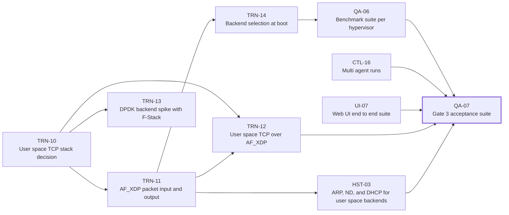

<!-- Generated by tools/plan/plan.py render from plan/work-packages.yaml. Do not edit by hand. -->

# Phase 3 work packages (Scale)

Gate 3 (v1 release). One 16 vCPU agent meets the tier T1 targets on KVM, multi agent runs aggregate correctly, every image format boots, and the web UI passes its end to end suite.

This page lists 10 work packages. Packages marked critical path gate the phase.
Read [Swarm Protocol](Swarm-Protocol.md) before claiming one.

## Dependency graph

## Summary

| ID | Title | Size | Depends on | Critical |
|---|---|---|---|---|
| [TRN-10](#trn-10-user-space-tcp-stack-decision) | User space TCP stack decision | M | TRN-01 |  |
| [TRN-11](#trn-11-af_xdp-packet-input-and-output) | AF_XDP packet input and output | M | TRN-10 |  |
| [TRN-12](#trn-12-user-space-tcp-over-af_xdp) | User space TCP over AF_XDP | L | TRN-10, TRN-11 |  |
| [HST-03](#hst-03-arp-nd-and-dhcp-for-user-space-backends) | ARP, ND, and DHCP for user space backends | M | TRN-11 |  |
| [TRN-13](#trn-13-dpdk-backend-spike-with-f-stack) | DPDK backend spike with F-Stack | M | TRN-10 |  |
| [TRN-14](#trn-14-backend-selection-at-boot) | Backend selection at boot | S | TRN-11, AGT-03 |  |
| [CTL-16](#ctl-16-multi-agent-runs) | Multi agent runs | M | CTL-07, CTL-08, CTL-12 |  |
| [UI-07](#ui-07-web-ui-end-to-end-suite) | Web UI end to end suite | M | UI-03, UI-04, UI-05, UI-06, CTL-08 |  |
| [QA-06](#qa-06-benchmark-suite-per-hypervisor) | Benchmark suite per hypervisor | M | TRN-14, QA-03 |  |
| [QA-07](#qa-07-gate-3-acceptance-suite) | Gate 3 acceptance suite | M | QA-06, CTL-16, UI-07, IMG-03, TRN-12, HST-03 | yes |

## QA Test infrastructure and gate suites

### QA-06 Benchmark suite per hypervisor

Phase 3 · size M · workstream QA

- **Depends on.** TRN-14, QA-03
- **Paths.** `bench/`

Run the standard benchmark set on each supported hypervisor and publish the results.

Deliverables.

- Benchmark definitions for throughput, session rate, concurrency, and TLS.

Acceptance.

- [ ] Results for KVM are published with host details and compared with tier T1 targets.

### QA-07 Gate 3 acceptance suite

Phase 3 · size M · workstream QA · critical path

- **Depends on.** QA-06, CTL-16, UI-07, IMG-03, TRN-12, HST-03
- **Paths.** `tests/gates/gate3/`

Automate the v1 release criteria.

Deliverables.

- A gate script and report for tier T1, multi agent runs, image formats, and the UI suite.

Acceptance.

- [ ] The suite passes on the reference KVM host and records every measured value.

## TRN Transport backends

### TRN-10 User space TCP stack decision

Phase 3 · size M · workstream TRN

- **Depends on.** TRN-01
- **Paths.** `docs/decisions/`, `engine/fps-tcp/`
- **Owner action.** The owner accepts or rejects decision record 0012.

Compare smoltcp, an own TCP stack, and F-Stack for the AF_XDP and DPDK backends and propose decision record 0012 with measurements.

Deliverables.

- A prototype benchmark for each candidate behind SessionIo and a license review.

Acceptance.

- [ ] The decision record reports sessions per second and throughput for each candidate on the same host.

### TRN-11 AF_XDP packet input and output

Phase 3 · size M · workstream TRN

- **Depends on.** TRN-10
- **Paths.** `engine/fps-backend-afxdp/`

Implement UMEM, fill, completion, receive, and transmit rings with batching per queue, using the S3 results to choose defaults.

Deliverables.

- Zero copy mode with fallback to copy mode, and per queue workers.

Acceptance.

- [ ] A two VM test on KVM reaches the packet rate that S3 measured within 10%.

### TRN-12 User space TCP over AF_XDP

Phase 3 · size L · workstream TRN

- **Depends on.** TRN-10, TRN-11
- **Paths.** `engine/fps-tcp/`, `engine/fps-backend-afxdp/`
- **Epic.** Split this package into S or M packages before anyone claims it.

Run the chosen TCP stack over AF_XDP and expose SessionIo. Split this epic after decision record 0012 is accepted.

Deliverables.

- Child packages for connection setup, data transfer, timers and retransmission, and OS profile options.

Acceptance.

- [ ] The http1 module passes realism CI on the AF_XDP backend.

### TRN-13 DPDK backend spike with F-Stack

Phase 3 · size M · workstream TRN

- **Depends on.** TRN-10
- **Paths.** `engine/fps-backend-dpdk/`

Measure F-Stack behind SessionIo on SR-IOV or bare metal, as the Gate 0 update of decision D1 requires.

Deliverables.

- A spike report with session rate, throughput, and integration cost.

Acceptance.

- [ ] The owner records whether tier T2 proceeds with F-Stack.

### TRN-14 Backend selection at boot

Phase 3 · size S · workstream TRN

- **Depends on.** TRN-11, AGT-03
- **Paths.** `engine/fps-backend-kernel/`, `engine/fps-backend-afxdp/`

Select the fastest working backend from detected capabilities and report the choice.

Deliverables.

- A selection function with a forced override.

Acceptance.

- [ ] Tests cover a virtio-net guest with and without zero copy support.

## HST Host emulation

### HST-03 ARP, ND, and DHCP for user space backends

Phase 3 · size M · workstream HST

- **Depends on.** TRN-11
- **Paths.** `engine/fps-hosts/`

Answer ARP and neighbor discovery for host pools, obtain addresses through DHCP when configured, and assign MAC addresses per host.

Deliverables.

- Responders and a MAC allocator that avoids conflicts.

Acceptance.

- [ ] The host identity check passes for 20,000 hosts on one port.

## CTL Controller

### CTL-16 Multi agent runs

Phase 3 · size M · workstream CTL

- **Depends on.** CTL-07, CTL-08, CTL-12
- **Paths.** `controller/`

Split plans across several agents, check clock synchronization, and aggregate results.

Deliverables.

- Plan splitting across agents and a clock offset check before start.

Acceptance.

- [ ] A run with three fake agents aggregates counters exactly and refuses to start with an offset above 10 ms.

## UI Web UI

### UI-07 Web UI end to end suite

Phase 3 · size M · workstream UI

- **Depends on.** UI-03, UI-04, UI-05, UI-06, CTL-08
- **Paths.** `ui/`

Exercise the UI against a real controller with fake agents in a browser.

Deliverables.

- Browser tests for configuration, run, and report flows.

Acceptance.

- [ ] The suite passes in CI on Chromium.
