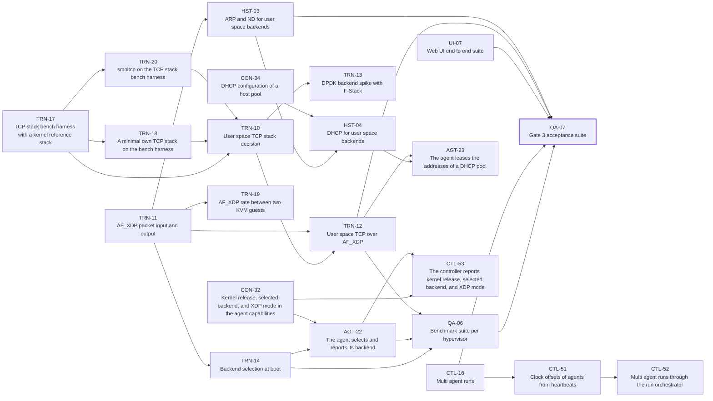

<!-- Generated by tools/plan/plan.py render from plan/work-packages.yaml. Do not edit by hand. -->

# Phase 3 work packages (Scale)

Gate 3 (v1 release). One 16 vCPU agent meets the tier T1 targets on KVM, multi agent runs aggregate correctly, every image format boots, and the web UI passes its end to end suite.

This page lists 22 work packages. Packages marked critical path gate the phase.
Read [Swarm Protocol](Swarm-Protocol.md) before claiming one.

## Dependency graph

## Summary

| ID | Title | Size | Depends on | Critical |
|---|---|---|---|---|
| [TRN-10](#trn-10-user-space-tcp-stack-decision) | User space TCP stack decision | S | TRN-01, TRN-17, TRN-18, TRN-20 |  |
| [TRN-11](#trn-11-af_xdp-packet-input-and-output) | AF_XDP packet input and output | M | TRN-01 |  |
| [TRN-12](#trn-12-user-space-tcp-over-af_xdp) | User space TCP over AF_XDP | L | TRN-10, TRN-11 |  |
| [HST-03](#hst-03-arp-and-nd-for-user-space-backends) | ARP and ND for user space backends | M | TRN-11 |  |
| [TRN-13](#trn-13-dpdk-backend-spike-with-f-stack) | DPDK backend spike with F-Stack | M | TRN-10 |  |
| [TRN-14](#trn-14-backend-selection-at-boot) | Backend selection at boot | S | TRN-11, AGT-03 |  |
| [CTL-16](#ctl-16-multi-agent-runs) | Multi agent runs | M | CTL-07, CTL-08, CTL-12 |  |
| [UI-07](#ui-07-web-ui-end-to-end-suite) | Web UI end to end suite | M | UI-03, UI-04, UI-05, UI-06, CTL-08 |  |
| [QA-06](#qa-06-benchmark-suite-per-hypervisor) | Benchmark suite per hypervisor | M | TRN-14, QA-03, AGT-22, TRN-12 |  |
| [QA-07](#qa-07-gate-3-acceptance-suite) | Gate 3 acceptance suite | M | QA-06, CTL-16, UI-07, IMG-03, TRN-12, HST-03 | yes |
| [TRN-17](#trn-17-tcp-stack-bench-harness-with-a-kernel-reference-stack) | TCP stack bench harness with a kernel reference stack | M | TRN-01 |  |
| [TRN-20](#trn-20-smoltcp-on-the-tcp-stack-bench-harness) | smoltcp on the TCP stack bench harness | S | TRN-17 |  |
| [TRN-18](#trn-18-a-minimal-own-tcp-stack-on-the-bench-harness) | A minimal own TCP stack on the bench harness | M | TRN-17 |  |
| [TRN-19](#trn-19-af_xdp-rate-between-two-kvm-guests) | AF_XDP rate between two KVM guests | S | TRN-11 |  |
| [HST-04](#hst-04-dhcp-for-user-space-backends) | DHCP for user space backends | S | HST-03, CON-34 |  |
| [AGT-22](#agt-22-the-agent-selects-and-reports-its-backend) | The agent selects and reports its backend | S | TRN-14, CON-32 |  |
| [AGT-23](#agt-23-the-agent-leases-the-addresses-of-a-dhcp-pool) | The agent leases the addresses of a DHCP pool | M | HST-04, TRN-12 |  |
| [CON-32](#con-32-kernel-release-selected-backend-and-xdp-mode-in-the-agent-capabilities) | Kernel release, selected backend, and XDP mode in the agent capabilities | S | none |  |
| [CTL-51](#ctl-51-clock-offsets-of-agents-from-heartbeats) | Clock offsets of agents from heartbeats | S | CTL-16 |  |
| [CTL-52](#ctl-52-multi-agent-runs-through-the-run-orchestrator) | Multi agent runs through the run orchestrator | M | CTL-51 |  |
| [CTL-53](#ctl-53-the-controller-reports-kernel-release-selected-backend-and-xdp-mode) | The controller reports kernel release, selected backend, and XDP mode | S | CON-32, AGT-22 |  |
| [CON-34](#con-34-dhcp-configuration-of-a-host-pool) | DHCP configuration of a host pool | S | none |  |

## CON Contracts

### CON-32 Kernel release, selected backend, and XDP mode in the agent capabilities

Phase 3 · size S · workstream CON

- **Depends on.** none
- **Paths.** `contracts/`
- **Owner action.** An additive contract change, approved by the vetting agent under decision D13 on 2026-11-16 (issue #74 in part).

Issue #74 in part. Agent protocol 0.2.4 to 0.2.5 and an OpenAPI minor version. REST Agent.backend takes the first entry of backends, which is always kernel, so the agent reports the backend it selected. NUMA fields stay open in #74, because v1 has no consumer of them.

Deliverables.

- Capabilities.kernel_release (string, 9), Capabilities.selected_backend (Backend, 10), PortInfo.xdp_driver_mode (6) with an enum XdpMode of UNSPECIFIED, GENERIC, NATIVE, and ZERO_COPY documented as a driver table hint, the REST mirror Agent.kernel_release and ports[].xdp_driver_mode, and contracts/changes/CON-32.md.

Acceptance.

- [ ] The contracts validate, the versions are bumped, and the change file names the consumers, AGT-22 first.

### CON-34 DHCP configuration of a host pool

Phase 3 · size S · workstream CON

- **Depends on.** none
- **Paths.** `contracts/`, `tools/contracts/`
- **Owner action.** An additive contract change, specified and approved by the vetting agent under decision D13 on 2026-11-17.

HST-04 obtains host addresses through DHCP when a host pool configures it, and no schema field configures DHCP today. The configuration schema gains an optional dhcp4 object on a client host pool, and the plan gains a Dhcp4 message on HostPoolSlice. The package also fixes the validator, which checks a gateway against both address families, so every dual stack pool with a gateway fails today.

Deliverables.

- test-config schema v0.3 to v0.4 with an optional dhcp4 object (additionalProperties false, no properties yet) on $defs.host_pool, allowed only on a client pool without ipv4, ipv6, and gateway; agent protocol 0.2.5 to 0.2.6 with message Dhcp4 and HostPoolSlice field 13, plan rule 5 for DHCP hosts; the example contracts/examples/tests/dhcp_clients.yaml and negative checker cases; the plan checker accepts a DHCP slice without a prefix; the validator checks a gateway against its own family; contracts/changes/CON-34.md with the consumers, HST-04 first.

Acceptance.

- [ ] The contracts validate, the new example passes, the negative cases fail with clear errors, and a dual stack pool with a gateway passes.

## QA Test infrastructure and gate suites

### QA-06 Benchmark suite per hypervisor

Phase 3 · size M · workstream QA

- **Depends on.** TRN-14, QA-03, AGT-22, TRN-12
- **Paths.** `bench/`

Run the standard benchmark set on KVM and publish the results. Other hypervisors follow v1.

Deliverables.

- Benchmark definitions for throughput, session rate, concurrency, and TLS.

Acceptance.

- [ ] Results for KVM are published with host details and compared with tier T1 targets.

### QA-07 Gate 3 acceptance suite

Phase 3 · size M · workstream QA · critical path

- **Depends on.** QA-06, CTL-16, UI-07, IMG-03, TRN-12, HST-03
- **Paths.** `tests/gates/gate3/`
- **Owner action.** The owner names the reference KVM host, which gives one guest 16 vCPUs without overcommit, and signs off Gate 3. On 2026-11-17 the owner kept the 16 vCPU tier and chose to find a larger host later, because fat-nuc has 8 vCPUs.

Automate the v1 release criteria.

Deliverables.

- A gate script and report for tier T1, multi agent runs, image formats, and the UI suite.

Acceptance.

- [ ] The suite passes on the reference KVM host and records every measured value, and its small profile on fat-nuc prints NOT A GATE RESULT.

## TRN Transport backends

### TRN-10 User space TCP stack decision

Phase 3 · size S · workstream TRN

- **Depends on.** TRN-01, TRN-17, TRN-18, TRN-20
- **Paths.** `docs/decisions/`, `engine/fps-tcp/`
- **Owner action.** The vetting agent accepts or rejects decision record 0014 under decision D13, unless the record alters decision D1 or a tier target, which only the owner decides.

Compare smoltcp, an own TCP stack, and F-Stack for the AF_XDP and DPDK backends and propose decision record 0014. TRN-17 and TRN-18 measure smoltcp and an own stack on one harness, and this package assesses F-Stack on paper, since TRN-13 measures it on SR-IOV or bare metal.

Deliverables.

- Decision record 0014 with the measurements of TRN-17 and TRN-18, the paper assessment of F-Stack, and a license review.

Acceptance.

- [ ] The decision record reports sessions per second, throughput, and socket scaling for each measured candidate on the same host.

### TRN-11 AF_XDP packet input and output

Phase 3 · size M · workstream TRN

- **Depends on.** TRN-01
- **Paths.** `engine/fps-backend-afxdp/`

Implement UMEM, fill, completion, receive, and transmit rings with batching per queue, using the S3 results to choose defaults. The rate test on KVM guests is TRN-19.

Deliverables.

- Zero copy mode with fallback to copy mode, per queue workers, and a published frame trait with batched receive and transmit per queue.

Acceptance.

- [ ] AF_XDP on a veth pair in the namespace harness passes frames both ways in CI, falls back to copy mode, and reads the bind mode from the socket.

### TRN-12 User space TCP over AF_XDP

Phase 3 · size L · workstream TRN

- **Depends on.** TRN-10, TRN-11
- **Paths.** `engine/fps-tcp/`, `engine/fps-backend-afxdp/`
- **Epic.** Split this package into S or M packages before anyone claims it.

Run the chosen TCP stack over AF_XDP and expose SessionIo. Split this epic after decision record 0014 is accepted.

Deliverables.

- Child packages for connection setup, data transfer, timers and retransmission, and OS profile options.
- A child package with paths engine/fps-agent/ and controller/internal/wiring/ that lands with the change that sets fps_backend_afxdp::TRANSPORT_AVAILABLE. It makes fps_agent::assemble start the selected backend instead of plan.backend and report the bound mode in PortInfo.xdp_driver_mode (AGT-22 finding), and makes the orchestrator inventory use the selected backend of each agent instead of its first backend (CTL-53 finding).

Acceptance.

- [ ] The http1 module passes realism CI on the AF_XDP backend.

### TRN-13 DPDK backend spike with F-Stack

Phase 3 · size M · workstream TRN

- **Depends on.** TRN-10
- **Paths.** `engine/fps-backend-dpdk/`
- **Owner action.** Parked by the owner on 2026-11-17. It needs an SR-IOV network card or a spare network card that DPDK supports, which no host has, and AF_XDP stays the fast path. The coordinator does not dispatch it.

Measure F-Stack behind SessionIo on SR-IOV or bare metal, as the Gate 0 update of decision D1 requires.

Deliverables.

- A spike report with session rate, throughput, and integration cost.

Acceptance.

- [ ] The owner records whether tier T2 proceeds with F-Stack.

### TRN-14 Backend selection at boot

Phase 3 · size S · workstream TRN

- **Depends on.** TRN-11, AGT-03
- **Paths.** `engine/fps-backend-kernel/`, `engine/fps-backend-afxdp/`

Select the fastest working backend from detected capabilities and report the choice. HostCapabilities lives in fps-agent, which depends on the backends, so the selection takes an input type of its own, and AGT-22 wires it into the agent.

Deliverables.

- A selection function over its own input type, with a forced override.

Acceptance.

- [ ] Tests cover a virtio-net guest with and without zero copy support.

### TRN-17 TCP stack bench harness with a kernel reference stack

Phase 3 · size M · workstream TRN

- **Depends on.** TRN-01
- **Paths.** `engine/fps-tcp/`

The harness that TRN-10 measures its candidates on. It drives a TCP stack behind a TcpStack seam and SessionIo and measures sessions per second, throughput, and scaling to 1,000,000 sockets. The kernel loopback stack is the reference. The smoltcp adapter is TRN-20, because smoltcp and managed are licensed 0BSD, which deny.toml does not allow yet.

Deliverables.

- The harness with the TcpStack seam and a kernel loopback reference stack, with no dependency on smoltcp, and results committed for the CI runner.

Acceptance.

- [ ] The harness reports the three measures for the kernel reference stack, cargo deny passes, and its tests run in CI.

### TRN-20 smoltcp on the TCP stack bench harness

Phase 3 · size S · workstream TRN

- **Depends on.** TRN-17
- **Paths.** `engine/fps-tcp/`

The smoltcp adapter of the TRN-17 harness. The first draft in PR #586 reached 1,000,584 sockets at 1.59 KB per socket, with an idle poll cost that grows from 15 ns to 52 ns per socket.

Deliverables.

- The smoltcp adapter behind the TcpStack seam, with results committed for the CI runner. The fat-nuc results follow through a host test once the relay account on fat-nuc has a Rust toolchain.

Acceptance.

- [ ] The harness reports the three measures for smoltcp on the same hosts as the reference stack.

### TRN-18 A minimal own TCP stack on the bench harness

Phase 3 · size M · workstream TRN

- **Depends on.** TRN-17
- **Paths.** `engine/fps-tcp/`

The second measured candidate of TRN-10: a minimal TCP stack of our own behind SessionIo, measured on the TRN-17 harness.

Deliverables.

- The stack with connection setup, data transfer, and teardown, its tests, and results on the same hosts as TRN-17.

Acceptance.

- [ ] The harness reports the three measures for the own stack on the same hosts as smoltcp.

### TRN-19 AF_XDP rate between two KVM guests

Phase 3 · size S · workstream TRN

- **Depends on.** TRN-11
- **Paths.** `engine/fps-backend-afxdp/`

The rate test that TRN-11 left out. Two guests at the S3 small size on fat-nuc, run as a host test under decision D13.

Deliverables.

- A test that boots two guests, runs AF_XDP between them, and compares the packet rate with S3.

Acceptance.

- [ ] The packet rate is within 20% of the rate that S3 measured, since S3 records 20% noise.

## HST Host emulation

### HST-03 ARP and ND for user space backends

Phase 3 · size M · workstream HST

- **Depends on.** TRN-11
- **Paths.** `engine/fps-hosts/`

Answer ARP and neighbor discovery for host pools and assign MAC addresses per host. DHCP is HST-04.

Deliverables.

- Responders and a MAC allocator that avoids conflicts.

Acceptance.

- [ ] The host identity check passes for 20,000 hosts on one port.

### HST-04 DHCP for user space backends

Phase 3 · size S · workstream HST

- **Depends on.** HST-03, CON-34
- **Paths.** `engine/fps-hosts/`

Obtain host addresses through DHCP when the host pool configures it.

Deliverables.

- A DHCP client per host for user space backends.

Acceptance.

- [ ] Hosts of a pool configured for DHCP obtain and renew addresses in the namespace harness.
- [ ] The fps-hosts API gives the agent the leased addresses of a DHCP pool, so that a later agent change can build the pool at Prepare and filter a DHCP port by those addresses instead of keeping every session.

## AGT Agent service

### AGT-22 The agent selects and reports its backend

Phase 3 · size S · workstream AGT

- **Depends on.** TRN-14, CON-32
- **Paths.** `engine/fps-agent/`

Wire the selection of TRN-14 into the agent, and fill the capabilities fields of CON-32.

Deliverables.

- The agent maps HostCapabilities to the selection input, starts the selected backend, and reports kernel_release, selected_backend, and xdp_driver_mode.

Acceptance.

- [ ] The agent contract test passes against CON-32, and a test covers a forced backend and an unsupported one.

### AGT-23 The agent leases the addresses of a DHCP pool

Phase 3 · size M · workstream AGT

- **Depends on.** HST-04, TRN-12
- **Paths.** `engine/fps-agent/`

Build a DHCP host pool at Prepare from the leases of HST-04, and filter a DHCP port by the leased addresses. The steps are in the Shared page notes of the HST-04 log entry (2026-11-17T0400).

Deliverables.

- assemble builds a DHCP pool with HostPool::dhcp, runs the DHCP clients of each worker queue at Prepare until every lease is bound or a timeout, and fails with an error that names dhcp4 on a timeout or on the kernel backend.
- Pools::addresses reads the lease table, and the capture filter of a DHCP port keeps a session only when an address of the session is leased.
- The agent rebuilds the neighbor table when the lease generation moves.

Acceptance.

- [ ] In the namespace harness, a run with a DHCP client pool on the user space backend leases every address before traffic starts, and the capture filter drops a session whose addresses are not leased.

## CTL Controller

### CTL-16 Multi agent runs

Phase 3 · size M · workstream CTL

- **Depends on.** CTL-07, CTL-08, CTL-12
- **Paths.** `controller/internal/multiagent/`

Split plans across several agents, check clock synchronization, and aggregate results.

Deliverables.

- Plan splitting across agents and a clock offset check before start.

Acceptance.

- [ ] A run with three fake agents aggregates counters exactly and refuses to start with an offset above 10 ms.

### CTL-51 Clock offsets of agents from heartbeats

Phase 3 · size S · workstream CTL

- **Depends on.** CTL-16
- **Paths.** `controller/internal/agents/`, `controller/internal/fakeagent/`, `controller/internal/multiagent/`

CTL-16 refuses a multi agent run when an agent's clock is more than 10 ms off, but the controller has no production source of the offsets: agents.Manager ignores Heartbeat.agent_time, and fakeagent always sends the current time. The contract already carries Heartbeat.agent_time and HeartbeatAck.controller_time, so no contract change is needed.

Deliverables.

- The agent manager records agent_time minus the receive time per agent and exposes it as a multiagent ClockSource, fakeagent gains a clock skew option, and a test runs the CTL-16 check over real heartbeats.

Acceptance.

- [ ] A fake agent with a skew of 15 ms makes a three agent run refuse to start through the real heartbeat path, and one with 2 ms starts.

### CTL-52 Multi agent runs through the run orchestrator

Phase 3 · size M · workstream CTL

- **Depends on.** CTL-51
- **Paths.** `controller/internal/runs/`, `controller/internal/wiring/`

No production code calls controller/internal/multiagent, and runs.Orchestrator starts a run on several agents without the clock check of CTL-16. Gate 3 needs multi agent runs through the REST API.

Deliverables.

- The orchestrator starts a run on several agents through multiagent.Coordinator with the clock source of CTL-51, and aggregates its results.

Acceptance.

- [ ] An end to end test over REST runs one configuration on three fake agents, refuses it with one agent 15 ms off, and reports exact totals.

### CTL-53 The controller reports kernel release, selected backend, and XDP mode

Phase 3 · size S · workstream CTL

- **Depends on.** CON-32, AGT-22
- **Paths.** `controller/internal/agents/`

The REST mirror of CON-32 in controller/internal/agents/rest.go, after AGT-22 fills the fields and the generated code is regenerated. Agent.backend reports the selected backend instead of the first entry of backends.

Deliverables.

- The REST agent view carries kernel_release, selected_backend, and ports[].xdp_driver_mode from the capabilities.

Acceptance.

- [ ] The agent contract test and a REST test with a fake agent that selects a non kernel backend pass.

## UI Web UI

### UI-07 Web UI end to end suite

Phase 3 · size M · workstream UI

- **Depends on.** UI-03, UI-04, UI-05, UI-06, CTL-08
- **Paths.** `ui/`

Exercise the UI against a real controller with fake agents in a browser.

Deliverables.

- Browser tests for configuration, run, and report flows.

Acceptance.

- [ ] The suite passes in CI on Chromium.
