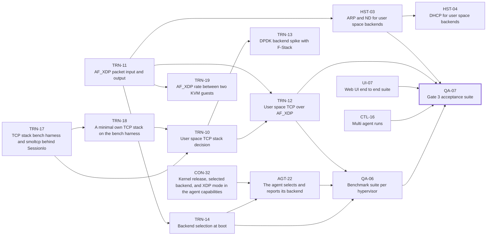

<!-- Generated by tools/plan/plan.py render from plan/work-packages.yaml. Do not edit by hand. -->

# Phase 3 work packages (Scale)

Gate 3 (v1 release). One 16 vCPU agent meets the tier T1 targets on KVM, multi agent runs aggregate correctly, every image format boots, and the web UI passes its end to end suite.

This page lists 16 work packages. Packages marked critical path gate the phase.
Read [Swarm Protocol](Swarm-Protocol.md) before claiming one.

## Dependency graph

## Summary

| ID | Title | Size | Depends on | Critical |
|---|---|---|---|---|
| [TRN-10](#trn-10-user-space-tcp-stack-decision) | User space TCP stack decision | S | TRN-01, TRN-17, TRN-18 |  |
| [TRN-11](#trn-11-af_xdp-packet-input-and-output) | AF_XDP packet input and output | M | TRN-01 |  |
| [TRN-12](#trn-12-user-space-tcp-over-af_xdp) | User space TCP over AF_XDP | L | TRN-10, TRN-11 |  |
| [HST-03](#hst-03-arp-and-nd-for-user-space-backends) | ARP and ND for user space backends | M | TRN-11 |  |
| [TRN-13](#trn-13-dpdk-backend-spike-with-f-stack) | DPDK backend spike with F-Stack | M | TRN-10 |  |
| [TRN-14](#trn-14-backend-selection-at-boot) | Backend selection at boot | S | TRN-11, AGT-03 |  |
| [CTL-16](#ctl-16-multi-agent-runs) | Multi agent runs | M | CTL-07, CTL-08, CTL-12 |  |
| [UI-07](#ui-07-web-ui-end-to-end-suite) | Web UI end to end suite | M | UI-03, UI-04, UI-05, UI-06, CTL-08 |  |
| [QA-06](#qa-06-benchmark-suite-per-hypervisor) | Benchmark suite per hypervisor | M | TRN-14, QA-03, AGT-22, TRN-12 |  |
| [QA-07](#qa-07-gate-3-acceptance-suite) | Gate 3 acceptance suite | M | QA-06, CTL-16, UI-07, IMG-03, TRN-12, HST-03 | yes |
| [TRN-17](#trn-17-tcp-stack-bench-harness-and-smoltcp-behind-sessionio) | TCP stack bench harness and smoltcp behind SessionIo | M | TRN-01 |  |
| [TRN-18](#trn-18-a-minimal-own-tcp-stack-on-the-bench-harness) | A minimal own TCP stack on the bench harness | M | TRN-17 |  |
| [TRN-19](#trn-19-af_xdp-rate-between-two-kvm-guests) | AF_XDP rate between two KVM guests | S | TRN-11 |  |
| [HST-04](#hst-04-dhcp-for-user-space-backends) | DHCP for user space backends | S | HST-03 |  |
| [AGT-22](#agt-22-the-agent-selects-and-reports-its-backend) | The agent selects and reports its backend | S | TRN-14, CON-32 |  |
| [CON-32](#con-32-kernel-release-selected-backend-and-xdp-mode-in-the-agent-capabilities) | Kernel release, selected backend, and XDP mode in the agent capabilities | S | none |  |

## CON Contracts

### CON-32 Kernel release, selected backend, and XDP mode in the agent capabilities

Phase 3 · size S · workstream CON

- **Depends on.** none
- **Paths.** `contracts/`
- **Owner action.** An additive contract change, approved by the vetting agent under decision D13 on 2026-11-16 (issue

Issue #74 in part. Agent protocol 0.2.4 to 0.2.5 and an OpenAPI minor version. REST Agent.backend takes the first entry of backends, which is always kernel, so the agent reports the backend it selected. NUMA fields stay open in #74, because v1 has no consumer of them.

Deliverables.

- Capabilities.kernel_release (string, 9), Capabilities.selected_backend (Backend, 10), PortInfo.xdp_driver_mode (6) with an enum XdpMode of UNSPECIFIED, GENERIC, NATIVE, and ZERO_COPY documented as a driver table hint, the REST mirror Agent.kernel_release and ports[].xdp_driver_mode, and contracts/changes/CON-32.md.

Acceptance.

- [ ] The contracts validate, the versions are bumped, and the change file names the consumers, AGT-22 first.

## QA Test infrastructure and gate suites

### QA-06 Benchmark suite per hypervisor

Phase 3 · size M · workstream QA

- **Depends on.** TRN-14, QA-03, AGT-22, TRN-12
- **Paths.** `bench/`

Run the standard benchmark set on KVM and publish the results. Other hypervisors follow v1.

Deliverables.

- Benchmark definitions for throughput, session rate, concurrency, and TLS.

Acceptance.

- [ ] Results for KVM are published with host details and compared with tier T1 targets.

### QA-07 Gate 3 acceptance suite

Phase 3 · size M · workstream QA · critical path

- **Depends on.** QA-06, CTL-16, UI-07, IMG-03, TRN-12, HST-03
- **Paths.** `tests/gates/gate3/`
- **Owner action.** The owner names the reference KVM host, which gives one guest 16 vCPUs without overcommit, and signs off Gate 3.

Automate the v1 release criteria.

Deliverables.

- A gate script and report for tier T1, multi agent runs, image formats, and the UI suite.

Acceptance.

- [ ] The suite passes on the reference KVM host and records every measured value, and its small profile on fat-nuc prints NOT A GATE RESULT.

## TRN Transport backends

### TRN-10 User space TCP stack decision

Phase 3 · size S · workstream TRN

- **Depends on.** TRN-01, TRN-17, TRN-18
- **Paths.** `docs/decisions/`, `engine/fps-tcp/`
- **Owner action.** The vetting agent accepts or rejects decision record 0014 under decision D13, unless the record alters decision D1 or a tier target, which only the owner decides.

Compare smoltcp, an own TCP stack, and F-Stack for the AF_XDP and DPDK backends and propose decision record 0014. TRN-17 and TRN-18 measure smoltcp and an own stack on one harness, and this package assesses F-Stack on paper, since TRN-13 measures it on SR-IOV or bare metal.

Deliverables.

- Decision record 0014 with the measurements of TRN-17 and TRN-18, the paper assessment of F-Stack, and a license review.

Acceptance.

- [ ] The decision record reports sessions per second, throughput, and socket scaling for each measured candidate on the same host.

### TRN-11 AF_XDP packet input and output

Phase 3 · size M · workstream TRN

- **Depends on.** TRN-01
- **Paths.** `engine/fps-backend-afxdp/`

Implement UMEM, fill, completion, receive, and transmit rings with batching per queue, using the S3 results to choose defaults. The rate test on KVM guests is TRN-19.

Deliverables.

- Zero copy mode with fallback to copy mode, per queue workers, and a published frame trait with batched receive and transmit per queue.

Acceptance.

- [ ] AF_XDP on a veth pair in the namespace harness passes frames both ways in CI, falls back to copy mode, and reads the bind mode from the socket.

### TRN-12 User space TCP over AF_XDP

Phase 3 · size L · workstream TRN

- **Depends on.** TRN-10, TRN-11
- **Paths.** `engine/fps-tcp/`, `engine/fps-backend-afxdp/`
- **Epic.** Split this package into S or M packages before anyone claims it.

Run the chosen TCP stack over AF_XDP and expose SessionIo. Split this epic after decision record 0014 is accepted.

Deliverables.

- Child packages for connection setup, data transfer, timers and retransmission, and OS profile options.

Acceptance.

- [ ] The http1 module passes realism CI on the AF_XDP backend.

### TRN-13 DPDK backend spike with F-Stack

Phase 3 · size M · workstream TRN

- **Depends on.** TRN-10
- **Paths.** `engine/fps-backend-dpdk/`
- **Owner action.** The owner provides an SR-IOV or bare metal host. The coordinator does not dispatch this package before then.

Measure F-Stack behind SessionIo on SR-IOV or bare metal, as the Gate 0 update of decision D1 requires.

Deliverables.

- A spike report with session rate, throughput, and integration cost.

Acceptance.

- [ ] The owner records whether tier T2 proceeds with F-Stack.

### TRN-14 Backend selection at boot

Phase 3 · size S · workstream TRN

- **Depends on.** TRN-11, AGT-03
- **Paths.** `engine/fps-backend-kernel/`, `engine/fps-backend-afxdp/`

Select the fastest working backend from detected capabilities and report the choice. HostCapabilities lives in fps-agent, which depends on the backends, so the selection takes an input type of its own, and AGT-22 wires it into the agent.

Deliverables.

- A selection function over its own input type, with a forced override.

Acceptance.

- [ ] Tests cover a virtio-net guest with and without zero copy support.

### TRN-17 TCP stack bench harness and smoltcp behind SessionIo

Phase 3 · size M · workstream TRN

- **Depends on.** TRN-01
- **Paths.** `engine/fps-tcp/`

The first measured candidate of TRN-10. A harness that drives a TCP stack behind SessionIo and measures sessions per second, throughput, and scaling to 1,000,000 sockets, with smoltcp as the first stack.

Deliverables.

- The harness and a smoltcp adapter behind SessionIo, with results committed for the CI runner and for fat-nuc through a host test.

Acceptance.

- [ ] The harness reports the three measures for smoltcp, and its tests run in CI.

### TRN-18 A minimal own TCP stack on the bench harness

Phase 3 · size M · workstream TRN

- **Depends on.** TRN-17
- **Paths.** `engine/fps-tcp/`

The second measured candidate of TRN-10: a minimal TCP stack of our own behind SessionIo, measured on the TRN-17 harness.

Deliverables.

- The stack with connection setup, data transfer, and teardown, its tests, and results on the same hosts as TRN-17.

Acceptance.

- [ ] The harness reports the three measures for the own stack on the same hosts as smoltcp.

### TRN-19 AF_XDP rate between two KVM guests

Phase 3 · size S · workstream TRN

- **Depends on.** TRN-11
- **Paths.** `engine/fps-backend-afxdp/`

The rate test that TRN-11 left out. Two guests at the S3 small size on fat-nuc, run as a host test under decision D13.

Deliverables.

- A test that boots two guests, runs AF_XDP between them, and compares the packet rate with S3.

Acceptance.

- [ ] The packet rate is within 20% of the rate that S3 measured, since S3 records 20% noise.

## HST Host emulation

### HST-03 ARP and ND for user space backends

Phase 3 · size M · workstream HST

- **Depends on.** TRN-11
- **Paths.** `engine/fps-hosts/`

Answer ARP and neighbor discovery for host pools and assign MAC addresses per host. DHCP is HST-04.

Deliverables.

- Responders and a MAC allocator that avoids conflicts.

Acceptance.

- [ ] The host identity check passes for 20,000 hosts on one port.

### HST-04 DHCP for user space backends

Phase 3 · size S · workstream HST

- **Depends on.** HST-03
- **Paths.** `engine/fps-hosts/`
- **Owner action.** Waits for a contract package that adds DHCP configuration to the host pool schema, which no schema field configures today. The coordinator does not dispatch it before then.

Obtain host addresses through DHCP when the host pool configures it.

Deliverables.

- A DHCP client per host for user space backends.

Acceptance.

- [ ] Hosts of a pool configured for DHCP obtain and renew addresses in the namespace harness.

## AGT Agent service

### AGT-22 The agent selects and reports its backend

Phase 3 · size S · workstream AGT

- **Depends on.** TRN-14, CON-32
- **Paths.** `engine/fps-agent/`

Wire the selection of TRN-14 into the agent, and fill the capabilities fields of CON-32.

Deliverables.

- The agent maps HostCapabilities to the selection input, starts the selected backend, and reports kernel_release, selected_backend, and xdp_driver_mode.

Acceptance.

- [ ] The agent contract test passes against CON-32, and a test covers a forced backend and an unsupported one.

## CTL Controller

### CTL-16 Multi agent runs

Phase 3 · size M · workstream CTL

- **Depends on.** CTL-07, CTL-08, CTL-12
- **Paths.** `controller/internal/multiagent/`

Split plans across several agents, check clock synchronization, and aggregate results.

Deliverables.

- Plan splitting across agents and a clock offset check before start.

Acceptance.

- [ ] A run with three fake agents aggregates counters exactly and refuses to start with an offset above 10 ms.

## UI Web UI

### UI-07 Web UI end to end suite

Phase 3 · size M · workstream UI

- **Depends on.** UI-03, UI-04, UI-05, UI-06, CTL-08
- **Paths.** `ui/`

Exercise the UI against a real controller with fake agents in a browser.

Deliverables.

- Browser tests for configuration, run, and report flows.

Acceptance.

- [ ] The suite passes in CI on Chromium.
