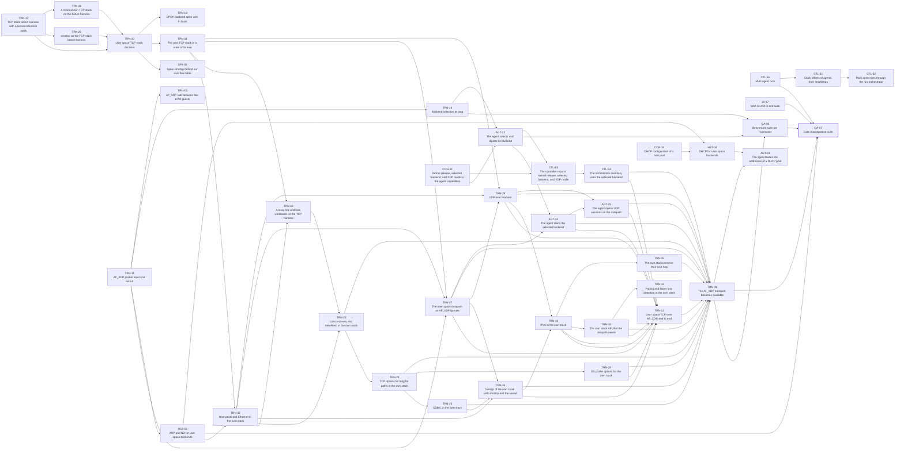

<!-- Generated by tools/plan/plan.py render from plan/work-packages.yaml. Do not edit by hand. -->

# Phase 3 work packages (Scale)

Gate 3 (v1 release). One 16 vCPU agent meets the tier T1 targets on KVM, multi agent runs aggregate correctly, every image format boots, and the web UI passes its end to end suite.

This page lists 41 work packages. Packages marked critical path gate the phase.
Read [Swarm Protocol](Swarm-Protocol.md) before claiming one.

## Dependency graph

## Summary

| ID | Title | Size | Depends on | Critical |
|---|---|---|---|---|
| [SPK-05](#spk-05-spike-smoltcp-behind-our-own-flow-table) | Spike smoltcp behind our own flow table | S | TRN-10 |  |
| [TRN-10](#trn-10-user-space-tcp-stack-decision) | User space TCP stack decision | S | TRN-01, TRN-17, TRN-18, TRN-20 |  |
| [TRN-11](#trn-11-af_xdp-packet-input-and-output) | AF_XDP packet input and output | M | TRN-01 |  |
| [TRN-12](#trn-12-user-space-tcp-over-af_xdp-end-to-end) | User space TCP over AF_XDP, end to end | M | TRN-26, TRN-27, TRN-28, TRN-29, TRN-30, TRN-33, AGT-24, AGT-25, CTL-54 |  |
| [TRN-21](#trn-21-the-own-tcp-stack-in-a-crate-of-its-own) | The own TCP stack in a crate of its own | S | TRN-10 |  |
| [TRN-32](#trn-32-host-pools-and-ethernet-in-the-own-stack) | Host pools and Ethernet in the own stack | M | TRN-21, HST-03 |  |
| [TRN-22](#trn-22-a-lossy-link-and-loss-workloads-for-the-tcp-harness) | A lossy link and loss workloads for the TCP harness | M | TRN-21, TRN-32 |  |
| [TRN-23](#trn-23-loss-recovery-and-newreno-in-the-own-stack) | Loss recovery and NewReno in the own stack | M | TRN-22, TRN-32 |  |
| [TRN-24](#trn-24-tcp-options-for-long-fat-paths-in-the-own-stack) | TCP options for long fat paths in the own stack | M | TRN-23 |  |
| [TRN-25](#trn-25-cubic-in-the-own-stack) | CUBIC in the own stack | M | TRN-24 |  |
| [TRN-26](#trn-26-interop-of-the-own-stack-with-smoltcp-and-the-kernel) | Interop of the own stack with smoltcp and the kernel | M | TRN-25, TRN-27, TRN-32 |  |
| [TRN-27](#trn-27-the-user-space-datapath-on-af_xdp-queues) | The user space datapath on AF_XDP queues | M | TRN-21, TRN-32, TRN-11 |  |
| [TRN-28](#trn-28-os-profile-options-for-the-own-stack) | OS profile options for the own stack | S | TRN-24 |  |
| [TRN-29](#trn-29-udp-over-frameio) | UDP over FrameIo | M | TRN-21, TRN-32, TRN-27 |  |
| [TRN-30](#trn-30-ipv6-in-the-own-stack) | IPv6 in the own stack | M | TRN-26, TRN-29 |  |
| [TRN-31](#trn-31-the-af_xdp-transport-becomes-available) | The AF_XDP transport becomes available | S | TRN-12, TRN-23, TRN-24, TRN-25, TRN-26, TRN-27, TRN-28, TRN-29, TRN-30, TRN-33, TRN-35, AGT-24, AGT-25, CTL-54 |  |
| [TRN-33](#trn-33-the-own-stack-api-that-the-datapath-needs) | The own stack API that the datapath needs | S | TRN-30 |  |
| [TRN-34](#trn-34-pacing-and-faster-loss-detection-in-the-own-stack) | Pacing and faster loss detection in the own stack | M | TRN-33 |  |
| [TRN-35](#trn-35-the-own-stacks-resolve-their-next-hop) | The own stacks resolve their next hop | S | TRN-30 |  |
| [AGT-25](#agt-25-the-agent-opens-udp-sessions-on-the-datapath) | The agent opens UDP sessions on the datapath | S | AGT-24, TRN-29 |  |
| [AGT-24](#agt-24-the-agent-starts-the-selected-backend) | The agent starts the selected backend | S | AGT-22, TRN-27 |  |
| [CTL-54](#ctl-54-the-orchestrator-inventory-uses-the-selected-backend) | The orchestrator inventory uses the selected backend | S | CTL-53 |  |
| [HST-03](#hst-03-arp-and-nd-for-user-space-backends) | ARP and ND for user space backends | M | TRN-11 |  |
| [TRN-13](#trn-13-dpdk-backend-spike-with-f-stack) | DPDK backend spike with F-Stack | M | TRN-10 |  |
| [TRN-14](#trn-14-backend-selection-at-boot) | Backend selection at boot | S | TRN-11, AGT-03 |  |
| [CTL-16](#ctl-16-multi-agent-runs) | Multi agent runs | M | CTL-07, CTL-08, CTL-12 |  |
| [UI-07](#ui-07-web-ui-end-to-end-suite) | Web UI end to end suite | M | UI-03, UI-04, UI-05, UI-06, CTL-08 |  |
| [QA-06](#qa-06-benchmark-suite-per-hypervisor) | Benchmark suite per hypervisor | M | TRN-14, QA-03, AGT-22, TRN-31 |  |
| [QA-07](#qa-07-gate-3-acceptance-suite) | Gate 3 acceptance suite | M | QA-06, CTL-16, UI-07, IMG-03, TRN-31, HST-03 | yes |
| [TRN-17](#trn-17-tcp-stack-bench-harness-with-a-kernel-reference-stack) | TCP stack bench harness with a kernel reference stack | M | TRN-01 |  |
| [TRN-20](#trn-20-smoltcp-on-the-tcp-stack-bench-harness) | smoltcp on the TCP stack bench harness | S | TRN-17 |  |
| [TRN-18](#trn-18-a-minimal-own-tcp-stack-on-the-bench-harness) | A minimal own TCP stack on the bench harness | M | TRN-17 |  |
| [TRN-19](#trn-19-af_xdp-rate-between-two-kvm-guests) | AF_XDP rate between two KVM guests | S | TRN-11 |  |
| [HST-04](#hst-04-dhcp-for-user-space-backends) | DHCP for user space backends | S | HST-03, CON-34 |  |
| [AGT-22](#agt-22-the-agent-selects-and-reports-its-backend) | The agent selects and reports its backend | S | TRN-14, CON-32 |  |
| [AGT-23](#agt-23-the-agent-leases-the-addresses-of-a-dhcp-pool) | The agent leases the addresses of a DHCP pool | M | HST-04, TRN-31 |  |
| [CON-32](#con-32-kernel-release-selected-backend-and-xdp-mode-in-the-agent-capabilities) | Kernel release, selected backend, and XDP mode in the agent capabilities | S | none |  |
| [CTL-51](#ctl-51-clock-offsets-of-agents-from-heartbeats) | Clock offsets of agents from heartbeats | S | CTL-16 |  |
| [CTL-52](#ctl-52-multi-agent-runs-through-the-run-orchestrator) | Multi agent runs through the run orchestrator | M | CTL-51 |  |
| [CTL-53](#ctl-53-the-controller-reports-kernel-release-selected-backend-and-xdp-mode) | The controller reports kernel release, selected backend, and XDP mode | S | CON-32, AGT-22 |  |
| [CON-34](#con-34-dhcp-configuration-of-a-host-pool) | DHCP configuration of a host pool | S | none |  |

## SPK Phase 0 spikes

### SPK-05 Spike smoltcp behind our own flow table

Phase 3 · size S · workstream SPK

- **Depends on.** TRN-10
- **Paths.** `spikes/s5-smoltcp-flow-table/`

The fallback of decision record 0014 is unverified. This one day spike checks early whether a smoltcp socket can run outside its interface loop, behind a flow table and a timer wheel of our own, so the fallback is known to work before it is needed.

Deliverables.

- spikes/s5-smoltcp-flow-table with a prototype and RESULTS.md.

Acceptance.

- [ ] RESULTS.md states whether a smoltcp socket processes frames outside its interface loop, and the cost per event at 16,000 sockets.

## CON Contracts

### CON-32 Kernel release, selected backend, and XDP mode in the agent capabilities

Phase 3 · size S · workstream CON

- **Depends on.** none
- **Paths.** `contracts/`
- **Owner action.** An additive contract change, approved by the vetting agent under decision D13 on 2026-11-16 (issue #74 in part).

Issue #74 in part. Agent protocol 0.2.4 to 0.2.5 and an OpenAPI minor version. REST Agent.backend takes the first entry of backends, which is always kernel, so the agent reports the backend it selected. NUMA fields stay open in #74, because v1 has no consumer of them.

Deliverables.

- Capabilities.kernel_release (string, 9), Capabilities.selected_backend (Backend, 10), PortInfo.xdp_driver_mode (6) with an enum XdpMode of UNSPECIFIED, GENERIC, NATIVE, and ZERO_COPY documented as a driver table hint, the REST mirror Agent.kernel_release and ports[].xdp_driver_mode, and contracts/changes/CON-32.md.

Acceptance.

- [ ] The contracts validate, the versions are bumped, and the change file names the consumers, AGT-22 first.

### CON-34 DHCP configuration of a host pool

Phase 3 · size S · workstream CON

- **Depends on.** none
- **Paths.** `contracts/`, `tools/contracts/`
- **Owner action.** An additive contract change, specified and approved by the vetting agent under decision D13 on 2026-11-17.

HST-04 obtains host addresses through DHCP when a host pool configures it, and no schema field configures DHCP today. The configuration schema gains an optional dhcp4 object on a client host pool, and the plan gains a Dhcp4 message on HostPoolSlice. The package also fixes the validator, which checks a gateway against both address families, so every dual stack pool with a gateway fails today.

Deliverables.

- test-config schema v0.3 to v0.4 with an optional dhcp4 object (additionalProperties false, no properties yet) on $defs.host_pool, allowed only on a client pool without ipv4, ipv6, and gateway; agent protocol 0.2.5 to 0.2.6 with message Dhcp4 and HostPoolSlice field 13, plan rule 5 for DHCP hosts; the example contracts/examples/tests/dhcp_clients.yaml and negative checker cases; the plan checker accepts a DHCP slice without a prefix; the validator checks a gateway against its own family; contracts/changes/CON-34.md with the consumers, HST-04 first.

Acceptance.

- [ ] The contracts validate, the new example passes, the negative cases fail with clear errors, and a dual stack pool with a gateway passes.

## QA Test infrastructure and gate suites

### QA-06 Benchmark suite per hypervisor

Phase 3 · size M · workstream QA

- **Depends on.** TRN-14, QA-03, AGT-22, TRN-31
- **Paths.** `bench/`

Run the standard benchmark set on KVM and publish the results. Other hypervisors follow v1.

Deliverables.

- Benchmark definitions for throughput, session rate, concurrency, and TLS.

Acceptance.

- [ ] Results for KVM are published with host details and compared with tier T1 targets.

### QA-07 Gate 3 acceptance suite

Phase 3 · size M · workstream QA · critical path

- **Depends on.** QA-06, CTL-16, UI-07, IMG-03, TRN-31, HST-03
- **Paths.** `tests/gates/gate3/`
- **Owner action.** The owner names the reference KVM host, which gives one guest 16 vCPUs without overcommit, and signs off Gate 3. On 2026-11-17 the owner kept the 16 vCPU tier and chose to find a larger host later, because fat-nuc has 8 vCPUs.

Automate the v1 release criteria.

Deliverables.

- A gate script and report for tier T1, multi agent runs, image formats, and the UI suite.

Acceptance.

- [ ] The suite passes on the reference KVM host and records every measured value, and its small profile on fat-nuc prints NOT A GATE RESULT.

## TRN Transport backends

### TRN-10 User space TCP stack decision

Phase 3 · size S · workstream TRN

- **Depends on.** TRN-01, TRN-17, TRN-18, TRN-20
- **Paths.** `docs/decisions/`, `engine/fps-tcp/`
- **Owner action.** The vetting agent accepts or rejects decision record 0014 under decision D13, unless the record alters decision D1 or a tier target, which only the owner decides.

Compare smoltcp, an own TCP stack, and F-Stack for the AF_XDP and DPDK backends and propose decision record 0014. TRN-17 and TRN-18 measure smoltcp and an own stack on one harness, and this package assesses F-Stack on paper, since TRN-13 measures it on SR-IOV or bare metal.

Deliverables.

- Decision record 0014 with the measurements of TRN-17 and TRN-18, the paper assessment of F-Stack, and a license review.

Acceptance.

- [ ] The decision record reports sessions per second, throughput, and socket scaling for each measured candidate on the same host.

### TRN-11 AF_XDP packet input and output

Phase 3 · size M · workstream TRN

- **Depends on.** TRN-01
- **Paths.** `engine/fps-backend-afxdp/`

Implement UMEM, fill, completion, receive, and transmit rings with batching per queue, using the S3 results to choose defaults. The rate test on KVM guests is TRN-19.

Deliverables.

- Zero copy mode with fallback to copy mode, per queue workers, and a published frame trait with batched receive and transmit per queue.

Acceptance.

- [ ] AF_XDP on a veth pair in the namespace harness passes frames both ways in CI, falls back to copy mode, and reads the bind mode from the socket.

### TRN-12 User space TCP over AF_XDP, end to end

Phase 3 · size M · workstream TRN

- **Depends on.** TRN-26, TRN-27, TRN-28, TRN-29, TRN-30, TRN-33, AGT-24, AGT-25, CTL-54
- **Paths.** `engine/fps-backend-afxdp/`, `engine/fps-datapath/`

The closing package of the AF_XDP TCP path that decision record 0014 split into TRN-21 to TRN-31 and SPK-05. It runs the http1 module through the agent on the AF_XDP backend with the own stack and fixes what the end to end run finds.

Deliverables.

- The http1 run on the AF_XDP backend over a veth pair, and the fixes it needs within its paths. The coordinator adds the realism CI job.

Acceptance.

- [ ] The http1 module passes realism CI on the AF_XDP backend.

### TRN-21 The own TCP stack in a crate of its own

Phase 3 · size S · workstream TRN

- **Depends on.** TRN-10
- **Paths.** `engine/fps-tcp/`, `engine/fps-tcp-own/`

Move the own stack of TRN-18 out of fps-tcp into engine/fps-tcp-own, a crate with no smoltcp dependency, so an agent that uses the own stack does not link smoltcp (decision record 0014, item 2) and the stack and the bench harness get separate paths. fps-tcp keeps the harness and the smoltcp adapter and depends on the new crate.

Deliverables.

- engine/fps-tcp-own with the own stack and its tests, and fps-tcp using it through the TcpStack seam.

Acceptance.

- [ ] cargo tree -p fps-tcp-own shows no smoltcp, and the tests and the tcp_bench results of the own stack are unchanged within noise.

### TRN-32 Host pools and Ethernet in the own stack

Phase 3 · size M · workstream TRN

- **Depends on.** TRN-21, HST-03
- **Paths.** `engine/fps-tcp-own/`, `engine/fps-tcp/`

The own stack is two fixed hosts with one peer, a table keyed by the two ports, and bare IPv4 frames. Give it a table keyed by the 4-tuple, Ethernet and VLAN framing with mac_base + i, and neighbors from HST-03, so it serves the host pools of a test configuration.

Deliverables.

- The 4-tuple table, Ethernet and VLAN framing, and neighbor lookup, with tests.

Acceptance.

- [ ] The 1,000,000 socket row of tcp_bench still gives at least 50,000 probe sessions per second with a pool of 20,000 addresses.

### TRN-22 A lossy link and loss workloads for the TCP harness

Phase 3 · size M · workstream TRN

- **Depends on.** TRN-21, TRN-32
- **Paths.** `engine/fps-tcp/`

Add loss, delay, and reordering to the in memory link of the harness, a netem counterpart for the kernel reference stack in a network namespace, and a loss workload in tcp_bench, so every later child measures against the kernel over the same link. If sch_netem is missing on the hosted runner, report it in the Shared page notes and do not install packages outside tools/ci/apt-install.sh. The link also has a rate limit with a bounded queue, and the kernel side a matching rate, because TRN-24 and TRN-25 measure against a bottleneck.

Deliverables.

- The lossy link, the netem setup for the kernel stack, and a loss workload with goodput, retransmissions, and completion per transfer.

Acceptance.

- [ ] tcp_bench reports goodput and completion for the kernel stack at 0, 0.1, and 1 percent loss with 20 ms of delay, and for the own and smoltcp stacks over the in memory link with the same settings.

### TRN-23 Loss recovery and NewReno in the own stack

Phase 3 · size M · workstream TRN

- **Depends on.** TRN-22, TRN-32
- **Paths.** `engine/fps-tcp-own/`, `engine/fps-tcp/`

An RTT estimator with RFC 6298 retransmission timeouts, fast retransmit on three duplicate acknowledgments, an out of order queue, and NewReno (slow start, congestion avoidance, and fast recovery), because fast retransmit and later SACK recovery are defined on the congestion window.

Deliverables.

- The four mechanisms with unit tests and loss workload results committed.

Acceptance.

- [ ] At 1 percent loss and 20 ms of delay every transfer completes, and the goodput of the own stack is at least 50 percent of the kernel stack on the same link settings.

### TRN-24 TCP options for long fat paths in the own stack

Phase 3 · size M · workstream TRN

- **Depends on.** TRN-23
- **Paths.** `engine/fps-tcp-own/`, `engine/fps-tcp/`

Window scaling, timestamps, selective acknowledgment, and delayed acknowledgment in the own stack. It edits the same state machine as TRN-23 and TRN-25, so these three run in sequence.

Deliverables.

- The four options with unit tests and results committed.

Acceptance.

- [ ] At 0.1 percent loss and 50 ms of delay with a bandwidth delay product above 64 KB, the goodput of the own stack is at least 80 percent of the kernel stack running Reno (tcp_bench --kernel-cc reno), so that both sides use the same congestion control. The comparison with the default kernel (CUBIC) belongs to TRN-25.

### TRN-25 CUBIC in the own stack

Phase 3 · size M · workstream TRN

- **Depends on.** TRN-24
- **Paths.** `engine/fps-tcp-own/`, `engine/fps-tcp/`

CUBIC for the own stack, next to the NewReno of TRN-23, ported from smoltcp, which 0BSD allows. The code records the smoltcp version and the source file of every ported part.

Deliverables.

- CUBIC behind a choice in the stack configuration, with tests and results committed.

Acceptance.

- [ ] Four flows that share a 1 Gbps bottleneck with 20 ms of delay reach a Jain fairness index of at least 0.9 and together at least 80 percent of the goodput of four kernel flows on the same link.
- [ ] {'A single flow on the fat path of TRN-24 (tcp_bench --loss-profile fat': '50 Mbit/s, 50 ms per direction, 0.1 percent loss) reaches at least 80 percent of the goodput of the default kernel (CUBIC) on the same link.'}

### TRN-26 Interop of the own stack with smoltcp and the kernel

Phase 3 · size M · workstream TRN

- **Depends on.** TRN-25, TRN-27, TRN-32
- **Paths.** `engine/fps-tcp/`

Conformance and interop tests in the harness: the own stack against smoltcp over the lossy link in memory, and against the kernel stack over a veth pair with netem, in both directions.

Deliverables.

- Interop tests that run in CI, and a matrix of the results in Transport.md.

Acceptance.

- [ ] Every pairing completes the loss workload at 1 percent loss in both directions, and the interop tests pass in CI.

### TRN-27 The user space datapath on AF_XDP queues

Phase 3 · size M · workstream TRN

- **Depends on.** TRN-21, TRN-32, TRN-11
- **Paths.** `engine/fps-datapath/`, `engine/fps-backend-afxdp/`

The production datapath: a crate engine/fps-datapath with the loop per queue that splits ARP, ND, DHCP, TCP, and UDP frames between fps-hosts and the user space stacks, and offers connect and listen as fps-backend-kernel does. It cannot live in fps-backend-afxdp, because fps-hosts and the stacks depend on that crate for FrameIo. It is the first real evidence for tier T1. AGT-24 makes a forced AF_XDP run work before the flip.

Deliverables.

- engine/fps-datapath with the own stack on AF_XDP queues over a veth pair in CI, and sessions per second and sockets held reported.

Acceptance.

- [ ] A test over a veth pair in CI completes sessions through the datapath on AF_XDP queues, and the results are committed for the CI runner.

### TRN-28 OS profile options for the own stack

Phase 3 · size S · workstream TRN

- **Depends on.** TRN-24
- **Paths.** `engine/fps-tcp-own/`

Map the OS profile fields of the test configuration (TTL, window, MSS, window scale, and option order) onto the SYN and SYN-ACK of the own stack, as the kernel backend does through socket options today.

Deliverables.

- The profile mapping with tests that compare the SYN of each profile with the table in Transport.md.

Acceptance.

- [ ] The SYN and SYN-ACK of the own stack match the option order and values of every OS profile in Transport.md.

### TRN-29 UDP over FrameIo

Phase 3 · size M · workstream TRN

- **Depends on.** TRN-21, TRN-32, TRN-27
- **Paths.** `engine/fps-udp-own/`, `engine/fps-datapath/`

DatagramIo over FrameIo for the AF_XDP backend, so the UDP modules (dns, ntp, sip_rtp) run on it. The own stack covers only IPv4 TCP. Leaving UDP out of v1 is a scope decision for the owner.

Deliverables.

- A user space UDP layer behind DatagramIo with tests.

Acceptance.

- [ ] The dns module completes its scenarios over the user space UDP layer on a veth pair in CI.

### TRN-30 IPv6 in the own stack

Phase 3 · size M · workstream TRN

- **Depends on.** TRN-26, TRN-29
- **Paths.** `engine/fps-tcp-own/`, `engine/fps-udp-own/`, `engine/fps-datapath/`

IPv6 for the own TCP stack and the user space UDP layer. The own stack is IPv4 only today. Leaving IPv6 out of v1 is a scope decision for the owner.

Deliverables.

- IPv6 in both layers with tests.

Acceptance.

- [ ] The loss workload and the dns scenarios pass over IPv6 on a veth pair in CI.

### TRN-31 The AF_XDP transport becomes available

Phase 3 · size S · workstream TRN

- **Depends on.** TRN-12, TRN-23, TRN-24, TRN-25, TRN-26, TRN-27, TRN-28, TRN-29, TRN-30, TRN-33, TRN-35, AGT-24, AGT-25, CTL-54
- **Paths.** `engine/fps-backend-afxdp/`

Set fps_backend_afxdp::TRANSPORT_AVAILABLE last, because the flip makes AF_XDP automatic on every host with native XDP, and a stack without congestion control must not become the default. AGT-24 and CTL-54 prepare the agent and the controller behind the flag first.

Deliverables.

- The flip, with a test that the selection picks AF_XDP on a fake host with native XDP.
- Before the flip, every harness, gate, and realism job that tests the kernel backend passes --backend kernel, because veth and virtio_net count as native XDP and the flip would otherwise move them all to the own stack at once. AF_XDP runs are added on purpose. The coordinator makes the workflow changes in the same pull request.

Acceptance.

- [ ] On a host with native XDP the agent selects AF_XDP, runs the own stack, and reports the bound mode, and the controller inventory lists AF_XDP for that agent.

### TRN-33 The own stack API that the datapath needs

Phase 3 · size S · workstream TRN

- **Depends on.** TRN-30
- **Paths.** `engine/fps-tcp-own/`, `engine/fps-udp-own/`, `engine/fps-datapath/`

Close the fps-tcp-own API gaps that TRN-27 and TRN-29 worked around: OwnSession::local_addr and peer_addr, so Listener::accept returns the peer as KernelListener::accept does; OwnStack::unlisten, so a dropped listener frees its port; and Pools::tables, one source for the neighbor tables that fps-datapath::responders and the UDP layer now build a second time. An input and take_tx seam per side, so a lane runs one stack per arm without the FrameIo wrapper, is optional.

Deliverables.

- The accessors, unlisten, and Pools::tables with tests, and the datapath and the UDP layer moved onto them.

Acceptance.

- [ ] Listener::accept returns the peer address, a port can be listened on again after its listener is dropped, and the test that pinned the duplicate neighbor tables against each other is gone because one source remains.

### TRN-34 Pacing and faster loss detection in the own stack

Phase 3 · size M · workstream TRN

- **Depends on.** TRN-33
- **Paths.** `engine/fps-tcp-own/`, `engine/fps-tcp/`

The fix of bug 652 brought the own sender in a short bottleneck queue to 19.2 Mbit/s with 40 to 70 retransmissions per transfer, where the kernel sends 9. Add sender pacing, HyStart for the CUBIC slow start, and tail loss probes with RACK, measured with the bottleneck test of bug 652 and the loss workload of TRN-22.

Deliverables.

- Pacing, HyStart, TLP, and RACK in the own stack, each behind a switch, with tests and a tcp-bench comparison.

Acceptance.

- [ ] In the bottleneck test the own stack retransmits at most twice as many segments as the kernel at no lower goodput, and the TRN-22 to TRN-25 acceptance rows still pass.

### TRN-35 The own stacks resolve their next hop

Phase 3 · size S · workstream TRN

- **Depends on.** TRN-30
- **Paths.** `engine/fps-datapath/`, `engine/fps-tcp-own/`, `engine/fps-udp-own/`

The user space stacks answer ARP and ND for their pools but send no ARP requests or neighbor solicitations, so a peer behind a router works only when the next hop MAC is configured by hand (TRN-26 finding). Resolve the next hop for IPv4 and IPv6, hold frames while it resolves, and age the entries.

Deliverables.

- ARP requests and neighbor solicitations from the datapath with a neighbor cache and tests.

Acceptance.

- [ ] On a veth pair in CI the own stack reaches a kernel peer behind a namespace router with no neighbor entry configured, over IPv4 and IPv6.

### TRN-13 DPDK backend spike with F-Stack

Phase 3 · size M · workstream TRN

- **Depends on.** TRN-10
- **Paths.** `engine/fps-backend-dpdk/`
- **Owner action.** Parked by the owner on 2026-11-17. It needs an SR-IOV network card or a spare network card that DPDK supports, which no host has, and AF_XDP stays the fast path. The coordinator does not dispatch it.

Measure F-Stack behind SessionIo on SR-IOV or bare metal, as the Gate 0 update of decision D1 requires.

Deliverables.

- A spike report with session rate, throughput, and integration cost.

Acceptance.

- [ ] The owner records whether tier T2 proceeds with F-Stack.

### TRN-14 Backend selection at boot

Phase 3 · size S · workstream TRN

- **Depends on.** TRN-11, AGT-03
- **Paths.** `engine/fps-backend-kernel/`, `engine/fps-backend-afxdp/`

Select the fastest working backend from detected capabilities and report the choice. HostCapabilities lives in fps-agent, which depends on the backends, so the selection takes an input type of its own, and AGT-22 wires it into the agent.

Deliverables.

- A selection function over its own input type, with a forced override.

Acceptance.

- [ ] Tests cover a virtio-net guest with and without zero copy support.

### TRN-17 TCP stack bench harness with a kernel reference stack

Phase 3 · size M · workstream TRN

- **Depends on.** TRN-01
- **Paths.** `engine/fps-tcp/`

The harness that TRN-10 measures its candidates on. It drives a TCP stack behind a TcpStack seam and SessionIo and measures sessions per second, throughput, and scaling to 1,000,000 sockets. The kernel loopback stack is the reference. The smoltcp adapter is TRN-20, because smoltcp and managed are licensed 0BSD, which deny.toml does not allow yet.

Deliverables.

- The harness with the TcpStack seam and a kernel loopback reference stack, with no dependency on smoltcp, and results committed for the CI runner.

Acceptance.

- [ ] The harness reports the three measures for the kernel reference stack, cargo deny passes, and its tests run in CI.

### TRN-20 smoltcp on the TCP stack bench harness

Phase 3 · size S · workstream TRN

- **Depends on.** TRN-17
- **Paths.** `engine/fps-tcp/`

The smoltcp adapter of the TRN-17 harness. The first draft in PR #586 reached 1,000,584 sockets at 1.59 KB per socket, with an idle poll cost that grows from 15 ns to 52 ns per socket.

Deliverables.

- The smoltcp adapter behind the TcpStack seam, with results committed for the CI runner. The fat-nuc results follow through a host test once the relay account on fat-nuc has a Rust toolchain.

Acceptance.

- [ ] The harness reports the three measures for smoltcp on the same hosts as the reference stack.

### TRN-18 A minimal own TCP stack on the bench harness

Phase 3 · size M · workstream TRN

- **Depends on.** TRN-17
- **Paths.** `engine/fps-tcp/`

The second measured candidate of TRN-10: a minimal TCP stack of our own behind SessionIo, measured on the TRN-17 harness.

Deliverables.

- The stack with connection setup, data transfer, and teardown, its tests, and results on the same hosts as TRN-17.

Acceptance.

- [ ] The harness reports the three measures for the own stack on the same hosts as smoltcp.

### TRN-19 AF_XDP rate between two KVM guests

Phase 3 · size S · workstream TRN

- **Depends on.** TRN-11
- **Paths.** `engine/fps-backend-afxdp/`

The rate test that TRN-11 left out. Two guests at the S3 small size on fat-nuc, run as a host test under decision D13.

Deliverables.

- A test that boots two guests, runs AF_XDP between them, and compares the packet rate with S3.

Acceptance.

- [ ] The packet rate is within 20% of the rate that S3 measured, since S3 records 20% noise.

## HST Host emulation

### HST-03 ARP and ND for user space backends

Phase 3 · size M · workstream HST

- **Depends on.** TRN-11
- **Paths.** `engine/fps-hosts/`

Answer ARP and neighbor discovery for host pools and assign MAC addresses per host. DHCP is HST-04.

Deliverables.

- Responders and a MAC allocator that avoids conflicts.

Acceptance.

- [ ] The host identity check passes for 20,000 hosts on one port.

### HST-04 DHCP for user space backends

Phase 3 · size S · workstream HST

- **Depends on.** HST-03, CON-34
- **Paths.** `engine/fps-hosts/`

Obtain host addresses through DHCP when the host pool configures it.

Deliverables.

- A DHCP client per host for user space backends.

Acceptance.

- [ ] Hosts of a pool configured for DHCP obtain and renew addresses in the namespace harness.
- [ ] The fps-hosts API gives the agent the leased addresses of a DHCP pool, so that a later agent change can build the pool at Prepare and filter a DHCP port by those addresses instead of keeping every session.

## AGT Agent service

### AGT-25 The agent opens UDP sessions on the datapath

Phase 3 · size S · workstream AGT

- **Depends on.** AGT-24, TRN-29
- **Paths.** `engine/fps-agent/`

The agent opens UDP sessions through DatagramOpener with the kernel backend only. On the AF_XDP backend it opens them through Connector::connect_udp and UdpListener::accept of fps-datapath, as the dns_scenarios test of TRN-29 does, and picks the source and server host of a connect without a host from the pools (TRN-29 finding).

Deliverables.

- The datapath DatagramOpener in the agent with tests on fake hosts.

Acceptance.

- [ ] A forced AF_XDP run of the dns module through the agent completes its scenarios on a veth pair in CI.

### AGT-24 The agent starts the selected backend

Phase 3 · size S · workstream AGT

- **Depends on.** AGT-22, TRN-27
- **Paths.** `engine/fps-agent/`

fps_agent::assemble starts the selected backend instead of plan.backend and reports the bound mode in PortInfo.xdp_driver_mode (AGT-22 finding). It also lets a forced --backend af_xdp run work while TRANSPORT_AVAILABLE is false, by setting transport_available in AfXdpFacts for a forced run, which select_backend refuses with NoTransport today, so TRN-12 can run AF_XDP on purpose before the flip. The tests that pin today's refusal change with it. Without a forced backend the selection stays the kernel backend until TRN-31.

Deliverables.

- The assembly change and the bound mode report, with tests on fake hosts.

Acceptance.

- [ ] On a veth pair in the namespace harness, a forced AF_XDP run starts the AF_XDP backend through the datapath and reports the bound mode of a real socket.

### AGT-22 The agent selects and reports its backend

Phase 3 · size S · workstream AGT

- **Depends on.** TRN-14, CON-32
- **Paths.** `engine/fps-agent/`

Wire the selection of TRN-14 into the agent, and fill the capabilities fields of CON-32.

Deliverables.

- The agent maps HostCapabilities to the selection input, starts the selected backend, and reports kernel_release, selected_backend, and xdp_driver_mode.

Acceptance.

- [ ] The agent contract test passes against CON-32, and a test covers a forced backend and an unsupported one.

### AGT-23 The agent leases the addresses of a DHCP pool

Phase 3 · size M · workstream AGT

- **Depends on.** HST-04, TRN-31
- **Paths.** `engine/fps-agent/`

Build a DHCP host pool at Prepare from the leases of HST-04, and filter a DHCP port by the leased addresses. The steps are in the Shared page notes of the HST-04 log entry (2026-11-17T0400).

Deliverables.

- assemble builds a DHCP pool with HostPool::dhcp, runs the DHCP clients of each worker queue at Prepare until every lease is bound or a timeout, and fails with an error that names dhcp4 on a timeout or on the kernel backend.
- Pools::addresses reads the lease table, and the capture filter of a DHCP port keeps a session only when an address of the session is leased.
- The agent rebuilds the neighbor table when the lease generation moves.

Acceptance.

- [ ] In the namespace harness, a run with a DHCP client pool on the user space backend leases every address before traffic starts, and the capture filter drops a session whose addresses are not leased.

## CTL Controller

### CTL-54 The orchestrator inventory uses the selected backend

Phase 3 · size S · workstream CTL

- **Depends on.** CTL-53
- **Paths.** `controller/internal/wiring/`

The orchestrator inventory in controller/internal/wiring takes the selected backend of each agent instead of its first backend (CTL-53 finding). Today both are the kernel backend, so this lands before the flip of TRN-31.

Deliverables.

- The inventory change with tests.

Acceptance.

- [ ] A test with an agent whose selected backend is not its first backend lists the selected one in the inventory.

### CTL-16 Multi agent runs

Phase 3 · size M · workstream CTL

- **Depends on.** CTL-07, CTL-08, CTL-12
- **Paths.** `controller/internal/multiagent/`

Split plans across several agents, check clock synchronization, and aggregate results.

Deliverables.

- Plan splitting across agents and a clock offset check before start.

Acceptance.

- [ ] A run with three fake agents aggregates counters exactly and refuses to start with an offset above 10 ms.

### CTL-51 Clock offsets of agents from heartbeats

Phase 3 · size S · workstream CTL

- **Depends on.** CTL-16
- **Paths.** `controller/internal/agents/`, `controller/internal/fakeagent/`, `controller/internal/multiagent/`

CTL-16 refuses a multi agent run when an agent's clock is more than 10 ms off, but the controller has no production source of the offsets: agents.Manager ignores Heartbeat.agent_time, and fakeagent always sends the current time. The contract already carries Heartbeat.agent_time and HeartbeatAck.controller_time, so no contract change is needed.

Deliverables.

- The agent manager records agent_time minus the receive time per agent and exposes it as a multiagent ClockSource, fakeagent gains a clock skew option, and a test runs the CTL-16 check over real heartbeats.

Acceptance.

- [ ] A fake agent with a skew of 15 ms makes a three agent run refuse to start through the real heartbeat path, and one with 2 ms starts.

### CTL-52 Multi agent runs through the run orchestrator

Phase 3 · size M · workstream CTL

- **Depends on.** CTL-51
- **Paths.** `controller/internal/runs/`, `controller/internal/wiring/`

No production code calls controller/internal/multiagent, and runs.Orchestrator starts a run on several agents without the clock check of CTL-16. Gate 3 needs multi agent runs through the REST API.

Deliverables.

- The orchestrator starts a run on several agents through multiagent.Coordinator with the clock source of CTL-51, and aggregates its results.

Acceptance.

- [ ] An end to end test over REST runs one configuration on three fake agents, refuses it with one agent 15 ms off, and reports exact totals.

### CTL-53 The controller reports kernel release, selected backend, and XDP mode

Phase 3 · size S · workstream CTL

- **Depends on.** CON-32, AGT-22
- **Paths.** `controller/internal/agents/`

The REST mirror of CON-32 in controller/internal/agents/rest.go, after AGT-22 fills the fields and the generated code is regenerated. Agent.backend reports the selected backend instead of the first entry of backends.

Deliverables.

- The REST agent view carries kernel_release, selected_backend, and ports[].xdp_driver_mode from the capabilities.

Acceptance.

- [ ] The agent contract test and a REST test with a fake agent that selects a non kernel backend pass.

## UI Web UI

### UI-07 Web UI end to end suite

Phase 3 · size M · workstream UI

- **Depends on.** UI-03, UI-04, UI-05, UI-06, CTL-08
- **Paths.** `ui/`

Exercise the UI against a real controller with fake agents in a browser.

Deliverables.

- Browser tests for configuration, run, and report flows.

Acceptance.

- [ ] The suite passes in CI on Chromium.
